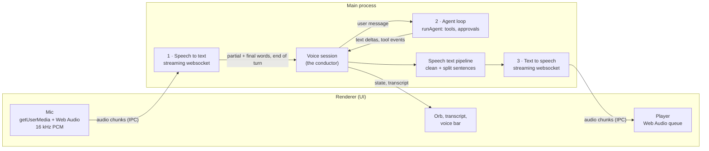
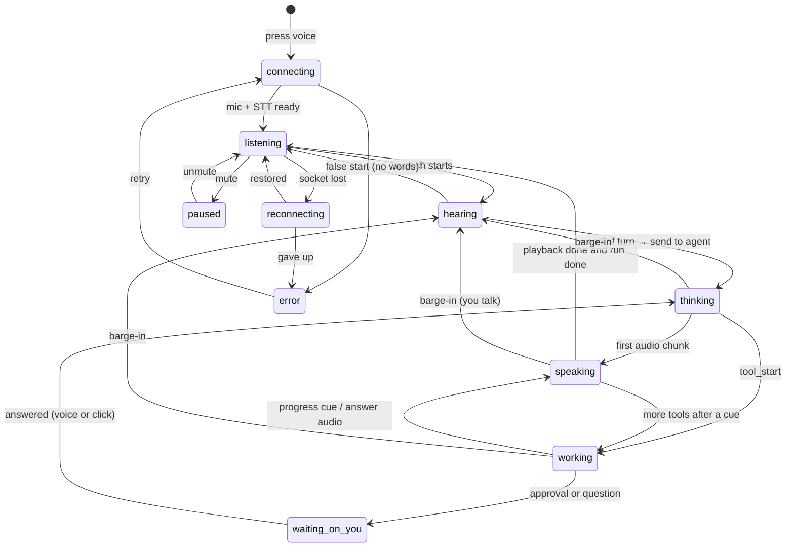

# Voice mode

A spoken conversation with Agent V: you talk, the agent works, and it answers
out loud while the full result lands in the task record. This page is the
design. It is a living document: every decision, change of plan and finished
step is recorded here as the work goes, and the **Status** and **Decision log**
sections are updated with every change to voice mode on `main`.

> **Status (2026-10-15):** the eighth audit (§24.13) found that a spoken stop could miss the run, and that the voice can act on nothing in the app. Its bug fixes (batch 1, with A-112), the voice's picture of the app (batch 2, §24.14) and control of the app, tasks, agent and system for the voice and the agent (batch 3, §24.15) are on `main` (fac745ad). The control gaps left after it (§24.16: rename and send to a task, a spoken yes for commit and push, `interruptMode` removed, voice spend charged to the task's workspace) are done (uncommitted). A streaming listener still needs a Deepgram or AssemblyAI key.
>
> **Earlier status (2026-10-14):** on `main`. [#65](https://github.com/vyotiqai/vyotiq-agent-v/pull/65)
> merged, then `e2c3985` (dip-then-stop barge-in, mic-on indicator, spoken-only voice replies).
> Built through Phase 6, approvals and questions by voice, and most of Phase 7. Since then: an
> OpenRouter listener (D-35). **The first real run failed** (2026-10-14); the audit in §24.5 found why,
> and steps 1–3 of its fixes are done (uncommitted): visible errors, models and voices fetched
> from the providers, and the rest (A-08 to A-22).
> **Then it ran but didn't converse** (2026-10-14): it talked back nothing useful. §24.6 has the
> causes (A-23 to A-35); §25 is the redesign, done and uncommitted: a fast voice model answers
> every turn and hands work to the agent (D-44), patient whole turns (D-43), a voice view over
> the task pane (D-48), hold Space to dictate (D-49). **Checked in the running app:** a spoken
> request is answered in about 1.5 s, handed to the agent, followed, and the agent's result is
> spoken back. **Then Ajay talked to it live** (headset): three turns answered, the third handed
> to the agent, 2.7–3.0 s from his turn to its voice with ElevenLabs Flash v2.5 (A-32 fixed).
> Open: A-22 (MiniMax needs MP3); A-34 (one restart after End, not reproduced); speakers without
> a headset (self-interruption) still untested. **Fourth audit** (§24.9, uncommitted): a run
> already working when voice opens is followed, and the short answers to approvals are heard.

---

## Contents

1. [What voice mode is, and isn't](#1-what-voice-mode-is-and-isnt)
2. [How a voice turn works](#2-how-a-voice-turn-works)
3. [What already exists](#3-what-already-exists)
4. [Architecture](#4-architecture)
5. [The session state machine](#5-the-session-state-machine)
6. [Turn-taking and barge-in](#6-turn-taking-and-barge-in)
7. [Connecting to the agent loop](#7-connecting-to-the-agent-loop)
8. [What gets spoken: the speech text pipeline](#8-what-gets-spoken-the-speech-text-pipeline) (incl. [§8.6 voice agent behaviour spec](#86-voice-agent-behaviour-spec))
9. [Providers and models](#9-providers-and-models)
10. [Audio formats and transport](#10-audio-formats-and-transport)
11. [IPC contract](#11-ipc-contract)
12. [Settings and keys](#12-settings-and-keys)
13. [UI and UX](#13-ui-and-ux)
14. [Latency budget](#14-latency-budget)
15. [Network failures](#15-network-failures)
16. [Risks](#16-risks)
17. [Open questions](#17-open-questions)
18. [Privacy, security and cost](#18-privacy-security-and-cost)
19. [Testing](#19-testing)
20. [Build plan](#20-build-plan)
21. [Decision log](#21-decision-log)
22. [References](#22-references)
23. [Next version (v2 backlog)](#23-next-version-v2-backlog)
24. [Wiring audit](#24-wiring-audit)
25. [The conversation (2026-10-14 redesign)](#25-the-conversation-2026-10-14-redesign)
26. [Placements, styles and the summary (2026-10-15 redesign)](#26-placements-styles-and-the-summary-2026-10-15-redesign)

---

## 1. What voice mode is, and isn't

**Is:** a hands-free conversation with the agent on a task. One press opens a
session. After that you just talk. The agent listens, notices when you've
finished, works, and speaks a short answer. You can talk over it at any time,
and it stops. Everything said and done also appears in the record, so code,
diffs and long results are read on screen, not listened to.

**Is not:**

- A replacement for dictation. Dictation (the composer's mic and `Ctrl+M`)
  still turns speech into text in a field you then edit. Voice mode is a
  conversation; dictation is typing by voice. They share the mic stack.
- A speech-to-speech model in place of the agent. Models like OpenAI's realtime
  speech models can hear and talk directly, but they can't run Agent V's tools,
  approvals, record or provider choice. Voice mode keeps Agent V's own loop as
  the brain and wraps speech around it. See [§21](#21-decision-log), D-03.
- Local or offline, in this first version. Cloud first (Ajay, 2026-10-11).
  The provider layer leaves room for local engines later.

**Product stance to confirm.** The dictation redesign
(`src/redesign/voice/README.md`, decision 6) said: *"Not a conversational voice
mode. No spoken replies. That fits 'never chatbot-like', and it can be revisited
separately."* This feature is that revisit. The design keeps to the spirit of
that rule: the agent speaks briefly and points at the record. It doesn't chat.
That is question **Q1**.

### Goals

| Goal | Measured by |
| --- | --- |
| Feels live | Under 1 s from the end of your speech to the first audio of the reply, when the model is fast (see §14) |
| Interruptible | Agent audio stops within 150 ms of you starting to speak |
| Always clear whose turn it is | One orb with distinct listening, thinking, working and speaking states |
| Trustworthy | A live transcript of what it heard; the full answer always on screen |
| Survives bad networks | A dropped socket reconnects without losing the session or the run |
| Providers are swappable | Changing STT or TTS vendor touches one adapter file |

---

## 2. How a voice turn works

There are three stages and one conductor.



1. **Speech to text.** The renderer opens the mic and sends ~80–128 ms chunks of
   16 kHz mono PCM to main. Main streams them to the STT provider over a
   websocket. The provider streams back partial words (for the live
   transcript), final words, and an **end of turn** signal: its judgment that
   you've finished.
2. **The agent.** On end of turn, the conductor sends your words to the agent
   as an ordinary user message: a new run, or a follow-up on the running one.
   The agent loop runs as usual (tools, approvals, record) and streams text.
3. **Text to speech.** The conductor takes the agent's streamed text, cleans it
   into something worth hearing (no code, no paths, no markdown), splits it into
   sentences and streams them to the TTS provider. Audio comes back in chunks,
   goes to the renderer and plays as it arrives. The first sentence is playing
   while later ones are still being written.

**The conductor** (the voice session in main) owns turn-taking: when to
listen, when to answer, when to stop talking because you started, and what
state the orb shows.

---

## 3. What already exists

Most of the input half is already built for dictation. Voice mode reuses it
rather than writing a second mic stack.

| Piece | Where | Reuse |
| --- | --- | --- |
| Mic capture, 16 kHz mono Int16, device choice, typed failures (`blocked`, `no_device`, `busy`…) | `src/renderer/src/lib/audio/micCapture.ts` | As is |
| Pause detector (RMS, adaptive noise floor, 600 ms silence cut) and level meter math | `src/renderer/src/lib/audio/segmenter.ts` | Local barge-in detection and orb levels |
| OpenAI realtime transcription over websocket, in main, 16→24 kHz upsampler | `src/main/dictation/liveOpenAI.ts` | Becomes the OpenAI STT adapter |
| Typed error codes over IPC (`no_key`, `rejected_key`, `rate_limited`, `offline`…) | `DICTATION_ERROR_CODES`, `schemas/agent.ts` | Same pattern, `voice:<code>` |
| Encrypted key storage, keys never in the renderer | `src/main/settings/secrets.ts` | OpenAI/OpenRouter keys as is; new namespace for Deepgram and ElevenLabs |
| Mic permission (audio only, main window only), OS mic status, open OS settings | `src/main/app/security.ts`, `src/main/dictation/micAccess.ts` | As is |
| Level meter component, mic device picker, mic test | `take/TakeStrip.tsx` (`LevelMeter`), `VoiceSection.tsx` | As is |
| Follow-up queue, soft interrupt of the current model stream (`promoteFollowUp`), cancel | `src/main/agent/runRegistry.ts` | Barge-in while the agent works (§6) |

**What doesn't exist:** any text-to-speech, any audio playback (the only
`AudioContext` is the silent capture tap), any turn detection beyond the pause
cutter, and any Deepgram or ElevenLabs code or keys.

---

## 4. Architecture

### Where things run, and why

| Concern | Process | Why |
| --- | --- | --- |
| Mic capture | Renderer | `getUserMedia` only exists there |
| Audio playback | Renderer | Same; Web Audio for gapless queued playback and the orb's output level |
| STT and TTS sockets | Main | Keys stay in main. The renderer's CSP has no `wss:` in `connect-src`, so sockets there are blocked in production builds anyway |
| Turn-taking, agent bridge, speech text pipeline | Main | Lives next to the agent loop, so it reads events before they are batched or UI-gated (§7.3), and it survives the task pane being hidden |
| UI state | Renderer | Driven by `voice:event` pushes from main |

Playback can't use `<audio src="blob:…">`: the CSP has no `blob:` in
`media-src`, and `tests/main/unit/rendererNoObjectUrls.test.ts` bans
`URL.createObjectURL`. The player decodes raw PCM into `AudioBuffer`s and
schedules them, so neither rule needs to change.

### Files (as planned on 2026-10-11)

The build differs from this plan. There is no `agentBridge.ts`: the run tap
is in `startAgentRun.ts` and the reply is spoken by `voice/replySpeaker.ts`.
The `<spoken>` parser is `src/shared/spokenSummary.ts`. OpenRouter speech
is `tts/openaiSpeech.ts`, and there is no `voice/index.ts`. The window's half
is `voiceSessionController.ts` (mic, player, events), `voiceMode.ts` (the
owning line and hand-offs) and `VoiceView.tsx` with `stage/` (§26).

```
src/shared/voice.ts                         types, constants, provider catalog
src/shared/ipc/schemas/voice.ts             zod schemas for every voice IPC payload
src/shared/ipc/channels.ts                  + voice:* channels

src/main/voice/
  index.ts                                  barrel
  session.ts                                VoiceSession: the conductor and its state machine
  agentBridge.ts                            starts runs and follow-ups, taps run events
  speechText.ts                             markdown → speakable text, sentence splitter
  spokenSummary.ts                          the <spoken> tag parser (§8.2)
  keys.ts                                   voice secret namespace (deepgram, elevenlabs)
  errors.ts                                 VoiceError + typed codes
  providers/
    types.ts                                SttProvider, TtsProvider interfaces (§9.1)
    registry.ts                             id → adapter, plus capability flags
    stt/deepgramFlux.ts
    stt/assemblyai.ts
    stt/elevenlabsScribe.ts
    stt/openaiRealtime.ts                   wraps dictation/liveOpenAI.ts
    stt/local.ts                            wraps dictation's local engine (beta)
    stt/fixture.ts                          scripted, for tests and VYOTIQ_E2E_FIXTURE
    tts/elevenlabs.ts
    tts/cartesia.ts
    tts/openai.ts
    tts/openrouter.ts                       OpenAI-compatible speech endpoint
    tts/fixture.ts
  socket.ts                                 shared websocket wrapper: open timeout,
                                            keepalive, reconnect with backoff, proxy

src/main/ipc/register.ts                    + voice handlers

src/renderer/src/features/voice/
  VoiceBar.tsx                              the docked bar on a task (§13)
  VoiceOrb.tsx                              the reactive orb
  VoiceTranscript.tsx                       live captions
  useVoiceSession.ts                        subscribes to voice:event, owns mic + player
  voicePlayer.ts                            Web Audio scheduler, ducking, output level
  voiceStore.ts                             useSyncExternalStore, like dictationStore.ts

src/renderer/src/features/settings/sections/VoiceSection.tsx
                                            + a "Voice mode" group
```

### Provider abstraction

All vendor code is behind two interfaces (§9.1). The session never imports a
vendor file; it asks the registry for the adapter that matches the settings.
Adding Cartesia, Deepgram TTS or a local engine later means one new adapter and
one catalog entry.

---

## 5. The session state machine

One session per window, one owner, the same rule as dictation's
`activeOwner`. States:

| State | Meaning | Orb | Mic |
| --- | --- | --- | --- |
| `off` | No session | Hidden | Closed |
| `connecting` | Opening mic and STT socket (and warming TTS) | Hollow, slow pulse | Opening |
| `listening` | Waiting for you; nothing heard yet | Idle breathing | Open |
| `hearing` | You're talking; partial words streaming | Follows your voice level | Open |
| `thinking` | Turn ended, waiting for the agent's first words | Inward shimmer | Open (barge-in) |
| `working` | Agent is running tools; it may speak short progress cues | Slow orbit + tool name | Open (barge-in) |
| `speaking` | Agent audio playing | Follows the agent's output level | Open (barge-in, ducked) |
| `waiting_on_you` | Agent asked a question or needs an approval | Accent ring | Open |
| `paused` | You muted the mic; the session stays open | Dimmed, mic-slash | Closed |
| `reconnecting` | A socket dropped; retrying | Hollow, warning tint | Buffering |
| `error` | Can't continue (bad key, mic blocked…); says why and how to fix it | Static, danger | Closed |



Every transition is an event (`voice:event { kind: 'state' }`), so the UI never
works out the state by itself. Transitions are pure functions in `session.ts`
and unit-tested without audio or sockets.

---

## 6. Turn-taking and barge-in

### 6.1 Ending your turn

Picking the moment you've finished is the hardest part of voice UX. If it's
too eager, the agent cuts you off mid-thought. If it's too slow, every reply
feels late.

- **Primary: the STT provider's own turn model.** Deepgram Flux was built for
  this: it emits `EndOfTurn` from a model of the conversation, not a silence
  timer. Defaults: `eot_threshold 0.7`, `eot_timeout_ms 5000`. We'll start
  with those and tune.
- **Fallback: the local pause detector** (`segmenter.ts`, 600 ms) for
  providers without turn detection, e.g. OpenAI realtime with server VAD off,
  as dictation runs it today. The OpenAI adapter can turn on server VAD
  instead. To decide in the spike.
- **Push-to-talk always wins.** Holding the voice key (§13.6) records until
  release, and release is the end of turn. No guessing. It's the fallback for
  noisy rooms.
- **Do not start the agent early.** Flux can send `EagerEndOfTurn` so a reply
  can be prepared speculatively and discarded on `TurnResumed`. For a chatbot
  that's free speed. For Agent V it's dangerous: a speculative run can edit
  files or run commands before you've finished talking. So we **don't** use
  eager end-of-turn to start runs. The only use, if any, is to warm the TTS
  socket. (D-05)

### 6.2 Barge-in: you talk while the agent talks

The effect is the same in every state where the agent has the floor:

1. **Duck** (≤ 50 ms): as soon as local voice activity is detected on the
   mic, the player's gain ramps to ~20%. This is local, so it doesn't wait for
   the network.
2. **Confirm** (≤ 150–300 ms): if the STT provider confirms speech (Flux
   start-of-turn, or ≥ 250 ms of voiced frames locally with real words in the
   partial), it's a barge-in. Otherwise it was a cough or a door, and the gain
   ramps back.
3. **Stop**: on a confirmed barge-in, the player flushes its queue (30 ms fade),
   the TTS context is closed (ElevenLabs `close_context`; OpenAI aborts the
   request), and the not-yet-spoken text is dropped from the speech queue.
4. **Mark**: the record shows where the agent was cut off. The agent's text
   stays in full in the record; only the speech stops.

**Built** (2026-10-13, D-33; replaces D-25's one-step stop). Any start of
speech while the agent's audio is playing (the local detector or the
listener's own) sends `duck on`: the player ramps to 20%. It is confirmed —
`duck off`, flush, barge-in as above — by either 600 ms of voiced audio in the
local detector, or a partial or finished turn whose words aren't the agent's
own (§6.4). It is released — `duck off`, the voice comes back, the detector
starts afresh — by an echo transcript, an empty turn, or 1.2 s with neither.
If the agent's audio ends while ducked and you're still talking, it becomes
your turn. Esc / Stop speaking during a duck stops as before.

### 6.3 What happens to the agent's *work* on barge-in

Stopping the voice is easy. What to do with a run that's mid-work is a product
decision (**Q4**). The recommendation:

| When you interrupt during… | Default | Mechanism |
| --- | --- | --- |
| `speaking` the final answer (run done) | Stop speech; your words are a new message | New user message on the same task |
| `thinking` / `working` (run live) | **Steer**: stop speech; your words become a follow-up that interrupts the current model stream and is applied at the next step | `chatFollowUp`, then `chatFollowUpPromote` (soft abort via `streamInterrupt`; tools in flight finish) |
| You say a stop phrase ("stop", "cancel", "never mind") | **Cancel** the run | `chatCancel` |
| `waiting_on_you` | Your words answer the question or approval (§7.5) | `respondToolApproval` / question response |

Steering, not cancelling, is the default because cancelling throws away work
in progress. Steering is what you'd do if you leaned over a colleague's
shoulder. The stop-phrase list is short and exact-match on the whole utterance
(`STOP_PHRASES` in `voice/speechText.ts`); it isn't shown in Settings.

### 6.4 Echo: the agent hearing itself

With speakers rather than headphones, the mic picks up the agent's own voice,
and that can trigger a false barge-in. Defences, in order:

1. Chromium's echo cancellation (`echoCancellation: true`, already on in
   `micCapture.ts`). **Whether Chromium's canceller treats Web Audio playback
   as its echo reference on Windows and macOS isn't confirmed. Verify it in
   the first spike** (R-02).
2. While `speaking`, a higher voiced threshold and a longer confirm window
   for barge-in.
3. Ignore STT partials that match the text currently being spoken (a fuzzy
   match on the last ~2 s of TTS text). **Built** (D-31, `voice/echoGuard.ts`):
   the session remembers what the agent said (up to 300 words of the current
   stretch of speech). While its audio plays, and for 2.5 s after it stops or
   is cut off, a transcript made at least 75% of those words, in order, is an
   echo: it isn't shown as your caption, and a finished echo turn is dropped
   as a false start, never sent to the agent. One or two words count only
   while audio is actually playing and only as an exact run of what was said,
   so "yes" right after "Say yes or no." is your answer. A false start now
   returns the orb to Working when the run is still going (a cough mid-run
   used to show Listening).
   Limit: if the echo was loud enough to trigger barge-in, the reply has
   already stopped by the time its words are recognised; that reply stays
   quiet (B5). The duck-then-confirm stage (§6.2, D-25) is the fix if this
   happens in real use.
4. Push-to-talk, and a "headphones recommended" hint the first time voice
   mode is used on speakers.

---

## 7. Connecting to the agent loop

### 7.1 Input: your words become a message

A finished turn becomes a `ChatMessage { role: 'user', content: text }` and goes
down the same path a typed message takes. No new loop entry point.

- **No run on the task:** the message starts one. The voice bridge calls the
  same launch path as `chat:start` (`launchRun`), with `source: 'voice'`.
- **A run is live:** follow-up and promote, as §6.3.
- The message carries `spoken: true` (so only that turn's reply opens with a
  `<spoken>` block, D-32). The `meta.voice` with provider, duration and
  confidence planned here was never built.

The renderer's composer flow (`createChatStreamController.send`) has
offline-queue and onboarding gates. The bridge either goes through it (sending a
`voice:submit` from the renderer once main reports end of turn) or reproduces
the gates in main. **Recommended: go through the renderer controller** so voice
messages get identical behaviour (drafts, offline queue, onboarding,
`buildUserContent`). Main tells the renderer "turn ended, here's the text", and
the renderer sends it like a typed message. This costs one IPC hop (< 5 ms). (D-07)

### 7.2 Telling the model it's a voice conversation

The model has to know its reply will be heard. While a voice session is open,
the run gets a `voice_reply` prompt section in the **stable zone**, next to
`response_style` (`agent/context/userRules.ts`). The stable zone matters for
the prompt cache: the prefix must stay byte-identical across steps (see
`docs/architecture.md`, "The prompt"). The section is fixed for the life of the
session, so it costs one cache miss when voice starts or stops, not one per step.

Draft text (superseded by the fuller draft in §8.6):

> The person is talking to you by voice and will hear your reply read aloud.
> Begin your final reply with a `<spoken>` block: one to three short spoken
> sentences, no code, no file paths, no markdown, no lists, that say what you
> did or found and what (if anything) you need from them. Then write your
> normal reply, which they will read on screen. Keep progress narration
> between tool calls to a short phrase.

### 7.3 Output: tapping the run's events

`startAgentRun.ts` iterates `runAgent`'s events and pushes them into the IPC
batcher (`for await (ev) … batcher.push(ev)`). The bridge adds a tap there: a
per-run listener the voice session registers for runs it owns. That gives it:

- `text_delta` with no 16 ms/80 ms batching delay, and
- events the IPC layer would drop: `UI_GATED_STREAM_TYPES` filters text deltas
  for runs the UI isn't subscribed to, so if you switch tasks mid-answer,
  speech would cut out. The tap doesn't have that problem.

The tap is read-only and must never slow the loop: it pushes into the session's
own queue and returns. A throwing listener is caught and logged; it must never
break a run.

Events used:

| Event | Voice use |
| --- | --- |
| `text_delta` | Feed the `<spoken>` parser / speech pipeline |
| `stream_reset` | The provider retried. Text already *spoken* can't be unsaid. Drop what's queued, and suppress the repeated prefix of the retried stream |
| `tool_start` | State `working`; optional progress cue (§8.4) |
| `assistant_message` (with `toolCalls`) | End of a narration step |
| `assistant_message` (no `toolCalls`) then `status: done` | Final answer complete → flush speech |
| `status: cancelled / error`, `error` | Speak a one-line failure ("That run failed, the error's on screen.") |
| `network_wait` | State reflects the agent waiting on the network (§15) |
| tool approval / `ask_question` requests | State `waiting_on_you` (§7.5) |

### 7.4 Final answer vs narration

There's no explicit "final" flag on the wire. An `assistant_message` without
tool calls, followed by `status: done`, is the final prose
(`recordModel.ts` → `RecordRun.result`). Narration between tool steps arrives as
`assistant_message` with `toolCalls`. The bridge buffers text per step and
decides when the step ends:

- step ended with tools → it was narration → maybe speak a progress cue (§8.4)
- step ended without tools → it's the answer → speak the `<spoken>` block, or
  the fallback summary

To start speaking before the step ends (sub-second goal), the parser speaks the
`<spoken>` block **as it streams**. If the model opens the reply with `<spoken>`,
we know it's the answer, even before the step ends.

### 7.5 Tools, approvals and questions by voice

- **Tools run as usual.** Voice doesn't change what the agent may do. Approval
  rules, the sandbox and mode (Ask / Agent) apply unchanged.
- **Approvals.** On an approval request the agent says a short version of
  `approvalTitle()` ("It wants to run `pnpm test`. Allow?") and the card shows
  on screen. Spoken "yes / allow / go ahead" means `once`; "no / deny" means
  `deny`. **Recommended:** voice can never answer an approval marked `danger`,
  or give `session`/`always`. Those need a click. (Q5)
- **Questions** (`ask_question`) — built (D-29). The question is spoken with
  its choices when there are four or fewer ("Which database should I use?
  Postgres, SQLite or MySQL."); a yes/no question ends "Yes or no?"; a form
  with several questions says "They're on screen, or just tell me what you
  want." A reply that clearly answers a one-question form settles it as the
  card would, and the agent says "Got it.":
  - single choice: the option's name, said alone or inside a sentence ("let's
    go with Postgres"), or its position ("the second one", "option 3", "the
    last one"); naming two options is unclear;
  - multiple choice: every option named;
  - yes/no: the approval words (§7.5 above), whole utterance only;
  - free text: the whole reply;
  - a question that allows its own answer: a short reply (eight words or
    fewer) that names no option.

  Anything else — an unclear pick, a long reply, a stop phrase, a form with
  several questions — goes to the agent as an ordinary message. That already
  closes the card and tells the model "the user sent a message instead; treat
  it as the answer if it addresses the question"
  (`ASK_QUESTION_SUPERSEDED_GUIDANCE`), so a miss costs precision, never the
  answer. Hook: `watchAgentQuestions` in `agent/agentQuestion.ts`; matching in
  `voice/questionByVoice.ts`.

### 7.6 Mode

Voice works in both Ask and Agent mode and doesn't switch modes. Spoken "switch
to ask mode" is out of scope for v1.

---

## 8. What gets spoken: the speech text pipeline

### 8.1 Why not read the answer verbatim

Agent V's answers are written to be read: code blocks, paths, diffs, tables,
lists. Read aloud, `src/main/agent/loop.ts:4008` is noise and a fenced block is
unbearable. Voice speaks a **short spoken version** and points at the screen
for the rest.

### 8.2 The `<spoken>` tag

The only new text tag. The model starts its final answer with:

```
<spoken>I fixed the race in the follow-up queue and the tests pass now. There's
one thing to check: the retry limit is a guess.</spoken>

…the full written answer, as normal…
```

- The bridge streams what's inside the tag to TTS **as it arrives**, sentence
  by sentence.
- The renderer **removes** the block from the displayed answer
  (`lib/markdown` sanitising plus a one-line strip in `recordModel.ts`). It
  isn't shown twice, and an old record without voice is unaffected.
- **Fallback** if the model skips the tag: clean the first paragraph of the
  answer (§8.3) and speak at most ~3 sentences / 400 characters, followed by
  "The details are on screen." A provider that ignores the instruction still
  gets a sensible result.
- Tag text never reaches the record redaction path differently. It is part of
  the message content like any other text.

**Provider expressiveness tags** (ElevenLabs v3 audio tags like `[laughs]`, SSML
`<break>`, Deepgram pause markers) are **not used in v1**. They're
vendor-specific, would leak into the written answer, and Flash models ignore
most of them. The speech pipeline strips anything bracketed that looks like one.
The `TtsProvider` interface has a `supportsMarkup` flag so they can be added
per vendor later. (D-08)

### 8.3 Cleaning text for speech (`speechText.ts`)

Pure functions, unit tested against fixtures:

| Input | Spoken as |
| --- | --- |
| Fenced code block | Dropped. If it was the whole answer: "I've put the code on screen." |
| Inline code `` `runAgent` `` | The identifier, de-camel-cased only if short: "run agent" |
| Paths `src/main/agent/loop.ts` | Basename without extension: "loop" ("in loop dot ts" if ambiguous) |
| Markdown (`**`, `#`, `>`, `-`, tables) | Stripped; list items joined as a sentence |
| Links `[text](url)` | `text` |
| URLs | "a link on screen" |
| Numbers, versions, `v1.2.0` | Left to the TTS normaliser; `1.2.0` becomes "1.2.0" with dots kept |
| Emoji, symbols | Dropped |

### 8.4 Progress cues while the agent works

A long silence while the agent works feels broken. Options, ordered by
cost, with the recommendation in bold:

1. **An earcon only** (a soft tick when a tool starts). No speech.
2. **Short template cues from tool events**: "Reading files…", "Running tests…",
   "Editing loop dot ts…". Drawn from `tool_start.summary`, rate-limited to one
   per ~6 s, never over a tool that finishes in < 1.5 s.
3. Speaking the model's own narration text between tools. Natural, but chatty
   and uncontrolled.

**Recommended: 2, with 1 when cues are turned off** (setting `speakProgress`).
It's what "short spoken summary while details render on screen" means in
practice.

### 8.5 Splitting into sentences

The TTS gets text in sentence-sized pieces so the first audio comes quickly
without choppy prosody:

- Split on `. ! ?` followed by space or newline, not after common
  abbreviations (`e.g.`, `i.e.`, `vs.`, version numbers, decimals).
- The **first** chunk may be cut early at a comma once it's ≥ 40 characters,
  to get audio started.
- ElevenLabs: send text continuously with `flush` at sentence ends (their
  recommended pattern). OpenAI TTS (HTTP): one request per sentence, the next
  request started while the previous one plays.

### 8.6 Voice agent behaviour spec

The rules for how it sounds, and why (Ajay asked for this to be spelled out,
2026-10-11). They're carried out in three places: the `voice_reply` prompt
section (§7.2), the speech text pipeline (§8.3–8.5) and the session state
machine (§5). Each rule names where it lives.

| # | Rule | Why | Where it's enforced |
| --- | --- | --- | --- |
| B1 | **Brief by default.** One to three spoken sentences. Go longer only when you ask for detail ("walk me through it") | Long speech is the most common way voice assistants fail; listening is slower than reading | Prompt (`<spoken>` length) + fallback cap (§8.2) |
| B2 | **Know the medium.** Code, lists, paths, diffs and numbers-heavy output go on screen; the voice says what it is and where ("The diff's on screen, three files") | A fenced block read aloud is useless | Prompt + `speechText.ts` |
| B3 | **No dead air.** Acknowledge within ~100 ms of your turn ending (earcon + orb). If the first words take more than ~1.5 s, a short spoken acknowledgement ("Sure, let me look.") is allowed once per turn | Silence feels like it didn't hear you | Session timers (§13.8); acknowledgement from a small fixed phrase set in main, not the model, so it costs nothing and never says anything wrong |
| B4 | **Say what it's doing during long work.** One short cue when a slow tool starts ("Running the tests."), never more than one every ~6 s, nothing for tools under 1.5 s | Long silence while working feels broken; a running commentary is grating | Progress cues (§8.4) |
| B5 | **Stop the moment you talk.** No "sorry, go ahead", no finishing the sentence, no repeating what it already said when it resumes | Interrupting is the most natural thing people do | Barge-in (§6.2); prompt: "if interrupted, don't repeat what you already said" |
| B6 | **Don't repeat itself.** It doesn't restate your question or recap what it said in an earlier turn unless asked | Repetition is far more annoying spoken than written | Prompt |
| B7 | **Warm, steady personality; not fake-cheery.** Friendly and direct; matches your register (serious when you are, lighter when you are); a little humour when it fits; never over-apologises or gushes | Over-enthusiasm reads as insincere when spoken | Prompt (`voice_reply` tone lines); respects the user's own Tone / Persona settings (`response_style`) when set |
| B8 | **Honest about uncertainty and failure.** "I'm not sure this fixes it; the test is flaky." "That failed, the error's on screen." It never covers a failure with confident speech | The voice must not be more confident than the record | Prompt + failure lines from run status (§7.3) |
| B9 | **Confirm before risky actions, by voice too.** Reads approvals as a short question, accepts yes/no for ordinary ones, requires a click for risky ones | Mishearing must never delete things | §7.5 |
| B10 | **Repeat back when unsure what it heard.** When transcript confidence is low on a word that matters (a file name, "delete"), it asks: "Did you say *delete* the branch?" | Speech recognition makes mistakes; agents act on words | STT confidence (where the provider gives it) + prompt; low-confidence words highlighted in the record |
| B11 | **Plain words for numbers and names.** "about two hundred milliseconds", "the loop file" rather than reading a full path or a 12-digit number | Natural to hear | `speechText.ts` + prompt |
| B12 | **Ends turns clearly.** Finishes with what happens next or a direct question, so you know it's your turn ("Want me to run the full suite?"). No trailing "Let me know if you need anything else" | Clear hand-back is how spoken turn-taking works | Prompt |

**Draft `voice_reply` prompt section** (replaces the shorter draft in §7.2;
tuned in Phase 5):

> The person is talking with you by voice and hears your reply read aloud.
> Begin your final reply with a `<spoken>` block: one to three short spoken
> sentences in plain, natural speech: no code, file paths, markdown, lists or
> long numbers. Say what you did or found, and end with what happens next or
> one direct question. Put everything detailed in the written reply after the
> block; in the spoken part, point to it ("the diff's on screen").
> Be warm and direct and match their tone; don't gush, apologise repeatedly,
> restate their question or repeat what you said earlier. If you're unsure,
> say so plainly. If a word that matters may have been misheard, ask before
> acting on it. Between tool calls, narrate in a few words at most.

---

## 9. Providers and models

### 9.1 Interfaces

```ts
// src/main/voice/providers/types.ts (planned)

export type SttEvent =
  | { kind: 'open' }
  | { kind: 'speech_start' }                       // provider detected speech
  | { kind: 'partial'; text: string }              // unstable words, for captions
  | { kind: 'final'; text: string; confidence?: number }
  | { kind: 'end_of_turn'; text: string }          // the turn is complete
  | { kind: 'error'; code: VoiceErrorCode; message: string; retryable: boolean }
  | { kind: 'closed'; reason: string }

export interface SttSession {
  /** 16 kHz mono Int16 LE; the adapter resamples if its provider wants otherwise. */
  pushAudio(pcm16k: Int16Array): void
  /** Push-to-talk release: force end of turn now. */
  endTurn(): void
  /** Vocabulary hints (workspace identifiers), replaces the previous list. */
  setKeyterms?(terms: readonly string[]): void
  close(): Promise<void>
}

export interface SttProvider {
  id: SttProviderId
  label: string
  caps: { turnDetection: boolean; keyterms: boolean; languages: 'en' | 'multi' }
  open(opts: {
    apiKey: string
    language?: string
    keyterms?: readonly string[]
    signal: AbortSignal
    emit: (e: SttEvent) => void
  }): Promise<SttSession>
}

export type TtsChunk = { pcm: Int16Array; sampleRate: number; contextId: string }

export interface TtsStream {
  /** Append text; the adapter decides when to synthesise. */
  pushText(text: string): void
  /** Sentence boundary or end of reply: synthesise what's buffered. */
  flush(): void
  /** Barge-in: stop generating and drop anything not yet delivered. */
  cancel(): void
  /** Resolves when all audio for pushed text has been delivered. */
  done(): Promise<void>
}

export interface TtsProvider {
  id: TtsProviderId
  label: string
  caps: { streamingInput: boolean; speed: [min: number, max: number]; supportsMarkup: boolean }
  listVoices(apiKey: string): Promise<VoiceOption[]>
  /** One per reply. Keep-alive and connection reuse are the adapter's job. */
  stream(opts: {
    apiKey: string
    voiceId: string
    speed: number
    signal: AbortSignal
    onAudio: (c: TtsChunk) => void
  }): TtsStream
}
```

Rules every adapter follows:

- Errors are mapped to `VoiceErrorCode` in the adapter (401/403 → `rejected_key`,
  429 → `rate_limited`, socket failure → `offline`…), never as raw provider text
  in the UI. This fixes dictation finding #6 for voice from the start.
  **Changed by D-40:** the plain sentence still comes first, and the
  provider's reason follows it, muted, redacted and cut to one line.
- Audio out of the adapter is always Int16 PCM with its sample rate stated. The
  player handles 16/22.05/24/44.1 kHz.
- There's a `fixture` adapter for each side, used by tests and by
  `VYOTIQ_E2E_FIXTURE=1`.

### 9.2 You choose the providers and bring the keys

Voice mode has no single fixed vendor (Ajay, 2026-10-11, D-15). Each
direction, **Listens with** (STT) and **Speaks with** (TTS), is a choice from a
catalog. You add your own API key for each vendor you use. One key per vendor
covers both directions: an ElevenLabs key powers ElevenLabs listening *and*
speaking.

- Keys you already gave Agent V for the model (OpenAI, OpenRouter) are reused.
  The row says "Using your OpenAI key from Providers" instead of asking again.
- Vendors that aren't LLM providers (Deepgram, ElevenLabs, AssemblyAI, Cartesia)
  get keys in Settings → Voice (§13.7).
- The catalog lives in `src/shared/voice.ts`: one entry per provider, with its
  label, which directions it supports, its key source, its models, its
  capabilities and its privacy line ("Audio goes to Deepgram"). Settings, the
  voice bar and the fallback logic all read from this catalog. Nothing is
  hard-coded per vendor in the UI.

### 9.3 Speech to text options

| Provider | Model(s) | Endpoint | Turn detection | Vocabulary | Key | Notes |
| --- | --- | --- | --- | --- | --- | --- |
| **Deepgram Flux** (recommended) | `flux-general-en`, `flux-general-multi` | `wss://api.deepgram.com/v2/listen` | Model-based `EndOfTurn` (`eot_threshold` 0.5–1.0, default 0.7; `eot_timeout_ms` default 5000) | `keyterms` ≤ 100, updatable mid-stream | Deepgram | Built for voice agents; 16 kHz linear16, 80 ms chunks |
| **AssemblyAI Universal Streaming** | `universal-3-6-pro` (default), `universal-streaming-english`, `universal-streaming-multilingual` | `wss://streaming.assemblyai.com/v3/ws` (US/EU residency hosts exist) | `Turn` messages with `end_of_turn`; `end_of_turn_confidence_threshold`, `min_turn_silence`, `max_turn_silence`; `ForceEndpoint` for push-to-talk | `keyterms_prompt` ≤ 100, updatable | AssemblyAI | `Authorization` header without `Bearer`; 50–1000 ms chunks |
| **ElevenLabs Scribe Realtime** | `scribe_v2_realtime` | `wss://api.elevenlabs.io/v1/speech-to-text/realtime` | Commit-based: we commit on our local pause detector or push-to-talk release (VAD commit mode to evaluate in Phase 1) | to check | ElevenLabs | JSON chunks with base64 PCM 16 kHz; partial and committed transcripts |
| **OpenAI realtime transcription** | `gpt-live-transcribe` | `wss://api.openai.com/v1/realtime?intent=transcription` | Server VAD, or our local pause detector (as dictation runs it today) | `prompt` / `keywords` | OpenAI (reused) | Code already exists in `dictation/liveOpenAI.ts` |
| **OpenRouter** (D-35) | `openai/gpt-transcribe` (dictation's) | HTTP `POST /api/v1/audio/transcriptions`, one upload per turn | Local pause detector | — | OpenRouter (reused) | No streaming endpoint, so no live captions; the words arrive after the turn ends. Shares dictation's upload, errors and headers. Last in Automatic's order |
| **This PC** (Whisper / Moonshine, beta) | dictation's installed model (no separate picker; see §24) | Local utility process | Local pause detector | — | none | Already built for dictation. Not streaming: each turn is transcribed when it ends, so replies start later. Offline and private. A bonus, not cloud-first |

**Whisper, to be precise.** OpenAI's hosted Whisper (`whisper-1`) is batch-only
(upload a file, get text back), so it can't produce live captions or detect turns.
The cloud "Whisper" option is the OpenAI realtime row above. Local Whisper is the
*This PC* row.

### 9.4 Text to speech options

| Provider | Model(s) | Transport | Streams text in? | Barge-in | Speed | Key | Notes |
| --- | --- | --- | --- | --- | --- | --- | --- |
| **ElevenLabs** (recommended) | `eleven_flash_v2_5` (fast); higher-quality models selectable | WS `…/v1/text-to-speech/{voice}/multi-stream-input` | Yes, `flush` per sentence | `close_context` | `voice_settings.speed` (range to confirm) | ElevenLabs | ~100–150 ms to first byte (NA/EU); ≤ 5 contexts per socket; cloned voices appear in the list |
| **Cartesia Sonic** | `sonic-3.6`, `sonic-latest` | WS `wss://api.cartesia.ai/tts/websocket` | Yes, `continue: true` per chunk, `context_id` | `{ context_id, cancel: true }` | 0.6–1.5 | Cartesia | Raw `pcm_s16le` at 24 kHz; also has volume and emotion controls; versioned API (`cartesia_version`) |
| **OpenAI** | `gpt-4o-mini-tts` | HTTP `POST /v1/audio/speech`, streamed | Per sentence | Abort the request | 0.25–4.0 | OpenAI (reused) | `instructions` steer the delivery ("calm, brief"); fixed voice set |
| **OpenRouter** | Fetched from its public list (D-36); default `elevenlabs/eleven-flash-v2.5`, voice Sarah. It has no OpenAI speech model (A-01) | HTTP `POST /api/v1/audio/speech` (OpenAI-compatible) | Per sentence | Abort the request | `speed` where the model supports it | OpenRouter (reused) | Model list comes from `GET /api/v1/models?output_modalities=speech`; one key covers many voices |
| **Deepgram** | Aura / Flux TTS | `/v2/speak` | to verify | to verify | 0.5–1.5 | Deepgram | One vendor for both directions with a single key. Details checked in Phase 1 before it's listed |

### 9.5 Picking a default, and what happens without keys

- **No key at all:** pressing the voice button opens **Set up voice** (§13.5).
  It lists every provider, recommended first, each with *Add key*. It never fails
  with an error.
- **Out of the box:** Listens with = the first provider in the order Deepgram,
  AssemblyAI, ElevenLabs, OpenAI, OpenRouter that has a key. Speaks with = the first in the
  order ElevenLabs, Cartesia, OpenAI, OpenRouter that has a key. If you only
  have an OpenAI key, both are OpenAI and it just works (D-13). The same holds
  for an OpenRouter key alone (D-35), with slower turns.
- **Your choice wins.** Once you pick a provider, it's used. If its key is later
  removed or rejected, the session falls back to the next provider in the order
  that has a working key, and the engine token in the bar says so ("Speaking
  with OpenAI, ElevenLabs key rejected"). It never falls back silently.
  **Built for listening** (2026-10-11): the bar's engine token shows a warning
  glyph instead of the cloud, its tooltip reads "Listening with OpenAI: no
  Deepgram Flux key", and screen readers hear the same. **Speaking too**
  (2026-10-13): the session's `engine` event also names who speaks (`tts`,
  `ttsFellBackFrom`); the same token adds "Speaking with OpenAI: no
  ElevenLabs key." With no speaking provider at all (`tts: null`) the bar says
  "No speaking voice has a key. Replies are on screen." from the start, with a
  Voice settings button, instead of at the first reply.
- **Fallback during a session** (a provider fails mid-session): see §15.

### 9.6 Adding a provider later

1. Write the adapter in `src/main/voice/providers/{stt|tts}/<id>.ts` against the
   §9.1 interface, with error mapping to `VoiceErrorCode`.
2. Add a catalog entry in `src/shared/voice.ts` (label, directions, key source,
   models, capabilities, privacy line).
3. If the vendor's key is new, add it to the `VoiceKeyVendor` union. The key
   store, the settings rows and the IPC are generic over it.
4. Add an adapter test against a fake socket, and add the endpoint to
   `PRIVACY.md`.

No UI change is needed: the settings rows, voice lists and engine token are
built from the catalog.

---

## 10. Audio formats and transport

| Leg | Format | Chunking | Transport |
| --- | --- | --- | --- |
| Mic → main | Int16 LE mono 16 kHz | 2,048 frames (128 ms), current `TAP_FRAMES`; consider 1,280 (80 ms) for Deepgram | IPC `voice:audio`, base64 like `dictation:liveAudio` today |
| Main → STT | Provider format (16 kHz linear16 for Deepgram; 24 kHz PCM for OpenAI) | Pass-through / upsampled | Websocket |
| TTS → main | Int16 PCM 24 kHz | Provider chunks | Websocket / HTTP stream |
| Main → renderer | Int16 LE + sample rate + context id + seq | Pass-through | IPC `voice:audio-out` push |
| Renderer playback | `AudioBuffer` (Float32) | Scheduled back-to-back on one `AudioContext` clock; 60 ms jitter buffer before the first chunk | Web Audio |

Notes:

- **Base64 over IPC** matches today's dictation and its 700k-char cap. Electron
  can pass `ArrayBuffer`/typed arrays through structured clone, which avoids the
  ~33% size overhead and an encode/decode on both sides. Worth switching for
  voice because it streams in both directions; the cost is a new schema shape.
  To decide when the IPC is built (D-09, open).
- **Capture uses a ScriptProcessorNode**, not an AudioWorklet, because worklet
  module loading fails under `file://` (comment in `micCapture.ts`). The player
  can avoid worklets too: chained `AudioBufferSourceNode`s are enough for
  gapless playback.
- The player has its own `AudioContext` at the TTS rate (24 kHz) so it never
  resamples. An `AnalyserNode` on its output drives the orb while speaking.
- **Ducking** is a `GainNode` ramp (`setTargetAtTime`, ~30 ms), never a jump,
  to avoid clicks.

---

## 11. IPC contract

All channels follow the five-place rule in `docs/architecture.md` (channel,
`vyotiqApi`, preload, handler with `senderOk` + zod, `ipcContract.test.ts`).

| Channel | Direction | Payload | Purpose |
| --- | --- | --- | --- |
| `voice:start` | invoke | `{ workspacePath, runId?, taskId? }` | Open a session on a task |
| `voice:stop` | invoke | `{ sessionId }` | Close it |
| `voice:audio` | send | `{ sessionId, seq, pcm16k }` | Mic chunks (fire-and-forget, like `liveAudio`) |
| `voice:ptt` | invoke | `{ sessionId, down: boolean }` | Push-to-talk press/release |
| `voice:mute` | invoke | `{ sessionId, muted }` | Pause / resume listening |
| `voice:barge` | send | `{ sessionId, level }` | Local VAD fired (renderer ducks right away; main confirms) |
| `voice:interrupt` | invoke | `{ sessionId }` | Stop speaking now (button / Esc) |
| `voice:submitted` | invoke | `{ sessionId, turnId, runId }` | The renderer sent the turn as a message (§7.1) |
| `voice:event` | push | union, below | State, captions, errors, turn ended |
| `voice:audio-out` | push | `{ sessionId, contextId, seq, sampleRate, pcm, final? }` | TTS audio to play |
| `voice:voices` | invoke | `{ provider }` | List voices for the picker |
| `voice:preview` | invoke | `{ provider, voiceId, speed }` | Speak a sample line in Settings |
| `voice:status` | invoke | — | Which providers have keys; which will be used |
| `voice:setKey` / `voice:clearKey` | invoke | `{ vendor: VoiceKeyVendor, key }` | Voice-only vendor keys, verified before save (§12). OpenAI/OpenRouter keep using `setSecret` |
| `voice:keyStatus` | invoke | — | Per vendor `{ set, last4?, lastVerified?, lastError? }` |
| `voice:catalog` | invoke | — | The provider catalog with each entry's resolved key state |

`voice:event` kinds: `state`, `partial` (caption), `final`, `turn_ended { text }`,
`speaking { contextId, text }` (what's being said, for captions),
`spoken_done`, `cue { text }`, `error { code, message, retryable }`,
`reconnecting { attempt }`, `engine { stt, tts }`.

Ownership: a session belongs to the `webContents` that opened it and closes when
that sender is destroyed (the `liveOwners` pattern from dictation). On quit,
`before-quit` closes all sessions next to `closeAllLiveTakes`.

---

## 12. Settings and keys

New `Settings.voice` (zod schema with defaults, migrated by ignoring unknown
keys, like `dictation`):

| Key | Type | Default | Notes |
| --- | --- | --- | --- |
| `sttProvider` | `SttProviderId \| 'auto'` | `'auto'` | `'auto'` = the first in the §9.5 order with a key. Ids: `deepgram`, `assemblyai`, `elevenlabs`, `openai`, `local` |
| `ttsProvider` | `TtsProviderId \| 'auto'` | `'auto'` | Ids: `elevenlabs`, `cartesia`, `openai`, `openrouter` (+ `deepgram` once verified) |
| `stt` | `Partial<Record<SttProviderId, { model?: string }>>` | `{}` | Per-provider model choice; empty = catalog default |
| `tts` | `Partial<Record<TtsProviderId, { model?: string; voiceId?: string }>>` | `{}` | Per provider, so switching back keeps your voice |
| `speed` | number | `1.0` | Clamped to the provider's range in the catalog |
| `language` | ISO-639-1 or `''` | `''` (English) | Each adapter maps it (e.g. Flux `-en` vs `-multi` + hint) |
| `deviceId` | string | shared with dictation | One mic choice for the app |
| ~~`interruptMode`~~ | | | Removed 2026-10-15 (§24.16): retired by D-46 and read nowhere; an old file's value is dropped when read |
| `speakProgress` | boolean | `true` | Spoken cues (§8.4); off = earcon only |
| `pushToTalkOnly` | boolean | `false` | No automatic turns; hold to talk |
| `endOfTurnPatience` | `'quick' \| 'normal' \| 'patient'` | `'normal'` | Each STT adapter maps this to its own knobs (Flux `eot_threshold`/timeout, AssemblyAI confidence/silence, local pause length) |
| `approveByVoice` | boolean | `true` | Only `once`/`deny` on non-danger approvals (§7.5) |
| `captions` | boolean | `true` | Live transcript in the voice bar |
| `earcons` | boolean | `true` | Start, end and turn-accepted sounds (§13.8) |

**Keys.** Voice vendors that aren't LLM providers can't use `SecretProvider`,
which only accepts `ProviderId | custom:*`. They get their own namespace in
`secrets.ts`: `setVoiceKey(vendor, key)`, `getVoiceKey(vendor)`,
`clearVoiceKey(vendor)` and `voiceKeyStatus()`, the same pattern as
`setVideoEngineKey`/`getVideoEngineKey`. Keys are encrypted with `safeStorage`,
written 0600, and never sent to the renderer; the renderer only sees
`{ set, lastVerified?, lastError? }`. `VoiceKeyVendor` is
`'deepgram' | 'assemblyai' | 'elevenlabs' | 'cartesia'`. OpenAI and OpenRouter
keep using `getSecret('openai' | 'openrouter')`, so one key serves the model and
voice.

**Checking a key.** *Add key* runs a cheap authenticated call in main (`keyService.ts`; the per-vendor endpoints are rechecked in the spike, and only a 401/403/402 refuses a key, so a moved endpoint can't lock a good key out) (list
voices or models) before saving, and shows the outcome on the row: ✓ verified,
✕ rejected (with the vendor's reason mapped to plain words), or ⚠ couldn't reach
the vendor (saved anyway, verified on first use).

Settings UI: §13.7.

---

## 13. UI and UX

All UI follows the root `CLAUDE.md`: tokens only (no literal colours, five
skins × light/dark), `lib/ui` primitives, icons from `lib/icons` only, 40px pane
rows, `focus-visible:vy-focus-ring` on everything interactive, type sizes on the
scale, and no `cn()` overrides. Every surface is checked against the
`wcag-desktop` skill before it ships.

### 13.1 Where voice mode lives

**Recommended (Q2):** a **voice bar docked at the bottom of the task pane, in
place of the composer** while a session is open. The record stays visible above
it, so "details render on screen" is literally true: you hear the summary and
see the diff in the same view.

Alternatives considered:

- *Full-screen overlay with a big orb* (like phone assistants): beautiful, but
  hides the record. That's wrong for a coding agent where the output is the point.
- *A floating mini window*: lets you talk while looking at another app. It's a
  good v2 ("talk to Agent V while you're in your editor"), but it adds
  window-management work.

### 13.2 The voice bar

```
┌───────────────────────────────────────────────────────────────────────────┐
│ record …                                                                  │
├───────────────────────────────────────────────────────────────────────────┤
│  ◉  "…and make the retry limit configurable"            0:42   🔒/☁  ⋯  ✕  │  ← 40px row
│ orb  live caption (you: fg; agent: muted)                time  engine menu end│
├───────────────────────────────────────────────────────────────────────────┤
│  [🎤 Mute]   [■ Stop speaking]                         Hold Space to talk │  ← 32px controls
└───────────────────────────────────────────────────────────────────────────┘
```

- **Orb** (left edge, 28px): the one living element. Everything else is
  muted (emphasis comes from neighbours).
- **Caption** (fills the row): your words in `text-fg` while you talk, unsettled
  tail in `text-tertiary` (the same convention as the take strip); the agent's
  current sentence in `text-muted` while it speaks. One line, ellipsised from the
  left so the newest words are visible.
- **Time**: session length, `text-tertiary`, tabular numerals.
- **Engine token**: where audio goes, ☁ `Deepgram · ElevenLabs` (or `OpenAI`),
  the same idea as the take strip's `EngineToken`. Click → engine and voice menu.
- **⋯**: voice, speed, captions, interrupt mode, headphones tip.
- **✕ End**: ends the session (also `Esc` twice, or the voice shortcut).
- **Controls row**: Mute (`micSlash` when muted), Stop speaking (only while
  speaking), push-to-talk hint.

### 13.3 The orb

One canvas (or SVG) element, 28px in the bar and 96px in the empty-task hero.
It's drawn only with token colours, read from CSS variables at mount and on skin
change (the `TerminalPanel.tsx` exception for JS colour reads).

| State | Motion | Colour token |
| --- | --- | --- |
| listening | Slow breathing scale (4 s) | `--vy-muted` |
| hearing | Radius and edge follow **your** mic level (RMS from `segmenter.levelFromRms`), 60 fps, smoothed | `--vy-accent` |
| thinking | Inward shimmer, no level | `--vy-accent-soft` |
| working | Slow orbit dot + tool glyph beside the orb | `--vy-muted` |
| speaking | Edge follows **the agent's** output level (`AnalyserNode`) | `--vy-fg-strong` |
| waiting_on_you | Steady ring + "needs you" dot | `--vy-accent` |
| paused | Static, `micSlash` overlay | `--vy-tertiary` |
| reconnecting | Hollow, slow blink | `--vy-warning` |
| error | Static | `--vy-danger` |

Meaning is never carried by colour alone (CLAUDE.md "Never"): every state also
changes **shape or motion** and has a **text label** for screen readers
(`aria-live="polite"` region: "Listening", "Thinking", "Speaking"). Under
`prefers-reduced-motion: reduce` the orb doesn't animate; it switches between
static shapes and the label carries the state.

### 13.4 In the record

- Your spoken turns render like typed ones, with a small `mic` glyph and the
  duration. A low-confidence word is dotted-underlined; click to correct, which
  re-sends as an edit.
- The agent's answer renders exactly as today, minus the `<spoken>` block. A
  small `speaker` button on the answer replays the spoken summary.
- If you interrupted, a thin marker shows where speech stopped.

### 13.5 Starting voice mode

- A **voice button** (`waveform` icon) next to the mic on the instruction line
  and on the New task brief. The mic (dictation) and the voice button sit side
  by side: one types, one talks.
- **Shortcut:** `Ctrl+Shift+M` / `Cmd+Shift+M`, next to dictation's `Ctrl+M`.
  It's free in `lib/shortcuts/bindings.ts`, and mod chords forbid Shift by
  default, so it doesn't also fire dictation.
- **Command palette:** "Start voice mode".
- **On New task** — built (D-30). The voice bar takes the brief's place and
  says "Listening. Say what you want done." The first thing you say starts
  the task, exactly as Start task would: after anything already typed in the
  brief, with its checks, added folders, attachments, worktree choice and
  draft. The session then moves to the new task's instruction line, and the
  conversation carries on there; its clock keeps counting and no earcons
  play for the move. How: the brief marks a handoff just before sending, and
  the first instruction line to appear in the next 10 s takes the session
  (`beginVoiceHandoff` / `registerVoiceLine` in `voiceMode.ts`); if the brief
  turns into that line in place, it simply keeps it. The run id to follow is
  read from whichever line owns the session by then. A task started in a new
  worktree runs in another folder: following its run points the voice-reply
  prompt there (`followVoiceRun`), so every reply after the first is written
  to be heard; the first falls back to the spoken summary (§8.2).
- **First use:** the *Set up voice* popover (§9.5), then a one-time tip:
  "Talk naturally. Interrupt any time. Headphones work best." **Built**
  (2026-10-11): with no listening key, the voice button opens **Talk with**
  beside it (the same shape as dictation's "Dictate with"): the four
  listening services in Automatic's order, Deepgram marked Recommended, each
  with what it's good at and where audio goes, and *Add key* to Settings →
  Voice (Providers for OpenAI, whose key is the chat key). It checks the keys
  on every press, so a key added since just works. The tip
  ("Talk naturally · interrupt any time · headphones work best") sits in the
  bar's hint row until the first session ends; a per-viewer flag in
  localStorage, so blocked storage only means seeing it again.

### 13.6 Keys while a session is open

| Key | Action |
| --- | --- |
| `Space` (hold, when no field is focused) | Push to talk |
| `Esc` | Stop speaking. A second `Esc` within 2 s ends the session |
| `Ctrl/Cmd+Shift+M` | End the session |
| `M` | Mute / unmute |

Esc routing must respect existing handlers (`lib/shortcuts/escape.ts` already
routes Esc to an open take before stopping a run). Voice adds `[data-voice-open]`
with the same precedence.

### 13.7 Settings → Voice

Voice mode gets its own group at the top of Settings → Voice; Dictation and
Microphone follow. It uses the page's existing `FormGroup` / `FormRow` grammar.
Values at their default are `text-muted`, so anything you changed stands out on
its own (CLAUDE.md "Emphasis comes from the neighbours").

```
Voice mode
─────────────────────────────────────────────────────────────────────────────
Listens with      [ Deepgram Flux        ▾ ]   ☁ Audio goes to Deepgram
                    Model  flux-general-en ▾
Speaks with       [ ElevenLabs           ▾ ]   ☁ Reply text goes to ElevenLabs
                    Model  eleven_flash_v2_5 ▾
Voice             [ Rachel · warm, calm  ▾ ]   ▶ Preview
Speed             ──────●──────  1.0×           ▶ Preview
Language          [ English              ▾ ]

Keys
  Deepgram        ✓ Verified            ••••3f9a     Replace · Remove
  ElevenLabs      ✓ Verified            ••••a120     Replace · Remove
  AssemblyAI      Not set                            Add key
  Cartesia        Not set                            Add key
  OpenAI          ✓ From Providers                   Manage in Providers
  OpenRouter      Not set                            Manage in Providers

Behaviour
  When you interrupt     ( Steer the agent | Stop the agent | Just stop talking )
  Progress updates       ( Spoken | Sound only )
  Turn ending            ( Quick | Normal | Patient )
  Push-to-talk only      [ ]
  Approve by voice       [✓]  once/deny only; risky actions always need a click
  Captions               [✓]
  Sounds                 [✓]
  Shortcut               Ctrl Shift M

Microphone (shared with dictation)
  Input           [ MacBook Pro Microphone ▾ ]  ▮▮▮▮▯▯▯▯ live level
```

**Provider pickers** (`Listens with`, `Speaks with`):

- A menu (`vy-menu`, `MENU_ROW`) listing every catalog provider for that
  direction. Each row has the provider name, a one-line trait ("Fastest turn
  detection", "Runs on this PC") and a trailing key state: ✓, *Add key*, or
  *From Providers*.
- A provider without a key can still be selected. The row then shows *Add key*
  inline, and the voice bar won't use it until the key works. Choosing it is
  never disabled (the same rule as dictation finding #11).
- An *Automatic* option at the top shows what it resolves to: "Automatic ·
  Deepgram Flux".
- The **privacy line** to the right always says where audio or text goes for
  the current choice, with `cloud` or `lock` icons from `lib/icons`.

**Model** sub-row: shown only when the provider has more than one model, with
the catalog default first and labelled *Recommended*.

**Voice picker:**

- Lists voices from `voice:voices` for the selected TTS provider, fetched in
  main with your key and cached for 24 h.
- Each row: name, the vendor's descriptors (accent, gender, style), a ▶ preview,
  and a badge for your own cloned voices.
- Has a search field when there are more than 12 voices.
- Without a key, the picker shows the catalog's built-in default names and a
  note that previews need a key.

**Speed** (as built: four presets, D-20; the slider below was the first sketch):

- A slider limited to the provider's range from the catalog, snapping to 0.05.
- ▶ Preview speaks one fixed sentence ("Done. I fixed the failing test and the
  diff is on screen.") at that speed and voice.
- A preview cancels any preview already playing.

**Keys block:**

- One row per vendor in the catalog, whether or not it's selected, so all keys
  are managed in one place.
- *Add key* opens an inline field with `type="password"` and *Save* / *Cancel*.
  Saving verifies the key first (§12).
- *Replace* works the same way. *Remove* asks for a short confirm when the key
  is in use: "Voice mode uses this key. Remove it?".
- OpenAI and OpenRouter rows link to Settings → Providers and don't duplicate
  key entry.
- The masked tail (`••••3f9a`) comes from main, which returns the last four
  characters only.

**States and copy:**

| Situation | Row shows |
| --- | --- |
| Key verified | `✓ Verified` (`text-muted`) |
| Key rejected | `✕ Key rejected: check it in your Deepgram dashboard` + *Replace* (danger icon + words, not colour alone) |
| Out of credit / rate limited | `⚠ Deepgram says this account is out of credit` + link to the vendor's billing page |
| Can't reach vendor | `⚠ Couldn't reach Deepgram: saved, will check on first use` |
| Provider selected, no key | Picker row tinted `bg-warning-soft` + *Add key* |

Accessibility (checked with the `wcag-desktop` skill):

- Every control is keyboard-reachable with `focus-visible:vy-focus-ring`.
- Previews announce "Playing preview" in a polite live region.
- Key fields have visible labels.
- Status text pairs icon and words.
- Slider values are announced ("1.1 times").

### 13.8 UX details that make it feel right

- **Earcons:** a soft rising tone on session start, falling on end, a tick when
  your turn is accepted. Short (≤ 120 ms), quiet, synthesised in Web Audio (no
  asset files), and one setting turns them off.
- **No dead air:** if the agent hasn't produced audio 1.5 s after your turn, the
  orb is already in `thinking`. At ~4 s with tools running, a progress cue
  plays (if enabled).
- **Speech is never longer than ~20 s** without a pause for you. The
  `<spoken>` block is short by instruction, and the fallback caps it.
- **Window focus:** a session keeps running when the window loses focus (that's
  the point of hands-free), with an OS-level "Agent V is listening" indicator in
  the title bar. A session never starts without a press.
  **Built as tray + taskbar** (2026-10-13, Ajay's pick; the title-bar band is
  left alone, §24.3): while any session is open (muted included, off and
  error excluded) the taskbar overlay is a red hex with a microphone
  (`resources/badges/listening.png`, tooltip "Agent V is listening (voice
  mode)"), ranked under "needs you" and above unread and working; the macOS
  dock badge reads "Mic"; the tray icon gets a red dot in its corner on every
  frame (`app/trayDot.ts`) and its tooltip leads with "Agent V is listening".
  Sessions push a badge refresh on every state change; the tray polls.
- **Volume:** the player follows system volume; Settings has no separate
  volume slider in v1.

---

## 14. Latency budget

Target: **under 1 s from the end of your speech to the first audio**. It's
honest only for fast models; the agent's model is the dominant term and the one
voice can't control.

| Step | Budget | Notes |
| --- | --- | --- |
| End-of-turn decision | 200–400 ms after you stop | Flux `EndOfTurn`; patience setting moves this |
| IPC + launch / follow-up | < 30 ms | `launchRun` is in-process |
| Model time to first token | **300 ms – 3 s+** | Depends on provider/model/prompt size. Prompt cache helps on follow-ups |
| `<spoken>` first sentence ready | +200–600 ms of tokens | First chunk may be cut at a comma (§8.5) |
| TTS time to first audio | ~100–150 ms | ElevenLabs Flash over a warm websocket |
| IPC + jitter buffer + play | ~70 ms | |
| **Total** | **~0.9 s – 4 s+** | |

What voice does about the model term:

- **Instant acknowledgement**: the earcon and `thinking` orb within 100 ms of
  end of turn, so the wait never feels like being ignored.
- **Warm sockets**: open the TTS socket when the session starts and keep it
  alive, so the first reply skips the TLS handshake (~100–300 ms).
- **Recommend a fast model for voice** (Q7): a setting *Model for voice
  replies*, defaulting to the task's model. Advice in the UI when the task model's
  measured first-token time is > 1.5 s.
- **Measure it.** Each turn logs `eot→submit`, `submit→first_token`,
  `first_token→first_audio`, `first_audio→played` through the existing
  diagnostics path, so tuning is based on data.

---

## 15. Network failures

All cloud, so the network will fail mid-sentence. Rules:

| Failure | Behaviour |
| --- | --- |
| STT socket drops | State `reconnecting`. Mic keeps capturing into a ring buffer (≤ 10 s). Reconnect with backoff (250 ms, 500 ms, 1 s, 2 s, 4 s; 5 tries). On success, replay the buffer. The caption shows "Reconnecting…" |
| TTS socket drops mid-reply | Reopen and resend the not-yet-delivered sentences; the record already has the full text. Two failures → stop speaking with "Lost the voice connection. The answer's on screen." |
| Fully offline | Use `networkMonitor` (the `1.1.1.1` probe) to tell "offline" from "provider down". Offline → session goes `paused` with a clear reason and resumes by itself when the network's back |
| Agent waiting on network (`network_wait`) | Orb `working`, caption "Waiting for the network…"; no extra speech |
| Key rejected / rate limited | `error` with the fix button (*Update key* / *Switch to OpenAI*), never raw provider text |
| Proxy | `main/net/proxy.ts` sets Node's global proxy for `fetch`/`http(s)`. **Whether Node's global `WebSocket` follows it isn't established** (R-04). The shared `socket.ts` checks and, if needed, connects through the proxy explicitly |

Socket keepalive: ElevenLabs closes idle contexts after 20 s by default. The
adapter raises `inactivity_timeout` and sends empty-text keepalives while the
session is open but quiet. Deepgram gets `KeepAlive` while muted.

---

## 16. Risks

| ID | Risk | Mitigation |
| --- | --- | --- |
| R-01 | **This branch is built on GitHub `main` (2026-10-04); Ajay's local code is newer.** Conflicts in `register.ts`, `channels.ts`, `vyotiqApi.ts`, `settings.ts`, `Composer.tsx` are likely | Push local work to GitHub before implementation starts, or rebase this branch onto it when it lands. Keep new code in new files; keep edits to shared files small and additive |
| R-02 | Echo: speaker playback triggers false barge-in | §6.4; verify Chromium AEC with Web Audio playback in the first spike on Windows + macOS |
| R-03 | Model first-token latency makes "sub-second" untrue for big models | §14: acknowledge instantly, measure, recommend a fast voice model |
| R-04 | Node's global `WebSocket` may ignore the proxy | Test behind a proxy; explicit proxy agent in `socket.ts` if needed |
| R-05 | Model ignores the `<spoken>` instruction | §8.2 fallback summary |
| R-06 | A voice turn edits files from a misheard instruction | Captions show what was heard; approvals apply unchanged; never start runs on eager end-of-turn (D-05); low-confidence words highlighted |
| R-07 | Many providers means many adapters to build and keep working as vendor APIs change | One interface, catalog-driven UI, adapter tests against fake sockets; ship the recommended + OpenAI adapters first (Phases 3–4), the rest in Phase 4b; recheck vendor docs each phase |
| R-08 | macOS builds are unsigned, so entitlements (incl. `audio-input`) aren't applied (comment in `build/entitlements.mac.plist`) | Same situation as dictation today; mic works via `NSMicrophoneUsageDescription`. Note for release |
| R-09 | Cost runs while the session sits open | STT bills per second of streamed audio: pause STT streaming after ~60 s of silence (local VAD still listens), resume on speech |

---

## 17. Open questions

Answers go in the decision log (§21) and this list is kept current.

| # | Question | Recommendation / answer |
| --- | --- | --- |
| Q1 | Spoken replies change the product's "never chatbot-like" stance (dictation decision 6). OK to revisit? | Yes, with brief speech + "details on screen" |
| Q2 | Where does voice mode live? | **Answered:** no preference → going with the docked bar (D-11) |
| Q3 | What is spoken? | `<spoken>` summary of the final answer + short tool cues (§8) |
| Q4 | Talking while the agent works: steer, cancel, or just stop the voice? | **Answered:** steer by default; "stop" cancels (D-12) |
| Q5 | Approvals by voice? | Yes for `once`/`deny` on non-danger only (§7.5) |
| Q6 | Ship with Deepgram + ElevenLabs required, or fall back to OpenAI automatically? | **Answered:** auto-fallback to OpenAI (D-13) |
| Q7 | A separate (faster) model for voice turns? | Setting, default = task model |
| Q8 | Can you push your local code to GitHub before implementation starts? | **Answered:** yes, Ajay pushes first; implementation waits for it (D-14) |
| Q9 | One big PR, or this design PR followed by stacked PRs per phase? | One branch, one draft PR, with commits per phase and this doc updated on each |

---

## 18. Privacy, security and cost

- **Audio leaves the machine** in voice mode, to the STT provider, and the
  agent's text goes to the TTS provider. The engine token says so on every
  session. `PRIVACY.md` gets a new section next to §7 (Voice dictation) naming
  every catalog provider and its endpoints (Deepgram, AssemblyAI, ElevenLabs,
  Cartesia, OpenAI, OpenRouter), generated from the catalog so it can't drift. The README's "No audio
  leaves the app" line is already untrue for cloud dictation and should be
  corrected in the same change.
- **Nothing is recorded to disk.** Audio isn't kept after it's sent. Only the
  text turns enter the task record (redacted as usual).
- **Keys** stay in main, encrypted (§12). Renderer sees status only.
- **Mic permission** is unchanged: audio only, main window only
  (`security.ts`). No new permission.
- **The agent's text is sent to the TTS vendor.** It could contain secrets the
  agent read from files. The `<spoken>` block is short and filtered (§8.3), but
  the fallback path sends answer text. **Run TTS input through the record
  redaction (`recordRedaction.ts`) before sending.** (D-10)
- **Cost** (rough, check current pricing): STT is billed per minute of audio
  streamed; TTS per character spoken. Short spoken summaries keep TTS cheap.
  Silence-pausing (R-09) keeps STT cheap. Usage goes through `aux_usage` so it
  shows in the usage view.

---

## 19. Testing

| Layer | What | Where |
| --- | --- | --- |
| Pure | State machine transitions, speech text cleaning, sentence splitter, `<spoken>` parser (streamed char by char), stop-phrase matcher, echo-match filter | `tests/main/unit/voice*.test.ts` |
| Adapters | Each adapter against a fake websocket/HTTP server: handshake, events, error mapping, keepalive, reconnect, cancel | `tests/main/unit/voiceProviders*.test.ts` (pattern: `dictationLiveOpenAI.test.ts`'s `setOpenLiveSocketForTests`) |
| Bridge | Fixture STT + fixture TTS + a scripted run: turn → message → speech; barge-in → follow-up promote; stop phrase → cancel; approval by voice | `tests/main/integration/voiceSession.test.ts` |
| IPC | Every channel in `VYOTIQ_INVOKE_MAP`; schema round-trips | `ipcContract.test.ts`, `tests/shared/ipcSchemas.test.ts` |
| Renderer | Orb states and labels, voice bar, player scheduling (fake `AudioContext`), Esc precedence, reduced motion | `tests/renderer/voice/*.test.tsx` |
| End to end | Electron with Chromium's fake mic (`--use-fake-device-for-media-stream` + a WAV), fixture providers under `VYOTIQ_E2E_FIXTURE=1` | `tests/gui-e2e/voice-mode.spec.ts` |
| Manual | Real keys: latency per leg, echo on speakers (Win/macOS), proxy, airplane-mode mid-turn | Checklist in this doc, filled in per phase |

Gates for every commit: `pnpm typecheck`, `eslint .`, the vitest suite.

---

## 20. Build plan

One branch, one draft PR, commits per phase. Each phase leaves the app working
with the feature off.

| Phase | Scope | Done when |
| --- | --- | --- |
| 0 | This design doc | Questions answered, decisions logged |
| 1 · Spike | Throwaway script: mic → Flux → `EndOfTurn`; text → ElevenLabs → Web Audio; measure latency and echo on Windows/macOS | Numbers recorded in §14; R-02, R-04 resolved |
| 2 · Foundations | `shared/voice.ts`, schemas, channels, settings, key namespace, provider interfaces, fixture adapters, `speechText.ts`, `<spoken>` parser, player | Unit tests green; nothing visible yet |
| 3 · Speaking | Voice key store + catalog; TTS adapters (ElevenLabs, OpenAI, OpenRouter); the `speaker` replay button on answers (a small, shippable slice that exercises TTS + player end to end) | You can hear a past answer read out |
| 4 · Listening | STT adapters (Deepgram Flux, OpenAI realtime), the session state machine, turn → message via the renderer controller | A spoken question starts a run |
| 4b · More providers | AssemblyAI, ElevenLabs Scribe, Cartesia, local Whisper/Moonshine (beta); Deepgram TTS once verified | Every catalog provider passes its adapter tests and a manual call with a real key |
| 5 · Conversation | Event tap, `voice_reply` prompt section, spoken summary, progress cues, barge-in (duck/confirm/stop), steer/cancel, approvals and questions by voice | Full loop with interruption |
| 6 · UI polish | Voice bar, orb, captions, settings group, set-up popover, earcons, shortcuts, reduced motion, a11y review | Passes `wcag-desktop` review in all 5 skins × 2 themes |
| 7 · Hardening | Reconnect/backoff, offline, proxy, silence pause, latency logging, PRIVACY.md and README, e2e spec | All tests green; manual checklist done |

### Progress

- [x] Phase 0: design doc drafted (2026-10-11)
- [x] Phase 0: blocking questions answered (Q2, Q4, Q6, Q8) — 2026-10-11
- [ ] Phase 0: remaining questions (Q1, Q3, Q5, Q7, Q9): taking the recommendations unless Ajay says otherwise
- [ ] Ajay's local code pushed to GitHub; branch updated onto it (no longer blocking, D-19)
- [ ] Phase 1 · Spike: needs real keys, a mic and speakers on Windows/macOS; can't run in the cloud workspace, so it moves to the first hands-on session. Phase 2 doesn't depend on it
- [x] Phase 2 · Foundations (2026-10-11)
  - [x] Provider catalog, auto/fallback resolution, error codes (`src/shared/voice.ts`)
  - [x] `Settings.voice` schema + defaults, in settings export (`src/shared/ipc/schemas/voice.ts`)
  - [x] Voice key namespace in `secrets.ts`; key status without exposing keys (`src/main/voice/keys.ts`)
  - [x] Provider interfaces (`src/main/voice/providers/types.ts`), `VoiceError`
  - [x] Speech text cleaning, sentence splitter, fallback summary, stop phrases (`src/main/voice/speechText.ts`)
  - [x] Streaming `<spoken>` parser + display strip (`src/shared/spokenSummary.ts`)
  - [x] Session state machine as a pure function (`src/shared/voiceSession.ts`)
  - [x] Tests: 49 new, passing; typecheck and lint clean
  - [x] Fixture STT/TTS adapters (`src/main/voice/providers/fixture.ts`)
  - [x] Key check before save + IPC `voice:keyStatus`, `voice:setKey`, `voice:clearKey` (`src/main/voice/keyService.ts`)
  - [x] Renderer player: gapless Web Audio queue, 60 ms jitter buffer, duck to 20%, 30 ms fade on barge-in, output level (`features/voice/voicePlayer.ts`)
  - [x] 12 more tests (67 total for voice); IPC contract test updated; test-typecheck ratchet: no new errors
- [x] Voice mode settings, first cut (2026-10-11, ahead of Phase 6 because Ajay asked for it): provider pickers with Automatic and privacy lines, model per provider, speaking speed, language, all vendor keys with check-on-save, behaviour switches; search entries; 6 tests (`features/settings/sections/VoiceModeSettings.tsx`). Voice picker with preview comes with the speaking engines in Phase 3
- [x] Phase 3 · Speaking (2026-10-11), not yet heard on real hardware
  - [x] ElevenLabs (multi-context websocket), Cartesia (websocket), OpenAI + OpenRouter (`/audio/speech`, two sentences in flight, in order) (`src/main/voice/providers/tts/`)
  - [x] Provider registry with fixtures under `VYOTIQ_E2E_FIXTURE` (`providers/registry.ts`); websocket seam (`socket.ts`)
  - [x] Speaker service: one utterance at a time, `<spoken>` block or fallback summary, voice lists cached a day (`speaker.ts`)
  - [x] IPC `voice:speak`, `voice:stopSpeaking`, `voice:voices`; pushes `voice:audio-out`, `voice:speak-end`
  - [x] Renderer playback store + **Read aloud** button beside Copy on every finished answer (`features/voice/speechPlayback.ts`, `ReadAloudButton.tsx`)
  - [x] Voice picker with ▶ Preview in Settings → Voice (your own voices grouped first)
  - [x] `<spoken>` block hidden from the displayed and copied answer
  - [x] 34 more tests (voice total: 101). Full unit suites: 8,701 pass; the 36 that fail here fail identically on untouched `main` in this workspace (no network, setup scripts skipped), so none are from this branch
  - [ ] Hear it: first run with a real key on Windows/macOS (needs Ajay at his computer)
- [x] Phase 4 · Listening (2026-10-11), not yet heard on real hardware
  - [x] Listeners: Deepgram Flux (turn events; eager end-of-turn ignored, D-05), AssemblyAI v3, ElevenLabs Scribe (commit-based), OpenAI realtime (same protocol as dictation), This PC (beta, per-turn local Whisper) (`src/main/voice/providers/stt/`), on a shared socket base (`socketStt.ts`)
  - [x] Pause detector: ends turns for listeners without turn detection; fast local speech-start for barge-in; stricter while the agent speaks (`pauseDetector.ts`)
  - [x] Live session: state machine, captions, finished turns with stop-phrase flag, push-to-talk, mute with keepalive, reconnect 250 ms→4 s ×5 with the turn so far replayed, typed errors (`session.ts`); one session per window, closed with the window and on quit (`sessions.ts`)
  - [x] IPC `voice:start`, `voice:stop`, `voice:audio`, `voice:ptt`, `voice:mute`; push `voice:event`. Mic audio crosses as `Int16Array` too (D-09 complete)
  - [x] Renderer controller: opens the mic first (a blocked mic fails before anything is billed), streams audio, follows events, hands each turn on (`features/voice/voiceSessionController.ts`)
  - [x] 50 more tests (voice total: 151)
- [ ] Phase 4b · More providers: AssemblyAI, ElevenLabs Scribe, Cartesia and This PC are built (above); Deepgram TTS is still unverified and unlisted
  - [x] OpenRouter listener (2026-10-14, D-35): This PC's whole-turn session made generic (`TurnUploadSttSession`), sent through dictation's OpenRouter upload; dictation's error codes mapped to voice's, a 5xx is `provider_down`; last in Automatic's order. PRIVACY.md and site docs updated. 9 tests
- [ ] First real run (2026-10-14): failed on Windows with an OpenRouter key; 20 findings in §24.5 (A-01..A-20)
  - [x] Step 1: failures visible and recoverable (A-03, A-04, A-07, A-09, A-10, A-11, A-14, A-17, A-19, A-20)
  - [x] Step 2: model and voice lists from the providers (A-01, A-05, A-06; D-36, D-37)
  - [x] Step 3: the rest (A-08, A-12, A-13, A-15, A-16, A-18; and A-21)
- [x] Conversation pass (2026-10-14, uncommitted): it ran but didn't converse; causes in §24.6, design in §25
  - [x] Patient whole turns, never dropped, merged when they follow each other (D-43): pause 0.9 / 1.3 / 2.0 s, min speech 120 ms (300 ms while the agent's voice plays, A-94), noise fillers ignored, transcripts in agent-floor states kept
  - [x] Voice responder in main (`voice/responder.ts`, `voice/responderChat.ts`): fast model, `hand_to_agent` and `stop_agent` tools, history capped, the agent's spoken results fed back in; usage site `voice_reply` ("Voice replies") (D-44, D-45)
  - [x] Talking never cancels work; `interruptMode` retired from Settings (D-46)
  - [x] English by default, settings v8 migrates a blank language (D-47)
  - [x] Voice view over the task pane with the conversation, controls and a pill when closed; session keys and sounds moved out of the bar (`VoiceView.tsx`) (D-48)
  - [x] Hold Space in an empty composer to dictate (D-49)
  - [x] The owning line remounting no longer strands the session (A-31); "On it." before the hand-off shows (A-33)
  - [x] Settings: "Answers with" model row; search index entry
  - [x] Tests: 20 responder, 8 voice view, 4 remount hand-off, the migration, plus updated session, controller, routing, settings, bar and dictation suites
  - [x] Checked in the running app (CDP, fake mic from a Windows-voice WAV): one whole turn; answer in ~1.3–1.8 s; brief handed off; the run followed; the agent's result spoken
  - [x] Real mic, live (2026-10-14, Ajay on a headset): "Hello.", "Who are you?" answered; "Analyze the codebase." handed to the agent; no self-interruption (headset mic silent while it spoke)
  - [x] ElevenLabs Flash v2.5 instead of HeyGen (A-32, Ajay's pick): 2.7–3.0 s from turn to voice
  - [ ] Speakers without a headset: self-interruption and echo
- [x] Phase 5 · Conversation (2026-10-11): 5a, 5b (approvals) and 5c (questions) done; echo filter done (Phase 7)
  - [x] Run event tap: the loop's events, before IPC batching and UI gating (`src/main/agent/runEventTap.ts`, one line in `startAgentRun.ts`)
  - [x] `voice_reply` prompt section in the stable zone while voice is open on the workspace; byte-identical prompt when it isn't (`context/userRules.ts`, `voice/voiceReply.ts`)
  - [x] Reply speaker: `<spoken>` spoken as it streams, cleaned per whole sentence (a word split across deltas stays whole), fallback summary, narration silent, one progress cue for slow tools, failure line, quiet after barge-in until the next turn, secrets redacted before any text leaves for a vendor (D-10) (`voice/replySpeaker.ts`)
  - [x] Session follows the run each turn went to; speaking state driven by the player's start/drain reports; barge-in flushes the speakers (`session.ts`); IPC `voice:follow`, `voice:playback`; events `say`, `flush`
  - [x] Renderer: reply playback + captions in the controller; turn routing for Redirect / Stop the agent / Just stop talking and stop phrases (`turnRouting.ts`)
  - [x] 28 more tests (voice total: 179); prompt-assembly and run-launch suites unchanged
  - [x] 5b: approvals by voice (2026-10-11). The followed run's approval is read out ("It wants to run pnpm test. Say yes or no.") and the orb shows Needs you; a whole-utterance yes/no answers it (`once` / `deny`) and is not sent as a message; anything else is a message; risky (`danger`) approvals and Approve by voice off always say "on screen"; a click on the card clears the wait. Hook: `watchToolApprovals` in `agent/toolApproval.ts`. 8 tests
  - [x] 5c: questions by voice (2026-10-11). The followed run's `ask_question` is read out with its choices; a clear pick, yes/no or free-text reply answers a one-question form as the card would; everything else goes as a message, which the agent already reads as the answer (D-29). Hook: `watchAgentQuestions` in `agent/agentQuestion.ts`; matching in `voice/questionByVoice.ts`. 14 tests
  - [x] Echo filter (2026-10-11, D-31): the agent's own words picked up by the mic are neither captions nor messages; a false start mid-run returns to Working (`voice/echoGuard.ts`). 10 tests
- [x] Phase 6 · Voice bar and orb (2026-10-11), first cut — not yet seen on real hardware
  - [x] Voice button (waveform) beside dictation's mic on the instruction line; `Ctrl/Cmd+Shift+M` and the palette's "Voice mode" go to the line last used (no double start in a split view) (`VoiceModeButton.tsx`)
  - [x] Voice bar in place of the line's box: orb · caption (yours in `text-fg`, the agent's in `text-muted`) · time · listener with cloud/lock; Mute · Stop speaking · Stop the agent · hint or problem with its fix · End (`VoiceBar.tsx`)
  - [x] Orb: a distinct shape or motion per state, token colours via `currentColor`, level-driven size in an animation frame (no re-renders), still under reduced motion (`VoiceOrb.tsx`)
  - [x] Keys: Esc stops speaking, Esc twice ends (never stops the run: `escape.ts` defers to `[data-voice-bar]`); M mutes; hold Space to talk; none of them in a text field
  - [x] Plain-language problems with one fix each: Voice settings / Open mic settings / Try again (`voiceCopy.ts`); a speaking problem is a quiet note, replies stay on screen
  - [x] Earcons: start, end, turn accepted; synthesised, quiet, off in Settings (`earcons.ts`)
  - [x] One session per window, owned by one line; the line keeps the store pointed at its task's send/stop (`voiceMode.ts`); `voice:interrupt` for Stop speaking
  - [x] WCAG review against the repo's `wcag-desktop` skill: 24px targets with ≥4px gaps, state announced in a polite live region, no meaning in hue alone, informative text in `text-muted` or stronger
  - [x] 15 more tests (voice total: 222); composer, task, settings, shortcut and palette suites pass
  - [ ] Seen and tuned in all five skins × light/dark, at the narrowest pane, and at large text (needs the running app)
  - [x] Voice mode on New task (2026-10-11, D-30): the bar in the brief's place, the first turn starts the task with the brief's checks, folders, attachments and worktree choice, and the session is handed to the task's line (clock and quiet earcons carried over); a worktree task's replies are written to be heard from its second reply. 5 tests
- [ ] Phase 6b · Polish after first real use
- [ ] Phase 7 · Hardening (2026-10-11, mostly done)
  - [x] Reconnect with backoff and replay (Phase 4); offline/provider errors worded with a fix (Phase 6)
  - [x] PRIVACY.md §7 "Voice mode": every listening and speaking endpoint, what is sent and what isn't, vocabulary hints, redaction, keys, previews; summary bullet. README: dictation bullet corrected (it said no audio ever leaves the app, untrue for cloud dictation) and a Voice mode bullet. **Ajay: the policy's effective date is unchanged; bump it when this ships**
  - [x] Site docs: new "Voice mode" page (Tasks), "What leaves your computer" and keyboard shortcuts updated
  - [x] Per-turn latency log: end of turn → sent → first sentence → first audio, timings only (`logLatency`, scope `voice`)
  - [ ] GUI end-to-end spec with Chromium's fake mic under `VYOTIQ_E2E_FIXTURE=1` (`tests/gui-e2e/voice-mode.spec.ts`): needs a built Electron app and a display; the cloud workspace installs without Electron's binary. Write it when the branch is next built on a full machine
  - [ ] Silence pause for billing (R-09) and the proxy check for websockets (R-04): need real providers to verify

---

## 21. Decision log

Newest last. "Proposed" means waiting on Ajay.

| ID | Date | Decision | Status |
| --- | --- | --- | --- |
| D-01 | 2026-10-11 | Cloud speech providers first; local engines later through the same interfaces | Decided (Ajay) |
| D-02 | 2026-10-11 | Defaults: Deepgram (STT) and ElevenLabs (TTS); OpenAI as the alternative for both | Superseded by D-15 (now the *recommended* picks, not fixed) |
| D-03 | 2026-10-11 | Agent V's own loop stays the brain; no speech-to-speech model in its place (it can't run Agent V's tools, approvals or record) | Proposed |
| D-04 | 2026-10-11 | Provider sockets, keys, turn-taking and the agent bridge live in main; mic and playback in the renderer. Required anyway by the renderer CSP (no `wss:`, no `blob:` media) | Proposed |
| D-05 | 2026-10-11 | Never start an agent run on an *eager* end-of-turn; it could act on half a sentence | Proposed |
| D-06 | 2026-10-11 | Reuse dictation's mic capture, segmenter, level meter, OpenAI realtime client and key storage | Proposed |
| D-07 | 2026-10-11 | A finished turn is sent through the renderer's chat controller like a typed message, not a new main-side entry | Proposed |
| D-08 | 2026-10-11 | One new text tag, `<spoken>`; no vendor expressiveness tags (SSML, `[laughs]`) in v1 | Proposed |
| D-09 | 2026-10-11 | IPC audio crosses as `Int16Array` by structured clone both ways (no base64; ~33% smaller, no encode/decode) | Decided |
| D-10 | 2026-10-11 | Text is redacted before it goes to the TTS vendor (`redactSecretsInText`, in the speaker and the reply speaker) | Decided |
| D-11 | 2026-10-11 | Voice mode lives in a bar docked on the task pane, in place of the composer (§13.1). Ajay had no preference; this was the recommendation | Decided |
| D-12 | 2026-10-11 | Talking while the agent works steers the run (follow-up + promote); a stop phrase cancels it (§6.3) | Decided (Ajay) |
| D-13 | 2026-10-11 | Without Deepgram/ElevenLabs keys, voice falls back to OpenAI automatically and says so (§9.5) | Decided (Ajay) |
| D-14 | 2026-10-11 | Implementation code waits until Ajay's newer local code is on GitHub; this branch is then updated onto it (R-01) | Decided (Ajay) |
| D-15 | 2026-10-11 | No fixed vendor: every catalog provider is selectable per direction; users bring their own keys; one key per vendor covers both directions; OpenAI/OpenRouter keys are reused from Providers (§9.2) | Decided (Ajay) |
| D-16 | 2026-10-11 | A dedicated **Voice mode** settings group: provider pickers, per-vendor key management with verification, voice + speed with preview, behaviour toggles (§13.7) | Decided (Ajay) |
| D-17 | 2026-10-11 | Voice agent behaviour spec B1–B12 (§8.6): brief, quick acknowledgements, stops when interrupted, doesn't repeat itself, warm but not fake-cheery, summary spoken + details on screen | Decided (Ajay) |
| D-18 | 2026-10-11 | Wake word, stronger privacy indicators and deeper failure recovery are **v2** (§23) | Decided (Ajay) |
| D-19 | 2026-10-11 | Build on the GitHub copy now instead of waiting for Ajay's local code (supersedes D-14). New code goes in new files; edits to shared files stay small and additive, to keep the later merge easy. Commits stay local until Ajay says to push | Decided (Ajay) |
| D-20 | 2026-10-11 | Speaking speed is four presets (Slower 0.85×, Normal, Faster 1.15×, Fastest 1.3×) on the existing `Segmented` control rather than a slider: the design system has no slider primitive, presets read faster, and each is clamped to the provider's range at use. A fine slider can follow if presets prove too coarse | Proposed |
| D-21 | 2026-10-11 | Read aloud sits beside Copy on the receipt line of every finished answer, not in the answer body: it's an action on the whole answer, and the receipt already holds those | Proposed |
| D-22 | 2026-10-11 | ElevenLabs opens one websocket per spoken reply for now. Keeping one socket warm for the whole session (§14 "warm sockets") lands with the live session in Phase 5, where it saves the handshake on every turn | Proposed |
| D-23 | 2026-10-11 | Mic chunks travel over `invoke` like dictation's `liveAudio` (about 8 a second), not a fire-and-forget `send`: it keeps the IPC contract test's invoke/push split and needs no new channel kind. Revisit only if the latency logging in §14 shows it matters | Proposed |
| D-24 | 2026-10-11 | The voice bar opens the mic **before** asking main for a session, so a blocked or missing mic fails at once and nothing is billed | Decided |
| D-25 | 2026-10-11 | Barge-in is one step for now: main's local speech detector (200 ms voiced, stricter while the agent speaks) stops speech at once, rather than §6.2's duck-then-confirm. Simpler and fast; if coughs cut the agent off in real use, add the duck stage | Superseded by D-33 |
| D-26 | 2026-10-11 | The voice_reply prompt section is keyed by workspace, not run: it must be in the very first step's prompt, before the renderer knows the run id. While voice is open on a workspace, every reply there is written to be heard | Narrowed by D-32 |
| D-27 | 2026-10-11 | Voice mode is started from the task's instruction line only (not the New task brief) in this cut: a session needs a task to steer. Starting a task by voice from the brief can follow | Superseded by D-30 |
| D-28 | 2026-10-11 | The bar's single-letter keys (M, Space) yield to any text field, empty or not; the app's `isTypingIn` treats an empty field as not typing, which is right for chords but wrong for bare letters | Decided |
| D-29 | 2026-10-11 | Questions by voice answer only what's unambiguous, and only one-question forms; everything else is sent as a message, which the existing superseded path hands to the model as the likely answer. No separate setting: unlike approvals, a wrong answer to a question grants nothing | Decided |
| D-30 | 2026-10-11 | Voice mode on New task (Ajay: yes). The first spoken turn starts the task with everything the brief holds, typed text first, and the session is handed to the new task's line; there is no "confirm before starting" step, because the brief's Start task has none either and the task can be stopped by voice ("stop") | Decided |
| D-31 | 2026-10-11 | The echo filter errs towards letting words through: only during playback plus a 2.5 s tail, 75% in-order word match, and one- or two-word transcripts only by exact run while audio plays. Dropping something you really said is worse than an occasional echo; push-to-talk and headphones remain the strong defences | Decided |
| D-32 | 2026-10-13 | `voice_reply` only for turns said out loud (Ajay: yes). A voice turn is sent with `{ voice: true }`, the user message is stored with `spoken: true`, and the prompt asks for a spoken summary only when the latest real user message is spoken and voice mode is still open on the folder. A typed message in the same task, other tasks in the folder, and helper instances get written answers. Supersedes D-26's folder-wide scope; the section stays in the stable zone, so switching between spoken and typed turns changes the prompt prefix | Decided |
| D-33 | 2026-10-13 | Barge-in dips first (Ajay: yes): 20% on any speech start while audio plays, stop on 600 ms voiced or non-echo words, back to full on echo, an empty turn or 1.2 s. Supersedes D-25 | Decided |
| D-34 | 2026-10-13 | "Mic is on" lives in the taskbar overlay, dock badge and tray (Ajay's pick), not the title bar: those are main-process, testable here, and visible with the window hidden. Dictation waits while voice mode is on in any pane (greyed, "Voice mode is using the microphone"), except a take already under way | Decided |
| D-35 | 2026-10-14 | OpenRouter listens too (Ajay: yes, last in Automatic's order). OpenRouter has only a one-shot transcription endpoint, so it works like This PC: the local pause detector ends the turn and the whole turn is uploaded. No live captions, roughly 1–2 s more per turn, but anyone whose dictation already runs on OpenRouter gets voice mode with no new key. Any streaming listener with a key is picked first | Decided |
| D-36 | 2026-10-14 | Model lists come from the providers' APIs wherever one exists (Ajay): OpenRouter both directions (public, no key), OpenAI, ElevenLabs and Deepgram with the key; cached a day with a refresh. AssemblyAI and Cartesia keep a curated list, labelled as such. Voices follow the chosen model (OpenRouter's `supported_voices`). The model row always shows, even with one model. **Amended in the build:** Deepgram stays curated, because its list has no Flux model (§24.5) | Decided |
| D-37 | 2026-10-14 | OpenRouter's speech models are all listed, searchable, with price per 1,000 characters; default ElevenLabs Flash v2.5 via OpenRouter. Models that fail a real test call are marked (Ajay) | Decided |
| D-38 | 2026-10-14 | Fix order (Ajay): failures made visible and recoverable first, then model and voice fetching, then the rest of §24.5. A-01 moves to step 2: a valid OpenRouter voice needs the model's voice list | Decided |
| D-39 | 2026-10-14 | Ajay adds OpenRouter credit so fixes are checked with real calls, including each model family's PCM rate (A-16) | Decided |
| D-40 | 2026-10-14 | Errors show our plain sentence first and the provider's own reason after it, muted, secrets redacted, one line; always logged (Ajay). Reverses §9.1's "never raw provider text" | Decided |
| D-41 | 2026-10-14 | OpenRouter credit: an ordinary key can't read the balance, so Settings states the $0.50 audio floor and warns only on what `/api/v1/key` proves (never paid, or a key limit under $0.50). Replaces A-08's "show the balance" | Decided |
| D-42 | 2026-10-14 | OpenRouter speech audio follows each response's `Content-Type` rate and channels (probed: 44.1 kHz and stereo exist), not a fixed 24 kHz | Decided |
| D-43 | 2026-10-14 | Turns end automatically and patiently (Ajay): 0.9 / 1.3 / 2.0 s of quiet for Quick / Normal / Patient (was 0.5 / 0.75 / 1.2), at least 300 ms of speech (120 ms since A-94: a crisp "Stop." was never heard; 300 ms stays while the agent's voice plays). A transcript is never dropped, in any state. Words said before the answer has started join the same turn; words cut off by a barge-in before anything was said carry into the next one | Decided |
| D-44 | 2026-10-14 | A fast voice model answers every turn, and the agent does the work (Ajay: "Fast voice + agent"). The voice talks, asks, and answers from what the agent reported; anything to do or check in the project goes through its `hand_to_agent` tool with a brief, which the window sends to the task (steering a running one) and then follows. Without a voice model or on a model error, the words go to the agent as they are. Supersedes sending every turn to the agent | Decided |
| D-45 | 2026-10-14 | The voice model defaults to Claude Haiku 5.5 through OpenRouter (Ajay's pick), changeable under Settings → Voice → Answers with. Measured first word: gpt-5.4-mini ~1.0 s, glm-5.3-flash 1.4–1.6 s, Haiku 5.5 1.7–2.4 s (1.1 s on a work request), gemini-3.8-flash 2.1 s (12 s cold), qwen 2.8–3.2 s; all support tools and `tool_choice` | Decided |
| D-46 | 2026-10-14 | Talking never cancels or redirects the agent's work by itself (Ajay: "Stop talking, keep working"). Speaking over the voice stops its audio; only "stop" (a stop phrase, or the voice model's `stop_agent`) stops the run. The Settings choice between redirect and stop (`interruptMode`) is retired; the field stays readable | Decided |
| D-47 | 2026-10-14 | English by default (Ajay). A blank language let multilingual listeners auto-detect, and the agent's echo came back as Turkish and Russian. Settings format 8 turns a blank language into `en` once; picking "Detect" afterwards still works | Decided |
| D-48 | 2026-10-14 | Voice mode opens a view over the task pane (Ajay), like the Claude app's voice screen: the conversation, the orb, Mute, Stop speaking, Stop the agent, End. "Show the task" closes it; the task's voice bar or a small pill brings it back. Keys and sounds belong to the session, not the bar | Decided |
| D-49 | 2026-10-14 | Hold Space in an empty composer to dictate, like Claude Code's `/voice` (Ajay). Held 300 ms it starts a take; release puts the words in the field to edit and send; a tap is a space | Decided |
| D-50 | 2026-10-14 | A hand-off in the voice view owns its run's live steps, what it waits on (answerable there, never a risky approval) and its result, from a `work` event main folds out of the run's own events; replaces the "To the agent" paragraph | Decided |
| D-51 | 2026-10-14 | The voice view's layout (Conversation, Orb, Split) and the orb's look (nine canvas orbs, Liquid, Simple) are settings, not one fixed design (Ajay). Defaults: Conversation and Glow | Decided |

---

## 22. References

Code (this repo): `src/main/dictation/liveOpenAI.ts`, `src/main/dictation/transcribe.ts`,
`src/renderer/src/lib/audio/micCapture.ts`, `src/renderer/src/lib/audio/segmenter.ts`,
`src/renderer/src/features/chat/components/composer/take/`, `src/main/agent/runRegistry.ts`,
`src/main/agent/startAgentRun.ts`, `src/main/ipc/streamBatch.ts`, `src/main/app/security.ts`,
`src/main/settings/secrets.ts`, `src/redesign/voice/README.md`, `docs/architecture.md`, `PRIVACY.md`.

Vendors (checked 2026-10-11; recheck model ids and limits in Phase 1):

- Deepgram Flux quickstart: <https://developers.deepgram.com/docs/flux/quickstart>
- Deepgram Flux configure: <https://developers.deepgram.com/docs/flux/configure>
- Deepgram changelog: <https://developers.deepgram.com/changelog/speech-to-text-changelog>
- ElevenLabs multi-context websocket: <https://elevenlabs.io/docs/eleven-api/guides/how-to/websockets/multi-context-web-socket.md>
- ElevenLabs latency guide: <https://elevenlabs.io/docs/api-reference/reducing-latency>
- OpenRouter TTS (OpenAI-compatible speech endpoint, model list): <https://openrouter.ai/docs/features/multimodal/tts>
- AssemblyAI streaming websocket (v3): <https://assemblyai.com/docs/streaming/api-spec/streaming-websocket>
- ElevenLabs Scribe realtime (server side): <https://elevenlabs.io/docs/eleven-api/guides/how-to/speech-to-text/realtime/server-side-streaming.md>
- Cartesia TTS websocket: <https://docs.cartesia.ai/api-reference/tts/websocket>

---

## 23. Next version (v2 backlog)

Out of scope for v1 and written down so they aren't lost (Ajay, 2026-10-11).
Each needs its own short design before it's built.

| Item | What | Notes |
| --- | --- | --- |
| **Wake word** | "Hey Agent V" starts a turn without a press, fully hands-free | Needs an always-on **local** keyword spotter (audio must not stream to the cloud while idle). Clear always-on indicator; off by default; per-workspace opt-in |
| **Privacy indicators, stronger** | A persistent, OS-level "mic is live" indicator (tray/dock badge + title-bar dot) whenever the mic is open, even when the window is hidden; a per-session log of what was sent where ("12 s of audio to Deepgram, 340 characters to ElevenLabs") | v1 has the engine token and title-bar indicator (§13.8); v2 makes it system-wide and auditable |
| **Friendlier failure handling, deeper** | Vendor-specific credit/quota detection with a "top up" link; automatic switch to the next provider mid-turn without losing the turn; "Did you mean…?" repair when a turn's transcript is low-confidence across the board | v1 maps errors to plain words with a fix button (§12, §15); v2 recovers by itself |
| **Floating mini window** | Talk to Agent V while in your editor | Considered for v1 surface (§13.1), deferred |
| **Local / offline engines first-class** | Streaming local STT (and local TTS, e.g. Piper/Kokoro-class models) behind the same interfaces | v1 has local Whisper/Moonshine as a non-streaming beta |
| **Expressive TTS markup** | Vendor tags (pauses, emphasis, emotion) where the provider supports them | `supportsMarkup` capability flag already in the interface (D-08) |
| **Voice-only mode switching** | "Switch to ask mode", "use the faster model" by voice | §7.6 |
| **Multiple languages per session** | Auto-detect and reply in the language spoken | Needs multilingual STT models + a matching voice |

---

## 24. Wiring audit

A check of every piece against what it's connected to, on 2026-10-11, after
Phase 7. Each row was checked by reading the code path end to end, not by the
checklist above.

### 24.1 Wired and tested

| Piece | Path, start to end |
| --- | --- |
| IPC (17 channels) | `channels.ts` → `vyotiqApi.ts` → `preload/index.ts` (zod-checked push listeners) → `register.ts` (`senderOk` + zod) → `ipcContract.test.ts`; every invoke channel has a renderer caller (settings, speech playback, or the session controller's bridge) |
| Settings (13 fields) | Every field is read where it acts: providers/models/voice/speed in `sessions.ts`/`speaker.ts`, language in all four cloud listeners, interrupt mode in `turnRouting.ts`, patience in the pause detector and listeners, push-to-talk in `session.ts`, approve-by-voice in `session.ts`, captions in `session.ts`, earcons in the bar, spoken progress in `replySpeaker.ts`. (Interrupt mode was retired by D-46 and is read nowhere now.) |
| Keys | Encrypted per vendor in `secrets.ts`; status/set/clear over IPC; checked on save; read only in main; the renderer sees set + last 4 |
| Agent bridge | Run tap in `startAgentRun.ts` → `ReplySpeaker`; `voice_reply` in the stable prompt zone; approvals and questions through their watchers; follow-up promote for steer; stop for cancel |
| Spoken summary on screen | Stripped from the answer (`TaskRecord`), copy (`Receipt`), narration notes (`WorkItems`), PR drafts (`prDraft.ts`) and find (`recordFind.ts`); kept raw only for Read aloud, which speaks it |
| Lifecycle | One session per window; ends on window destroy, on quit, on End/Esc Esc; brief → task handoff; mic and listener closed on stop |

### 24.2 Gaps found and fixed in this audit

| Gap | Effect | Fix |
| --- | --- | --- |
| Helper instances got `voice_reply` | A sub-agent run in the same workspace was told to open with `<spoken>`, and that went back to the parent as part of its result | `voiceReplyWanted()` skips inline instances (`loop.ts` passes `inlineInstance`) |
| PR draft kept `<spoken>` | A PR drafted after a voice answer had the spoken block in its body | `latestResultText` strips it |
| Narration notes showed `<spoken>` | If the model spoke, then turned to tools, the note showed the raw block | Stripped where notes render |
| Find matched hidden text | Searching the record could hit words only in the spoken block | Find searches what's shown |
| Speaking key missing was worded as listening | "Voice mode needs a key for a listening provider" when the *speaking* side had no key | Speaking problems have their own wording and a Voice settings button |
| Spoken progress off promised a sound | Settings said "Off plays a soft sound instead"; nothing played | A `cue` event and a soft two-note earcon for slow steps |
| Read aloud during a conversation | Two voices at once | Starting voice mode stops Read aloud; the button is off while a session is open |
| Voice mode during a dictation take | Two mic captures, and the take's field hidden by the bar | The voice button is off while a take is open |
| This PC transcribed everything since the last turn | Silence, and the agent's own voice from the speakers, went into your next turn | The listener keeps only a 0.5 s lead-in from your speech start |
| OpenRouter-only setups couldn't listen (found 2026-10-14) | Dictation ran on OpenRouter, but voice mode had no OpenRouter listener, so the same person was told to add a key | OpenRouter listener (D-35) |
| This PC offered a model picker that chose nothing | It always runs dictation's installed model | One entry, "Same model as dictation"; no picker |

### 24.3 Not implemented (and why)

| Item | Where specced | Why not yet |
| --- | --- | --- |
| A dot in the app's own title bar | §13.8 | Replaced by the tray + taskbar indicator (D-34); the top 36px band needs the Electron e2e (repo rule) |
| Voice-only mode switching, wake word, mini window, multilingual, expressive markup | §23 | v2 backlog |
| Voice mode while a dictation take is live in *another* pane | D-34 | The take keeps its keys until it's inserted or discarded; voice can start meanwhile. Rare; guard after real use if needed |

Closed on 2026-10-13: speaking fallback in the bar (§9.5), dip-then-stop
barge-in (§6.2, D-33), the tray + taskbar "mic is on" indicator (§13.8,
D-34), dictation waiting while voice mode is on (D-34), and `voice_reply`
only for spoken turns (D-32).

### 24.4 Needs the real app or hardware

- First run with real keys, mic and speakers (Phase 1 spike): echo on
  speakers, latency per provider (`TurnLatency` is logged), vendor formats.
- Look across the five skins × light/dark, the narrowest pane and large text.
- GUI e2e `tests/gui-e2e/voice-mode.spec.ts` with Chromium's fake mic under
  `VYOTIQ_E2E_FIXTURE=1`.
- Websockets through a proxy (R-04) and silence-pause billing (R-09).
- The tray dot and taskbar/dock badge on Windows and macOS (no tray test
  exists; the pixel painting and badge state are unit-tested).
- Tuning the dip: 600 ms to confirm and 1.2 s to give up are first guesses.
- The OpenRouter listener (D-35) on a real mic: turn timing with no provider turn detection, and how long the upload takes.

### 24.5 First real run and audit (2026-10-14)

The first real run, on Windows with only an OpenRouter key, got nothing to work.
Each cause below was reproduced in the running app (CDP probes: a speak call, a
Windows-voice WAV fed through a real session, and dictation's OpenRouter path),
not inferred. Fixes follow D-38's order; each row says where it stands.

**Step 1 done (2026-10-14, uncommitted): failures visible and recoverable.**
Fixed: A-03, A-04, A-07, A-09, A-10, A-11, A-14, A-17, A-19, A-20. Error events
now say which side failed (`session` / `turn` / `speak`) and carry the
provider's reason (`voiceDetail`, D-40); the bar keeps the three apart. 17 new
tests; 445 voice, settings and schema tests pass.

**Step 2 done (2026-10-14, uncommitted): models and voices from the providers.**
Fixed: A-01, A-05, A-06. `voice/modelCatalog.ts` fetches OpenRouter's public
speech and transcription lists (with `supported_voices`), OpenAI's `/v1/models`
and ElevenLabs' `/v1/models` with the key; cached a day per provider and key;
a failed fetch returns the curated models with its reason, and a failed refresh
keeps the last list. New IPC `voice:models`. Settings always shows both model
rows: searchable, with price, recommended first, a refresh, and where the list
came from. `chooseModel` honours any model a listing provider named;
`pickVoice` never sends a voice the model refuses (saved "alloy" on an
ElevenLabs model becomes Sarah). OpenRouter's default speaking model is now
`elevenlabs/eleven-flash-v2.5`, voice Sarah. 20 new tests; 885 tests in the
voice, composer, settings, dictation and IPC suites pass.

Checked against the live APIs, not assumed:

- Deepgram's `/v1/models` (public) lists 460 listening models and **no Flux
  model**, and this listener only speaks Flux (`/v2/listen`). So Deepgram stays
  curated, against D-36's first plan; the picker says why.
- OpenRouter prices speech per character and transcription per second of audio
  (`openai/gpt-transcribe` 0.000075/s = $0.0045/min, matching dictation's note).
  Token-priced models (Gemini) and two "per second" figures that can't be
  ($6–$21/min) show no price rather than a wrong one.

Not verified (no key or no credit here):

- Which ElevenLabs models the multi-context websocket accepts: ElevenLabs
  doesn't say, and v4 Turbo is documented on a different websocket. A refused
  model now fails with ElevenLabs' own reason (D-40).
- Which OpenAI transcription models the realtime socket takes; and the older
  OpenAI speech models (`tts-1`) take only six of the eleven voices.
- On the very first reply of a session the OpenRouter voice list may still be
  loading (it's fetched alongside, so the mic doesn't wait); that reply then
  uses the saved voice. Later replies and Read aloud wait for the list.

**Step 3 done (2026-10-14, uncommitted): the rest.** Fixed: A-08, A-12, A-13,
A-15, A-16, A-18, and A-21 found on the way.

- A-16: a probe called every OpenRouter speech family once (a throwaway
  Electron app reading a copy of the key store). The real format is in each
  response's `Content-Type` (`audio/pcm;rate=44100;channels=1`), and 24 kHz
  mono was wrong for three: **HeyGen and Fish Audio send 44.1 kHz, ByteDance
  Seed sends stereo**. The adapter now reads rate and channels from the header
  (OpenAI's 24 kHz mono when absent) and mixes stereo to mono (D-42). In the
  app, Ajay's own pick (`heygen/heygen-voice-1`) arrived at 44,100 Hz: before
  this it played at about half speed. ElevenLabs, MAI, Deepgram, Qwen, Grok,
  Orpheus, Sesame, Kokoro and Voxtral are 24 kHz mono. MiniMax refuses `pcm`
  (MP3 only) and fails with its own reason (A-22). Gemini wasn't checked (402).
- A-08: an ordinary key can't read the balance (`/api/v1/credits` needs a
  management key), so Settings states the $0.50 floor under "Listens with" when
  OpenRouter listens, and warns when `/api/v1/key` shows it's certainly short:
  an account that never bought credit, or a key limit under $0.50 (D-41). New
  IPC `voice:openrouter-credit`. Ajay's key: paid account, no key limit, so
  the plain note shows.
- A-12: a socket that fails before it ever opened asks the vendor's REST API
  once with the same key (Deepgram `/v1/projects`, AssemblyAI
  `/v2/transcript`, ElevenLabs and OpenAI `/v1/models`). 401 is "key
  rejected" (not a restricted ElevenLabs key missing a permission), 402 "out of
  credit", 429 "rate limited"; anything else stays a dropped connection.
- A-13: `speed` is sent only when it isn't 1.
- A-15: the blank language reads "Detect automatically" for ElevenLabs, OpenAI,
  OpenRouter and This PC, which also get an explicit English; Deepgram and
  AssemblyAI keep "English" (their blank is the English model).
- A-18: main checks every voice event against its schema before sending and
  logs a failure to vyotiq.log; the preload warns in the console when it drops
  one, as it does for chat events.

18 new tests; 861 tests in the voice, dictation, settings, composer and IPC
suites pass; typecheck and lint clean. Checked in the running app: the credit
call, the note, the language label, and a 44.1 kHz OpenRouter reply.

**Why nothing worked**

| # | Finding | Evidence |
| --- | --- | --- |
| A-01 | **Fixed (step 2)** OpenRouter speaking can never work: the catalog's model `openai/gpt-4o-mini-tts-2025-12-15` isn't on OpenRouter. It lists 35 speech models (ElevenLabs, Gemini TTS, Deepgram Aura, MiniMax, Kokoro…), no OpenAI one | `voice:speak` → `engine_failed` in 0.75 s, no audio; `GET /api/v1/models?output_modalities=speech` |
| A-02 | The OpenRouter account has under $0.50; OpenRouter refuses audio below that (HTTP 402) | Dictation path: "This request requires at least $0.50 in balance for audio" |
| A-03 | **Fixed (step 1)** A failed turn on a whole-turn listener (OpenRouter, This PC) is invisible: the error is retryable, the session "reconnects" (instantly, it's HTTP), the attempt counter restarts, the turn is lost, and the bar says Listening again. Forever | Probe: `hearing` → `reconnecting` → `listening`, no `turn`, no `error` |
| A-04 | **Fixed (step 1)** 402 is `engine_failed` in dictation (no `out_of_credit` code there), so the OpenRouter listener (D-35) treats it as retryable | `postCloudTranscription` |

**Missing**

| # | Finding |
| --- | --- |
| A-05 | **Fixed (step 2)** No model choice: the model row only shows when the catalog lists 2+ models (`VoiceModeSettings.tsx`), so OpenRouter, OpenAI and Scribe show none; every list is hard-coded. OpenRouter publishes both lists without a key (`output_modalities=speech`: 35, `=transcription`: 25) |
| A-06 | **Fixed (step 2)** OpenRouter's voice picker offers OpenAI's 11 names for any model; OpenRouter publishes each model's `supported_voices` |
| A-07 | **Fixed (step 1)** Voice code logs nothing but per-turn latency: no session start/stop, no provider error, no vendor reason. `VoiceError` messages are "for logs only" and never logged; IPC failures aren't either |
| A-08 | **Fixed (step 3)** No credit/balance shown anywhere, though a 402 is a likely first-run failure |

**Bugs**

| # | Finding |
| --- | --- |
| A-09 | **Fixed (step 1)** Captions off = the agent never speaks. The window plays only replies it learned of from `say`, and `say` is sent only with captions on (`session.ts`) |
| A-10 | **Fixed (step 1)** "Try again" after a session error does nothing: the window still holds the dead session id, so `start()` returns early |
| A-11 | **Fixed (step 1)** In the error state the mic keeps capturing, while the tray/taskbar indicator counts error as off |
| A-12 | **Fixed (step 3)** A key refused at the websocket handshake surfaces as close 1006 → `offline` → five retries → "Lost the connection", not "key rejected" |
| A-13 | **Fixed (step 3)** `speed` is always sent to OpenRouter; its docs say models without speed control may 400 on a non-default value |
| A-14 | **Fixed (step 1)** Messages carry no reason: "It couldn't be read aloud.", "Voice mode stopped unexpectedly." |
| A-15 | **Fixed (step 3)** Language `''` is labelled "English" but means "not specified" (auto-detect) for multilingual listeners |
| A-16 | **Fixed (step 3)** OpenRouter `pcm` is assumed 24 kHz for every model; the docs state it only for Azure's. Unverified for the rest: needs a real call per family |
| A-17 | **Fixed (step 1)** `failWith` marks offline/provider_down/rate_limited retryable; `isRetryableVoiceError` also counts `engine_failed`. Two answers to one question |
| A-18 | **Fixed (step 3)** The preload drops any voice event that fails its schema, silently |
| A-19 | The latency log's `listener` field was never written: string keys outside the log allowlist are dropped. Now `provider`. **Fixed** |
| A-21 | **Fixed (step 3)** A listener socket that failed to open rejected with a plain `Error`, read as `engine_failed` (not retryable), so one failed reconnect attempt ended the session instead of backing off. It rejects with its typed code now |
| A-22 | MiniMax's speech models refuse `pcm` ("only supports response_format=mp3 for streaming"). They fail with that reason; supporting them needs an MP3 decoder. **Open** |
| A-20 | A reply that arrives whole (no streamed deltas) was summarised from its raw text, so the voice said "spoken" and read the tag's contents as prose. Its `<spoken>` block is used now. **Fixed** (found by a new test) |

### 24.6 It ran, but didn't converse (2026-10-14)

After §24.5 the session ran, but Ajay found it "just talks back nothing". Read
from vyotiq.log, the sessions' run logs and traces, then reproduced with CDP
probes on the running app (fake mic from Windows-voice WAVs, real keys).
Settings at the time: OpenRouter listening (`openai/gpt-transcribe`), HeyGen
speaking via OpenRouter with voice "bella", interrupt mode "steer", language
blank, chat model `z-ai/glm-5.3-flash` with heavy reasoning.

| # | Finding | Fix |
| --- | --- | --- |
| A-23 | **Fixed** One sentence became several turns: 0.75 s of quiet ended a turn, and the pause between sentences is often longer. "Hello. Can you hear me?" went as two messages | D-43 |
| A-24 | **Fixed** A transcript that arrived while the agent had the floor (thinking, working, speaking) was dropped, so a second sentence vanished | D-43 |
| A-25 | **Fixed** With a whole-turn listener (OpenRouter, This PC), the transcript arriving reset the pause detector, trimming the start of the next words | Reset only when the listener does its own turn detection |
| A-26 | **Fixed** Fragments ("Hello.") reached the agent and, with interrupt mode "steer", redirected or cancelled the work in progress | D-44, D-46 |
| A-27 | **Fixed** Every turn went to the full coding agent: 25–60 s per step with this model's heavy reasoning, so "Can you hear me?" took a minute to answer, in writing-style prose | D-44, D-45 |
| A-28 | **Fixed** A blank language meant auto-detect; the agent's own voice picked up by the mic came back as "Burada" and "Я здесь" | D-47 |
| A-29 | **Fixed** Noise the listener invents ("you", "uh", "thanks for watching") became messages | `isNoiseTranscript` |
| A-30 | **Fixed** Once the voice went quiet, the agent starting work or speaking again had no transition out of Listening | `listening` takes `tool_start` and `audio_start` |
| A-31 | **Fixed** The agent's spoken reply never came. When a task starts, its line's composer remounts (and its input box is swapped for the voice bar), and each mount is a new owner id; the session stayed with the dead one, the hand-off waited 10 s for a run id that never came, and the run was never followed. This predates today's work: it's why "Yes, I'm here" was never heard | When the owning bar leaves, a line that appeared in the last 10 s takes over, or the next to appear does (`releaseVoiceLine`); checked after the commit, for StrictMode |
| A-32 | **Fixed (Ajay's pick: ElevenLabs Flash v2.5, voice bella)** HeyGen takes 3–8 s to the first audio in a direct probe and 5–12 s in the app (vyotiq.log `firstAudioMs`); "bella" isn't a HeyGen voice, so it falls back to nadine. Measured alternatives: ElevenLabs Flash v2.5 0.71–0.83 s, Kokoro 0.66–0.82 s, Grok 0.75–0.87 s, Voxtral 1.1–1.3 s. In the app after the switch: first audio 0.6 s after the first words | Settings |
| A-33 | **Fixed** "On it." was held for a whole sentence and went out after the hand-off, so the view showed the work before the voice said it heard you | Flushed before the hand-off |
| A-35 | Speech heard but no turn left no trace: an empty, echo or filler transcript went back to Listening silently, which is what "talks back nothing" looks like. Now logged (`Voice heard speech but took no turn`, reason and length, never the words). Seen twice in the first out-loud run, where the recorded question played on speakers a headset mic couldn't hear | `onTurnDropped` |
| A-34 | Once (10:17:45), a session ended and a new one started 2 s later. Not reproduced in three later runs; probably the probe's replayed mic. **Watching** | — |

Checked after the fixes, in the running app: one whole turn; the voice's first
words in 1.3–1.8 s; "On it."; the brief handed to the task; the view on "The
agent is working"; the agent's result ("Project's on branch main…") spoken;
back to Listening. My probe runs left tasks in Ajay's workspace (branch checks
and "Hello." messages).

Not a bug: the screenshot with This PC bold and OpenRouter outlined in "Runs on"
was This PC selected and OpenRouter holding keyboard focus.

### 24.7 It says it will, then nothing comes back (2026-10-14, second audit)

Ajay: the voice "just says things but does not work on them", and it is slow.
Read from vyotiq.log (11:40–12:16), run bf29ea47's events and messages, and the
settings at the time: voice model `z-ai/glm-5.3-flash`, OpenRouter listening
with `elevenlabs/scribe-v2`, OpenRouter speaking with Eleven v4 ("bella"),
patience Normal. Checked afterwards with a CDP probe on a built copy of the app
in an isolated profile (fake mic from Windows-voice WAVs, noise bursts, real key).

| # | Finding | Fix |
| --- | --- | --- |
| A-36 | **Fixed** The agent's result was never spoken. Any sound while the agent worked (a breath, headset hiss) was treated as a barge-in, which set the reply speaker quiet; the upload came back empty and nothing un-quieted it. Ajay asked three times to "report back now" | Sound over the agent's floor with nothing playing holds the voice instead (`hold`/`release`); only audible playback is ducked or barged |
| A-37 | **Fixed** The same false barge-in aborted the voice's pending answer and restarted it from zero: first words at 26 s and 63 s | A held answer keeps streaming into a buffer; words merge into it (D-43) |
| A-38 | **Fixed** ~40 empty uploads in 35 minutes, each billed | Voiced frames must also pass a zero-crossing check (broadband hiss doesn't); dropped turns log `speechMs` and `sttMs` |
| A-39 | **Fixed** The chosen listening model was ignored: every turn went to `openai/gpt-transcribe` | `model` passes through to dictation's OpenRouter call |
| A-40 | **Fixed** The voice never knew what the agent found, so "is it done?" became a new 10-minute job | `agentFinished` puts the answer in the voice's history; its status carries steps, the current tool, the last narration, how and when the run ended, and what it is blocked on |
| A-41 | **Fixed** Status questions were handed to the agent (4.5 min listing processes) | The voice answers progress questions from its status and never hands them off |
| A-42 | **Fixed** glm-5.3-flash skips the `<spoken>` block, so a markdown table was read aloud | Without one, the voice model reports the written answer in 1–3 sentences (no tools); `fallbackSummary` only if that fails |
| A-43 | **Fixed** Read Aloud and previews failed on Eleven v4: "speed is not supported by eleven_v4" (400) | A 400 naming `speed` retries without it, remembered per model; failures name the model |
| A-44 | **Fixed** The player's first underrun ended "speaking" mid-reply, so echo guard and state went wrong | Main marks each reply's last chunk; the player reports drained only after that chunk plays (8 s stall cap) |
| A-45 | **Fixed** Latency started at the transcript, missing the pause and the upload | `Voice turn latency` adds `waitMs`, `sttMs` and `totalMs` (end of speech → first audio) |
| A-46 | **Fixed** A cold TLS handshake on every turn (554 ms cold vs 46–144 ms warm) | One cheap request to openrouter.ai at session start and on speech start (throttled); Node's global fetch, so the proxy still applies |
| A-47 | **Fixed** Briefs read as third-person narration ("The user asks you to…") | Briefs are direct instructions |
| A-48 | **Fixed** Whole-turn listeners waited for the full pause before uploading | At 600 ms of quiet the turn is sent early; kept if the pause confirms it, aborted if you talk on (cloud only) |
| A-49 | **Fixed** A workspace `hooks.json` with no hooks (`{"hooks": {}}`) still stopped the task to ask "Run them?" | Nothing to run: never asked |
| A-50 | **Fixed** After the voice answered while a question or approval waited, the state said "working" | Back to "needs you" while the agent is blocked |
| A-51 | **Fixed** OpenRouter spread the voice model's requests by price: glm-5.3-flash's first word took 2.0–6.0 s | The voice model asks for `provider.sort: latency` (1.7–2.1 s measured) |

Probe, after the fixes (turn → first audio; `waitMs` is Normal patience):

| Turn | Pause | Listening | Voice model, first text | Speaking, first audio | Total |
| --- | --- | --- | --- | --- | --- |
| The task (cold) | 1.3 s | 2.6 s | 3.3 s | 1.2 s | 8.3 s |
| "How is it going?" | 1.3 s | 0.8 s | 5.3 s | 1.1 s | 8.6 s |
| "Is it done?" | 1.3 s | 0.4 s | 4.0 s | 1.1 s | 6.8 s |

The voice model is most of it, and that is the model, not the code:
glm-5.3-flash's reasoning is mandatory on OpenRouter ("cannot be disabled", 400),
and its first word took 2.0–6.0 s in direct probes, 1.7–2.1 s with latency
routing. gpt-5.4-mini answered in 0.9–1.0 s in the same probe. Eleven v4 takes
1.4–2.3 s to the first audio and doesn't stream (a long text took 71 s);
ElevenLabs Flash v2.5 takes 0.5 s. The coding agent's own steps on
glm-5.3-flash took 16–27 s each for 46–196 output tokens.

The probe confirmed that the noise bursts no longer leave a trace,
"How is it going?" was answered without a hand-off, the result (no `<spoken>`
block) was reported in the voice's words, and "Is it done? What did it find?"
was answered from what the agent found.


### 24.8 Capabilities, async ownership and keys (2026-10-14, third audit)

The question was whether voice mode can do everything the agent can, and
whether its async parts end cleanly. Read end to end (renderer controller →
preload → `register.ts` → `sessions.ts`/`session.ts` → the task's own send),
checked against vyotiq.log (16:52–17:09: 21 turns, no voice errors, 4.3–6.6 s
from your last word to the first sound), then reproduced in jsdom before any
fix.

**What voice can reach.** A hand-off is the task's own send (`onSend(…, { voice:
true })`, or the brief's Start path), so the agent gets every tool, MCP server,
skill and sub-agent it has from a typed message, under the same approval mode,
permission rules and command guard. There is no voice-only agent path.

| Capability | Through voice | Where |
| --- | --- | --- |
| Any agent work (files, terminal, browser, MCP, skills, sub-agents) | Yes, as typed | `Composer.tsx` voice target → `onSend` |
| Start a task from New task | Yes, with the brief's checks, folders and attachments | `Composer.tsx` brief target |
| Add to running work | Yes, steered between steps | `turnRouting.ts` |
| Stop work | "Stop", or the voice's `stop_agent` | `session.ts` |
| Progress, "is it done?", "what did it find?" | Answered from run events and the result | `agentStatus`, `agentFinished` |
| Approvals | Yes / no / **always allow (new)** for ordinary ones; risky ones on the card | `answerApprovalByVoice` |
| Agent questions | One single-pick or yes/no item; other forms on the task | `answerableByVoice` |
| Folder or program "always" grants, editing a command, attaching files, model or mode, a separate new task from inside one | Not by voice | No tool; the card and composer keep them |

**Always allow by voice (Ajay's pick, 2026-10-14).** "Always allow" (or "yes
always", "don't ask again"; whole utterance only) answers `always`, the same
decision as the card's plain Always allow, and only where the card offers it:
never a risky (`danger`) request, never a terminal command main couldn't scope
(`alwaysAllowCommand` null). The folder and program grants need the card's own
choice and stay there. The voice offers it out loud ("Say yes, no, or always
allow.") and says what it remembered ("It won't ask again for pnpm test in this
workspace."). Off with Approve by voice.

| # | Found (reproduced) | Fix |
| --- | --- | --- |
| A-52 | **Fixed** End while the mic was opening: the view said off, but the mic stayed open and a main session started and was fed audio | A start id that End bumps; a late mic is stopped, the session never started |
| A-53 | **Fixed** End while main opened the listener: that session kept running (and billing) in main; the renderer never knew its id to stop it | A late id is stopped as it arrives |
| A-54 | **Fixed** A hand-off the task refused (a file still being read, model not ready, no task line) was silent after "On it."; with nothing that can speak, the session sat in Thinking for good | `voice:hand-off-failed`: the voice says it didn't go and why, its status line drops the brief, and the line reads "Not sent" with the reason (icon and words) |
| A-55 | **Fixed** With voice mode on, Esc couldn't close a dialog: the voice handler took it first (`useEscapeToClose` gives up on `defaultPrevented`), armed End, and a second Esc ended voice mode under the dialog | Esc yields to open menus, popovers and modal dialogs |
| A-56 | **Fixed** With voice mode on, Space on any focused button, box or tab was swallowed as push-to-talk (WCAG 2.1.1), and its release ended your turn | Space on a control is the control's |
| A-57 | **Fixed** Every mic chunk (every 128 ms) re-rendered every voice subscriber, Composer included: 78 store updates per 10 s of listening, though the orbs read the level per frame | The level lives on the controller (`micLevel()`/`orbLevel()`); 0 updates from the mic, tested |
| A-58 | **Fixed** Each start added another `destroyed` listener to the window | One per window |
| A-59 | **Fixed** The three layouts' control rows used two border weights | `BORDER_DIVIDER` in every layout and the bar |

Checked and fine: every voice invoke validates with zod and checks the sender
and the session's owner; child instances don't ask approvals through the
window, so following only the task's run misses none; a stale listener's events
are dropped by generation; work events are deduped and throttled.

**The conversation is kept (Ajay's call, 2026-10-14).** Until now the
conversation lived only in memory: of the 21 turns in the 16:52 session, only the
two that became briefs (the same brief twice) could be found afterwards. Each
session now writes `userData/workspaces/<id>/voice/<started>_<session>.jsonl`
(`conversationLog.ts`): `start`, `you`, `voice`/`agent` (a sentence each, one
`contextId` per reply), `hand_off`, `followed` (run and hand-off), `not_sent`
(why), `answered` (an approval or question settled by voice), `stop_agent`
(by you or the voice), `dropped` (reason and length, never words), `error`,
`end`. Secrets are redacted before writing; writes are batched (250 ms) and
asynchronous; the newest 200 per workspace are kept; a folder that can't be
written costs the session nothing.

**Reading it back (Ajay's picks, 2026-10-14).** Two ways in, both opening one
working dialog (`features/voice/history/VoiceConversationsDialog.tsx`; the
inspector never holds a conversation, so it isn't a panel there):

- An instruction said by voice carries "Said by voice · N turns" under its
  brief, which opens that conversation. It's matched by words, not by run
  alone: a task holds typed and spoken instructions side by side, and the
  hand-off's brief ends the instruction it became (a new task puts anything
  typed first).
- The navigator's View menu › Voice conversations… lists the workspace's
  sessions by day (first words, time, turns, length, tasks, not sent).

A conversation shows your turns and the voice's and the task's replies (one
reply's sentences joined), each hand-off as "Asked …" with what became of it
(sent, with Open task; not sent, with why; or the session ended first),
answers given by voice, and stops. Dropped sounds and errors are one muted
count at the end, never lines of their own. A break of five minutes or more
shows the time it picked up.

Main serves it through `voice:conversations` and `voice:conversation`
(`ipc/handlers/voiceConversations.ts`): zod-validated, an open workspace only,
and the id is a file name that can't leave the voice folder (no dots, no
separators; the resolved path must sit directly in it; links and folders
aren't read). Every line is parsed again on read; a torn or unknown one is
skipped and counted. The record's lists are read once per workspace and again
600 ms after a live session hands work to a new run.

The "Not sent" line was shot in all five skins × light/dark (a scratch
harness mounting `ConversationItems`): it reads in each, and its
`text-danger` caption is 5.6–6.6:1 against the pane, AA everywhere.

Not checked here: a real mic and provider run of the new hand-off line and
"always allow" (the CDP probe, §24.6).

### 24.9 A run voice didn't start, and answers you can hear (2026-10-14, fourth audit)

The question was again whether voice reaches everything the agent can, and
whether every reply it promises is actually heard. Each finding was
reproduced in a failing test before it was fixed
(`tests/main/unit/voiceLiveRun.test.ts`, `tests/renderer/voice/voiceLiveRun.test.tsx`).

| # | Found (reproduced) | Fix |
| --- | --- | --- |
| A-60 | **Fixed** Voice mode opened on a task already working followed nothing (`voiceFollow` was sent only after a hand-off). "Stop" didn't stop that run (`stop_agent` needs a followed run), "is it done?" was answered with "idle", its result wasn't spoken, and its approvals weren't asked | The line's target reports a live run and the controller follows it once (`followRun`), also when the session moves to another task's line. The view shows it as a Task line, "Doing the task's current work" |
| A-61 | **Fixed** A run already waiting on an approval or question when it was followed was never asked: the watchers only see new asks | `follow` asks the newest pending one out loud (`pendingAsks` → `listPendingToolApprovals` / `listPendingAgentQuestions`); following another run clears the last run's |
| A-62 | **Fixed** "Allowed.", "Denied.", "It won't ask again…" and "Got it." were captions only: sent as `say` with no speaking stream, so never heard (and missing from the kept conversation) | `sayLine`: spoken, captioned, echo-guarded and kept like any reply |
| A-63 | **Fixed** With nothing that can speak, a spoken yes left the orb on Thinking until the next tool started | `sayLine` moves the session on when no audio will come |
| A-64 | **Fixed** A microphone unplugged (or taken by another app) mid-session ended voice mode silently: the view just vanished | Error "No microphone found." with the reason and Try again; the conversation stays on screen |
| A-65 | **Fixed** The view's Allow once / Deny stayed disabled for the next approval in the same run, and an answer main refused never re-enabled them | One set of buttons per request; a refused answer can be given again |
| A-66 | **Fixed** The view offered no Always allow, though the voice offers it out loud | **Always allow** where the card offers its plain one (`voiceMayAlwaysAllow`: never risky, never an unscoped command); the subline says "Say yes, no, or always allow" |
| A-67 | **Fixed** "Sure, run it" while an approval waited isn't a whole-utterance yes, so the voice model handed it to the agent and said "On it." while the run stayed blocked | The voice model is told it can't answer for you and not to hand an answer off; it asks for a plain yes or no, or points to the card |
| A-68 | **Fixed** A hand-off polled for its run id every 50 ms for up to 10 s | Resolved when the line reports the run id (`setVoiceTarget`), with the same 10 s limit |
| A-69 | **Fixed** The "Talk with" popover didn't open on the 40px row anchored popovers start with | Header row, as the model picker and context meter |

Not changed, by design: the whole-utterance approval words (B9), and the
folder and program grants, which stay on the card.

Not checked here: a real mic and provider run of A-60 to A-63 (the CDP probe,
§24.6), and the five skins × light/dark for the new Always allow button and the
popover row (they use `Button` and the same tokens as the rows beside them).

### 24.10 Text first, voice after (2026-10-14, fifth audit)

Reported: the reply's words appeared in the transcript, then the voice
started, laggy. Measured from vyotiq.log `Voice turn latency` (20 turns):
the first caption at 1.6–3.6 s after the turn, the first sound 0.9–2.1 s
after the caption, behind a 1.3 s end-of-turn wait.

| # | Found (measured or reproduced) | Fix |
| --- | --- | --- |
| A-70 | **Fixed** The voice model (glm-5.3-flash) can't turn reasoning off, and the call sent no effort, so it ran at the model's listed default, `max`. The call also never passed `modelInfo`, so models that *can* turn it off weren't told to. Real OpenRouter, 10 calls each: first word median 2.25 s, p90 5.4 s, 54–460 reasoning tokens. One call spent all 400 output tokens on reasoning and said nothing | `responderThinking`: off where allowed (`effort: none`), else the lowest listed effort. Model info is looked up once, starting when the session opens, with at most 1.5 s of waiting in a turn. Same 10 calls: median 1.0 s, p90 1.5 s, 1–77 reasoning tokens |
| A-71 | **Fixed** Captions were shown when a sentence was *ready to synthesise*, 0.5–2 s before its audio played | Each caption waits for its own audio: OpenAI/OpenRouter tag a sentence's first chunk (`piece`), and the window shows it when that chunk plays (`captionPacer.ts`). Sockets (ElevenLabs, Cartesia) can't tell, so waiting captions show with the next audio. A caption is shown at once when nothing can speak, when speaking fails, when a reply ends without audio, or after 4 s of quiet. Barge-in drops captions not yet heard |
| A-72 | **Fixed** A failed run was said as "That run hit an error" whatever the cause. Seen: PROVIDER_BILLING ("Prompt tokens limit exceeded… add more credits") | `runFailedLine(code)` names out of credit, rejected key, unreachable or provider error. The run's own message joins the voice's conversation (`agentFailed`), so "why did it stop?" has an answer |
| A-73 | **Fixed** An agent result that came before you had said anything was dropped from the voice's memory (`remember` removed a leading assistant message), so "what did it find?" on a run voice mode opened on had nothing to go on | It is kept on your side as a note |
| A-74 | **Fixed** The kept conversation's `error` lines had the code only (`out_of_credit`) | `detail`, the provider's reason, redacted |
| A-85 | **Fixed** Turns at 20:43 took 5.0 s and 12.2 s from the pause to the words (17.5 s in total), and three sounds came back empty after 4.4–12.8 s. The log held only `sttMs`, which can't tell a long upload from a retry, a missed early start or a slow model. The same models on a 3 s sentence took 0.85–1.7 s afterwards | Whole-turn listeners report `audioMs`, `requestMs`, `earlyUsed` and `attempts` (counted through `headersForAttempt`, once per HTTP try). Both "Voice turn latency" and "took no turn" carry them |
| A-86 | **Fixed** A short first word followed by a pause was cut. In the real app, "Hey, … can you hear me?" came through as "Can you hear me?": the detector fired 0.85 s after "Hey," ended, and only 0.5 s of lead-in was kept. A real turn read "You run several agents in parallel…" | Up to 1.5 s of lead-in, but never further back than the agent's voice stopped (`echo.msSinceVoice`), and never under 0.5 s. Real app after the fix: "Hey, can you hear me? What can you help me with today?" |

Not changed, with numbers: starting the voice model on the early
transcript (`settle`) would gain nothing. In every logged turn the listener's
words arrived 0.3–2.2 s *after* the 1.3 s pause had already confirmed the turn.

Checked in the real app (built, fixture speech, `voiceHandOffFailed` to make
it speak). Trace: `say` +5 ms, audio piece 0 +7 ms, end marker +10 ms,
speaking +11 ms. On a session's second line the caption reached the DOM
64 ms after its audio was scheduled, the player's 60 ms jitter buffer. The
first line costs a one-off 110–160 ms long task. That is the view swapping
its 200 px empty-state orb for the 48 px one (a new WebGL context:
`getContext`, shader compile), not the captions. The same run found the
fixture speaker's `done()` resolving before its audio, so the window got
"last" before the sound. It now waits for `end()`/`cancel()` as the real
adapters do.

Real providers, real app (21:20): a built app on a throwaway profile copy,
with a recorded sentence as the mic, run through scribe-v2, glm-5.3-flash
and eleven-v4-turbo. A 21:39 run, by the app's own `Voice turn latency`:
1.3 s pause wait, 1.19 s for the words (`earlyUsed`, one attempt), 1.02 s to
the first sentence (it was 1.6–3.6 s that day), and 1.05 s to its audio.
`totalMs` was 4567 from your last voiced sound; that day's log had
4.5–8 s. One sample: the clear gain is the voice model's step. Each
sentence's audio carried its piece mark. Not checked: a live human voice
through a physical mic.

### 24.11 It knew nothing of the task, left turns unanswered, and answered noise (2026-10-14, sixth audit)

Reported: voice mode on a task had no idea what the task was; some turns
showed on screen and got no answer until said again; it kept answering
sounds. Read from the kept conversations (§24.8) and vyotiq.log of the
same afternoon: "I really don't have a record of the earlier session";
"Resume the session." at 15:10:55Z with no reply and nothing logged;
"[background noise]", "[clears throat]", "[phone ringing]", "[laughs]" and
"はい。" each taken as a turn and answered, three in a row in one minute.

| # | Found | Fix |
| --- | --- | --- |
| A-75 | **Fixed** The voice model started every session with an empty conversation and was never told which task it was on. Only a run that was *working* was followed (A-60); a finished task gave the voice nothing at all | The owning line reports its task's run, working or not (`voice:task`, `controller.setTask`). Main reads the end of its transcript (`taskContext.ts`: what you asked and the agent's last words per turn, never tool output, ~9k chars, the goal on top when the start is out of reach, and how its last run ended from status.json, error included) and sends it with the agent status every turn. Read again when the followed run ends and when you start talking (at most every 5 s). The prompt says it is shared history, and that "resume" means a brief that continues the task |
| A-76 | **Fixed** The voice model call had no timeout. A call that never answered left your words on screen in Thinking until you spoke again | No first word in 12 s: asked again, once; then the turn goes to the agent as on any model failure. An answer that has started may run to 45 s. Every wait is raced, so a provider that ignores its abort signal can't hang the turn |
| A-77 | **Fixed** A reply with no words and no tool call ended in silence and logged nothing | Asked again once; then "Sorry, I lost that. Could you say it again?". Logged either way (`Voice model answered with nothing`) |
| A-78 | **Fixed** A reply whose speech produced no audio (the provider failed or sent nothing) was never reported drained by the window, so the session stayed in Thinking | The speaking stream reports whether any audio went out; one that ended unheard moves the session on (`endedUnheard`) and is logged (`VOICE_UNHEARD`) |
| A-79 | **Fixed** A sound while the voice worked out an answer held the answer until the sound paused. Steady noise never pauses, so the answer never came | The hold lets go after 10 s whatever the room (`HOLD_MAX_MS`) |
| A-80 | **Fixed** ElevenLabs Scribe (also through OpenRouter) writes sound tags in place of words, and each one was a turn | `cleanTranscript` removes `[…]`, `*…*`, music marks and short number-free `(…)` from turns and captions; nothing left is no turn. A transcript with letters but none in the script of the language you set (`はい。` with English) is no turn either |
| A-81 | **Fixed** "Okay." to nothing in particular got "Good — the analysis is still running…" | A bare acknowledgement is no turn unless an approval or question is waiting, or the voice or agent asked something in the last minute. It doesn't cut the voice off while it speaks |
| A-82 | **Fixed** The prompt told the model to "ask briefly" about anything unclear, so it remarked on every noise ("Still just noise coming through") | A `stay_quiet` tool for sounds, fillers and talk not meant for it; the prompt says not to remark on noise |
| A-83 | **Fixed** "Can you" then "spawn subagents" 3 s later were two turns, the first answered "can you what?" | A turn that stops mid-thought (a trailing comma, "and", "the", "can you"…) waits 2.5 s before the model is called; words in that time join it (D-43) |
| A-84 | **Fixed** An echo was judged at the time a whole-turn listener returned its words, often past the 2.5 s tail | Judged at when the words were heard (the pause that ended them) |
| A-85 | **Fixed** `stay_quiet` let the model leave a real question or request unanswered: your words on screen and nothing back (the A-77 symptom again) | Quiet is honoured only for five words or fewer with no question mark; otherwise it counts as no answer, so the model is asked again and then says it lost it |
| A-86 | **Fixed** "Yes" after an offer without a question mark ("I can have it check if you like.") was dropped as a backchannel; and only a reply's last sentence was checked, so "Want me to? It takes a minute." didn't count | The whole reply is checked, for a question mark or an offer ("want me to", "should I", "if you like"…) |
| A-87 | **Fixed** With A-84, words you finished before the agent's reply began could match that reply and be dropped as its echo | The echo memory notes when its words began; talk heard before then is never their echo |
| A-88 | **Fixed** A transcript in another script (A-80) still cut the agent's voice off when it came as a partial | It no longer confirms a barge-in, like noise and backchannels |
| A-89 | **Changed** (your choice, 2026-10-14) Words the voice heard and chose not to answer vanished, or sat on screen like a bug | An `unanswered` event marks them: a dropped filler or bare "okay" is added as your line, and a turn the model stayed quiet on is marked. Both show muted, with "Not answered". Echoes and sound tags still show nothing |
| A-90 | **Changed** (your choice) A slow voice model was up to 24 s of silence | If the model hasn't begun by 4 s (`STILL_THINKING_MS`), the voice says "One moment." once, kept out of the conversation; the waits after it are unchanged |
| A-91 | **Changed** (your choice) The voice's own conversation carried from one task to the next | Moving voice mode to another task clears it (and, with nothing running, the work it last gave the agent); the new task's conversation comes with every turn. The task a hand-off just created keeps it |
| A-92 | **Changed** (your choice) "Stop" stopped the work in silence | With work running it says "Stopped."; with nothing running it stays silent |
| A-93 | **Fixed** After a reconnect, the last 10 s of audio were replayed whole: a turn already answered could be heard and answered twice, and on listeners we end turns for (ElevenLabs, OpenAI) a turn whose answer the drop took was replayed but never ended | Each turn we end is marked in the kept audio; its answer trims it away. Replay sends only unanswered audio and ends each turn where it ended, including turns finished while the connection was down. Listening resumes before the replay, so a turn it ends finds the session ready |
| A-94 | **Fixed** (live probe) A crisp "Stop." while the agent worked was never heard: no turn, no log. It is about 160 ms of voice (the "st" hiss doesn't count), under the detector's 300 ms, so no turn ever started. Quick "yes"/"no" answers were at the same risk | `MIN_SPEECH_MS` is 120 ms; 300 ms only while the agent's voice plays (its echo). Measured peaks: typing 20 ms, a cup set down 60, a desk thud 140, "Stop." 180–200. A cough or thud that gets through comes back empty or as a sound tag and is dropped. Probed in the real app: "Stop." now stops the work and is answered "Stopped." |

Tests: `tests/main/unit/voiceTurnReliability.test.ts`, a `setTask` case in
`tests/renderer/voice/voiceSessionController.test.ts`.

Not checked here: a real mic and speaker run (same reason as §24.10).

---

### 24.13 A stop that missed the run, and a voice that can do nothing in the app (2026-10-15, eighth audit)

A read-only audit first, then fixes Ajay approved. Evidence: the 16 kept
conversations in `%APPDATA%/vyotiq/workspaces/1d7ca570-…/voice`, the 359 voice
lines of `vyotiq.log`, and run `ad3bcdc4`'s events. Settings at the time: voice
model `z-ai/glm-5.3-flash`, OpenRouter listening (`gpt-transcribe`), Eleven v4
Turbo speaking, the mini window.

| # | Found | Fix |
| --- | --- | --- |
| A-103 | **Fixed** The voice said "Stopping it." twice (11:18:23Z, 11:18:52Z) and run `ad3bcdc4` went on: four more steps, no `Chat cancel` in the log until 11:19:31Z. The stop went through the task's composer (`handleVoiceStop`), which dropped it; why its `running()` was false is not known. That Stop can also wait on a `window.confirm` when follow-ups are queued | A spoken stop cancels the followed run in main (`cancelRun`, which also clears its queued follow-ups); the window is asked only when main has no run to stop |
| A-104 | **Fixed** "Cancel it." at 11:18:16Z was stopped 7 s later: a noise held the voice's answer, and its `stop_agent` call waited in the held backlog | A stop the model calls runs at once; only its words wait for the hold |
| A-105 | **Fixed** "Cancel it." wasn't a stop phrase, so it went to the voice model | The list takes "cancel it", "stop the agent/task/work/run", "kill it", "halt", "stop everything" and more |
| A-106 | **Fixed** "Continue." four seconds into a new session handed back the work Ajay had just stopped as the wrong thing: each session started with an empty memory | Each session writes a `task` line; a new one on the same task loads the end of the last kept conversation (`lastConversationForRun`) as the voice's memory. The prompt says not to hand back work the user stopped or called wrong |
| A-107 | **Fixed** "(Noted, staying quiet.)" was spoken (11:17:39Z) | A sentence in brackets is never said; a reply that is only one counts as staying quiet. The prompt forbids notes and stage directions |
| A-108 | **Fixed** "There's a piece of context attached to this conversation that isn't from you" (11:35:43Z) | The prompt says the app's bracketed context is never mentioned |
| A-109 | **Fixed** Seven spoken sentences (04:01Z) and dashes in replies | At most three sentences are said; the rest is the reply's last caption, shown once the spoken ones have played. Dashes and brackets inside a sentence are said as pauses |
| A-110 | **Fixed** A turn was logged with `firstAudioMs` 25: the last reply's audio starting late was timed as its answer | Only replies opened after the turn time it |
| A-111 | **Fixed** Saved conversations lost "Not answered", and read back errors without their reason | `unanswered` lines, shown muted with "Not answered" in Voice conversations; an error's `detail` passes the schema |

Measured, 2026-10-15 (37 turns; medians, p90 in brackets): end-of-turn wait
1.30 s (always: Normal patience), words back 0.56 s (1.01), voice model's first
sentence 1.73 s (4.01), its audio about 1.0 s after; your last word to the
first sound 4.60 s (7.95), max 21.5 s. 123 empty and 17 noise uploads against
117 timed turns overall (297 s of audio).

Not changed here (batches 2 and 3, from Ajay's picks of 2026-10-15): the
voice's three tools and its context (task transcript and a status line only),
work going only to the task on screen, voice only from a task line, the voice
model (Claude Haiku 5.5 is the pick), and a streaming listener (needs a
Deepgram or AssemblyAI key).

Found while verifying, **fixed** (A-112): a task started from New task, said
or typed, left its pane on New task when the pane's workspace wasn't the active
one (a saved layout pins each pane's workspace). Only a sole pane in the active
workspace took its run id, so the voice never learned the run and sat in
Thinking. Now the New task pane that started a run takes it the moment its id
comes back, in any workspace and any layout (`bindDraftPane`), and focus stays
where it was. A hand-off that went but whose run still isn't learned within
10 s says so (`unfollowed`: "I passed that on, but I can't follow the task from
here") instead of leaving the session in Thinking.

Tests: `voiceStopReachesRun`, `voicePastConversation`, `voiceSpokenReply`,
`voiceSpeechText`, `voiceConversation`, and the GUI e2e
`tests/gui-e2e/voice-stop.spec.ts`: voice mode on a task whose run waits on an
approval, "Cancel it.", the run cancelled by the voice session in main (with
main's cancel unwired the same spec fails: the window's Stop did it instead).
`tests/gui-e2e/voice-brief.spec.ts`: "Run the tests." said to New task opens
the task and the voice reaches its approval (before the fix: still on New task,
voice in Thinking). Units: `chatPaneLayout` (`bindDraftPane`), `voiceHandoff`
(`unfollowed`).

### 24.14 The voice knows the app (2026-10-15, batch 2)

The voice knew the task on screen and nothing else: "what branch am I on?",
"is anything else running?" or "what day is it?" went to the agent or were
guessed. Now every turn carries the app as it is (`src/main/voice/appContext.ts`),
in the prompt's uncached part (`systemVolatile`), before the task and the
agent's status:

- the date and time;
- what is on screen: the task (with its state), New task, Home, Settings,
  the marketplace, Usage or a screen capture. The window sends it with the
  task (`voice:task` gained `screen`); `App` reports its view
  (`setVoiceAppView`);
- the workspace and its branch, read from `.git/HEAD` (worktrees and detached
  heads included; no git process);
- other tasks running or stopped on the user, in any open workspace (up to 6);
- a few settings: the agent's model, tool approvals, theme, voice placement and
  speed;
- the workspace's rules files and the agent's memory notes, by name and
  headline (up to 8 each), never their contents.

It is read when the session starts, when the task or screen changes, and again
as you start talking (at most every 5 s), so it is ready by the end of your
turn. Each part is read on its own: one that fails is left out. One prompt
line tells the voice it has this and not to read it out unasked.

The voice model's default was already Claude Haiku 5.5
(`DEFAULT_VOICE_RESPONDER`, `anthropic/claude-haiku-5.5`, listed by
OpenRouter). A saved pick overrides it: this install's is `z-ai/glm-5.3-flash`,
so Haiku 5.5 is one choice in Settings → Voice.

Not verified with a live voice model: the GUI e2e runs without a chat key,
where turns go straight to the agent. Tests: `voiceAppContext` (format, branch,
headlines, schema, and a session reading it on start, on a task or screen
change and as you talk, with the turn carrying it), `voiceHandoff` (screen
with the task, and when the app moves to Settings and back).

### 24.15 The voice and the agent act in the app (2026-10-15, batch 3)

Before this the voice had three tools (hand to the agent, stop, stay quiet)
and the agent had none for the app: "switch to dark mode" went to the coding
agent, which edited the project's theme. Now one catalog of app actions
(`src/shared/appActions.ts`) serves both.

| Group | Actions | Runs in |
| --- | --- | --- |
| Views and panes | `open_view` (Home, Settings, Usage, Inbox, Scheduled, Extensions, docs, What's new, shortcuts), `open_settings` (at a section), `open_panel` (terminal, changes, browser, files, plan, PR), `toggle_navigator`, `next_needs_you`, `new_task`, `switch_workspace` | the window |
| Tasks, any open workspace | `open_task`, `start_task` (a brief, a workspace; opened once started), `send_to_task` and `rename_task` (§24.16), `stop_task`, `archive_task` (`unarchive?`, §24.17), `delete_task` | main finds the task by words from its title or its run id; start and stop run in main, the rest in the window |
| The agent | `set_agent_mode` (Ask or Agent on the task on screen), `set_model` (from the recent and favourite models) | window, main |
| Settings | `set_theme`, `set_skin`, `set_tool_approvals` | main |
| The system | `open_path` (a file or folder, never a program), `reveal_path`, `open_url` (http and https only), `install_update`, `quit_app` | main, window |
| The voice itself | `voice_mute` (until called by name, or until unmuted), `voice_end`, `set_voice_speed`, `set_voice` (by name, where the speaker's voices are named), `set_voice_placement` | main |

How it runs (`src/main/appControl/`): main checks the arguments, finds what
was named across every open workspace, and runs main's own actions. A window
action is sent on `app:action` with what main found and answered on
`app:action-result` (10 s, else "The window didn't answer"). The window runs
it through the command palette's own handlers (`appActionExecutor.ts`), so
an action does exactly what the click or the palette does.

**The voice** has a fourth tool, `app_action`. A reply that says what it's
doing isn't repeated; a reply that said nothing has the result said, and a
failure is always said. Destructive actions (`delete_task`, `install_update`,
`quit_app`) need a yes: the prompt says to ask first, and the session runs one
only when the model marks it confirmed **and** your last words were a yes that
takes nothing back ("Yes, delete it", not "yes, but not that one"). A model
that skips the question gets "That needs your yes first." Muted until called,
nothing is a turn until "Agent V" ("Hey Agent V, …"); the views say "Standing
by · Say “Agent V” to talk", and M or unmuting brings it back too. Each action
is kept in the conversation (`app_action` lines; shown in Voice conversations,
and part of the next session's memory).

**The agent** has `app_control` in Agent mode, held back like the extra browser tools: only its name is in `<more_builtin_tools>` until the run asks for it or calls it (the built-in tools were already at their budget share). Its schema is two fields;
`action: "list"` returns the catalog with arguments, so the schemas cost
nothing until it needs one. The voice's own controls aren't in it. A
destructive call always stops at the approval card, whatever the approval
settings say (`app-control:destructive`); the rest pass like reads in
"mutating" mode.

**Voice mode from anywhere.** On Home, Settings or Usage no task line is on
screen, so Ctrl+Shift+M, the palette's command and the summary's "Talk again"
did nothing (the summary said to open a task first). Now they open New task
and voice mode starts on its brief.

Not verified with a live voice model or microphone: the GUI e2e has no voice
model key, so the voice's `app_action` is covered by unit tests, and the
runner, IPC and window path by the agent's `app_control`. Tests:
`appControl` (catalog, finding tasks and workspaces, main actions, a window
action's round trip and timeout, paths and URLs, the voice's controls),
`voiceAppAction` (results said, the yes rule, standby, ending),
`appActionExecutor`, `voiceView` ("Talk again" from anywhere), and the GUI e2e
`app-control.spec.ts` (a run opens Voice settings, sets the light theme, and
a delete waits on the card) and `voice-brief.spec.ts` (the shortcut on Home
opens New task and listens; it fails with the new handler off).

### 24.16 Control gaps after batch 3 (2026-10-15)

What the eighth audit asked for (C-01, C-03, W-01, W-04) and batch 3 left out.

| What | Now |
| --- | --- |
| No way to give a task that isn't on screen more work: `hand_to_agent` reaches only the task on screen, `start_task` makes a new one | `send_to_task {message, task?}`, any open workspace. A running task gets it queued, as the composer's queue does (`enqueueFollowUp`, the window told with `follow_up_queued`); a stopped one goes again with the message after its saved history (`launchRun`, incremental). Shown once sent, unless it was the task on screen. An imported task refuses, as it does in the window |
| No rename | `rename_task {title, task?}`, run by the window's own rename so its list refreshes. Refused while the task runs (main's `renameRun` refuses then too), said as "it can be renamed once it stops" |
| Committing or pushing went to the agent at once: the picks (2026-10-15) list them as needing a yes | A `hand_to_agent` brief that asks to commit or push (`asksToCommitOrPush`: "commit", "push" as verbs, not "the last commit" or "commit message") goes only with `confirmed` and when the turn it answers is a yes (`confirmsAction`). Otherwise the voice says "That commits or pushes code. Should I go ahead?", even after its own words, and nothing goes. The request itself is never its own yes. The same holds without the voice model (none set, or its call failed, so your words are the brief): a commit or push is held, the same line is said, and it goes only if your next turn is a yes; anything else drops it |
| W-01: `interruptMode` was in the schema and in settings files, read nowhere (D-46 retired it) | Removed from the schema and defaults. An old file's value is dropped when settings are read |
| W-04: the voice model's spend was charged to the workspace the session opened in | Charged to the task it is on (the run's workspace, else the task's), else where it opened |

**Live check (2026-10-15, 21:07-21:33).** The built app on a throwaway copy
of the profile (settings, keys, model list; a second workspace `probe-site`),
Claude Haiku 5.5 through OpenRouter as the voice model, OpenRouter's
listener and speaker, and a fake mic playing recorded sentences (Windows
speech). Three runs, 13 then 4 then 4 steps. All of these worked:
- "Switch the app to the light theme" set it.
- "Open the voice settings" opened Settings at Voice.
- "Start a new task in the probe site workspace…" started it there and showed it, and voice followed it.
- Renaming it was refused while it ran, then done once it had finished.
- "Tell the probe check task to also say goodbye" sent it again with the message.
- "Commit and push the changes" was asked about first, and "No, leave it" left it.
- "Delete the probe check task" was asked about, and "Yes, delete it" deleted it to Recently deleted.
- "Mute until I call you" put it on standby, and a question in between was ignored.
- "Agent V, what time is it?" woke it and was answered.
- "Please end the voice session now" ended it after "Bye for now."

Found and fixed during the check:

| What the run showed | Fix |
| --- | --- |
| "Mute until I call you" failed, and the voice read out `voice_mute: until Invalid option: expected one of "called"\|"unmuted"`: the catalog said `until?` without its choices, so the model guessed one | The catalog lists fixed choices (`voice_mute {until?: called\|unmuted}`), and a wrong argument comes back in words ("I couldn't do that: until has to be called or unmuted.") |
| "The user has confirmed the deletion, so I'll delete…": its reasoning, spoken, about you | The prompt: talk to the user as "you", never say the reasoning, and don't say something is done before the result |
| "stay_quiet." was spoken: the model wrote the tool's name as words | A reply piece that is only a tool's name is never said; `stay_quiet` written so counts as staying quiet where that's allowed |
| Woken by name, it answered "The mute was set a moment ago, so I shouldn't be replying right now" | Waking notes it in the voice's memory before the turn ("The user called me by name: I'm listening and answering again.") |
| Twice the wake sentence, heard in full (25 characters), didn't wake it: the listener wrote "Agent V" in a form the check didn't take. The log doesn't keep the words, so the form seen is unknown | "Agent V" is taken as the listeners write it: V, Vee, B, D, E, "the", "we", "five", joined or apart ("AgentV."). "Agents are…", "The agent…" and "Agent versus…" still aren't a wake. Each standby sentence is logged as ignored or woken, with its length only. Verified on the next run |

Not verified: with a real voice through a physical mic.

Tests: `appControl` (send queued or resumed and shown, refused imported; rename
refused while running, else sent to the window; wrong arguments in words,
choices listed), `appActionExecutor` (rename, refused rename),
`voiceAppAction` (commit held until a yes, a question about the last commit
not held, spend charged to the task, tool names never said, the wake note,
the wake name as heard), `voiceResponder` (without the voice model, or after
its call fails, a commit is held for a yes and dropped on anything else).

### 24.17 Control audit (2026-10-15, late evening)

Each action in the catalog was traced through main's runner and the window's
executor, and the actions no earlier run had driven were then run live.

Found and fixed:

| What the code did | Now |
| --- | --- |
| `open_panel` ran the palette's panel command, a toggle: "open the terminal" with the terminal on screen hid it and said "The terminal panel is open." | The window gets `vyotiq:open-panel`, and the task view shows that panel and never hides it |
| `archive_task` toggled: "archive it" on an archived task brought it back, and the model had no way to say which it meant | `unarchive?: boolean`. Archive only archives; one already in the asked state says so |
| An agent task in its own worktree is handed the worktree as its workspace (the loop's `toolWorkspace`), so `app_control` looked for "this task" there and started new tasks there | `contextAtHome`: tasks and workspaces come from the run registry's workspace, and relative file paths still resolve in the worktree (`filesRoot`) |
| `open_settings` knew 5 of Settings' 12 sections | All 12. The window's copy is typed as Settings' own, and a test keeps the two lists the same |
| `install_update` existed, but nothing could download an update | `download_update` (not destructive). Installing before the download says so |
| The commit question went through the three-sentence cap: after three sentences of its own it was only a caption | The question is always spoken |
| A title's own full stop doubled: `Archived “Say hello in one line.”.` | Dropped inside the quotes |

**Live check (2026-10-15, 22:55-23:02).** The same method as §24.16, in one run of 19 steps. All of these worked, each read from settings or the page after the step:
- `open_panel` twice: the terminal panel stayed open.
- `set_skin`: proof.
- `set_voice_speed`: 1 to 1.25.
- `set_voice_placement`: capsule.
- `open_view`: Home.
- `switch_workspace`: probe-site.
- `archive_task`, then `unarchive`: the task went into `archivedRuns` and back out.
- `download_update`: no update, said so.
- `start_task` with a brief to use `app_control`: the agent set the theme to dark. This is the agent's own tool working end to end.
- `quit_app`: it asked first, and quit after "Yes, quit it".

Not shown by the run:
- **Which Settings section opened.** The page check didn't capture it; the unit test covers the call.
- **The "already archived" answer.** On the second "archive" the voice answered from its own memory without calling the action.
- **Tool approvals.** They were already off in the profile copy, and the voice said so without calling the action.

Left as is, for a decision:
- **Risky approvals.** The picks say "a spoken yes". The voice instead says to approve or deny on screen and never settles one itself (`voiceMayAnswer`), which is stricter.
- **Palette commands without an action:** closed in §24.18.
- **A running task's model.** `set_model` sets the model for new tasks only.

### 24.18 The palette's last commands (2026-10-16)

The picks put the palette in scope. Ten of its commands still had no action.
They now have two:

- `fork_task {task?}` finds the task like the other task actions, in any open workspace. Main refuses a running task, as its own fork does ("Cancel run first"), and says so in words.
- `run_command {command}` acts on what is on screen. Its commands are `split_pane`, `close_pane`, `find`, `find_in_files`, `show_reasoning`, `hide_reasoning`, `open_in_editor`, `add_workspace`, `import_task` and `send_feedback`.

Each command says what actually happened, never a bare "done":

| Command | How it knows |
| --- | --- |
| Fork, split, close | App's handlers return whether they worked (they used to return nothing, with a toast on failure) |
| Find, show and hide reasoning | The focused task pane marks the `vyotiq:command` event `handled`. Reasoning is set as asked, never toggled, as with archive in §24.17 |
| Open in editor | `openInEditor`'s own result |
| Find in files | Only beside a task, where the Files panel opens |
| Add workspace, import task, send feedback | They open a picker or a form for the user. The voice says so and doesn't claim the result |

**Live check (2026-10-16, 02:28-02:50).** Same method as §24.16: the built app, a profile copy, Haiku 5.5, and recorded sentences as the mic. Four runs.

Worked, each read from the page or the run list after the step:
- **Find:** the find bar opened.
- **Find in files:** the Files panel opened.
- **Split:** 1 pane became 2.
- **Close after a split:** 2 panes became 1.
- **Fork:** a new run, "Say hello in one line. (fork)", was made and opened.
- **Feedback:** the "Send feedback" dialog opened.
- **Hide reasoning:** the action ran and answered "Reasoning is hidden."

Found and fixed on the way:

| Seen | Now |
| --- | --- |
| After a split, "close this pane" said "No task is open to close." The focused pane is the new empty one, which has no tab, so Ctrl+W did nothing there either | An empty pane among several closes, through the same `closePaneById` as its own close button. Ctrl+W goes through this path too |
| The voice read out its reasoning: "The user wants a fork of the hello task. The on-screen task is…". Counted as said, it also kept the fork's result from being spoken | A sentence reasoning about "the user" in the third person (`ABOUT_USER_RE`: "the user wants / asked / named…") is never said. "It sends the user to the login page" still is |
| "That's an app action: split_pane runs on the task on screen." | A sentence naming the voice's own tools, actions or commands (snake_case only, so "find" stays a word) is never said. The action's result is said instead |

After the fixes, a fresh build ran fork, split and close. Each step said only the action's result or a short line of its own.

Not shown live:
- **Show and hide reasoning, on screen.** The hello task had no reasoning lines to show or hide, so only the action's answer was seen.
- **Open in editor, add workspace, import task.** Left out of the live run: they open your editor or a system file dialog. Unit tests cover the calls.
- **Whether the model wrote reasoning in the last fork run.** Dropped sentences aren't logged.

## 25. The conversation (2026-10-14 redesign)

What Ajay asked for: it should work like Claude's voice mode. Two ways to talk,
from his answers: a hands-free conversation, and hold-to-talk dictation.

### 25.1 A turn

1. You talk. The listener hears; the pause detector ends the turn after the
   chosen quiet (D-43). Noise fillers and the agent's own echo aren't turns.
2. The **voice** (`VoiceResponder`, main) gets the turn with the recent
   conversation and one status line (is the agent working, on what, for how
   long). It streams one to three short sentences; each whole sentence is
   cleaned, redacted and sent to the speaking model as it arrives.
3. Work goes to the agent. When you want anything done or checked, the voice
   calls `hand_to_agent` with a brief and says so ("On it." if it said
   nothing). The window sends the brief to the task, steering it if it's
   running, and follows the run. A New task brief starts the task, and the
   new task's line takes the session over.
4. The agent's spoken result is read out (§7.3) and also added to the voice's
   conversation, so "what did it find?" is answered from it.
5. "Stop" stops the work at once without the model; the voice can also call
   `stop_agent` when you clearly ask. Nothing else you say cancels work (D-46).

Talking over the voice stops its audio and answers the new words. Words said
before an answer starts join the same turn; a turn that's cut off before it
said anything carries its words into the next.

Without a voice model (no key) the words go to the agent as they are, and
Settings says why. If the voice model fails, it says "I'll pass that to the
agent." and does.

### 25.2 Models

The voice model is `voice.responder`, default Claude Haiku 5.5 through
OpenRouter (D-45), picked under Settings → Voice → **Answers with** from any
configured chat provider. It runs without reasoning, at most 400 output
tokens, with history capped at 24 messages or 12k characters. Its usage is
recorded as `voice_reply` ("Voice replies" on the Usage page). The speaking
model matters as much: see A-32.

### 25.3 The voice view

Voice mode opens a view over the task pane (D-48). It always has:

- a 40px header: Voice and the time on the left edge; on the right, one
  engine token (a cloud, or a lock when audio stays on this PC, and the
  provider's name, once when one provider both hears and speaks; the full
  "Hears with … · speaks with …", where audio goes and any key fallback are
  its tooltip and accessible name, and a fallback turns its glyph to a
  warning), the layout's own toggle, and **Show the task**;
- the orb, and what's happening in a word with one line under it. The
  headline fades in on each change; the line moves (`vy-text-live`) while
  something is in progress;
- the conversation: You, Agent V, and Task for each hand-off, with your words
  appearing as you say them where the listener streams;
- a footer: any problem, or else the keys as keycaps (M Mute, Esc Esc End,
  Esc Stop speaking while it speaks, Space Hold to talk with push-to-talk);
  Mute with a four-bar meter of your mic level (drawn per frame from
  `micLevel()`, flat while muted, still under reduced motion), Stop speaking
  while it speaks, Stop the task while it works, and End.

**Each fact once (2026-10-15 redesign).** The line under the headline never
repeats what the view already shows. The brief is the hand-off's line (or,
under the orb, one work head: its glyph, the brief, and its time on the
right edge). While the run's steps and question are on screen, the line says
how far it has got ("6 steps · 1 min 14 s", "Getting started") or how to
answer ("Say yes or no, or use the buttons"); it names the running step only
where the steps are out of view (the orb layout while words are shown). The
split layout's task pane says how the run ended in its header, not again over
the result. Captions off hides the words in every layout, never the work.

**The order lines are read in.** A reply's caption waits for its audio
(A-71), but the hand-off it announces lands at once, so "On it." used to read
under "Doing …". The controller notes the transcript's last line when each
reply is said; its caption goes straight after that line when only hand-offs
came since, and last otherwise (`addLine`'s `after`).

**After End**, the kept conversation's header offers **All voice
conversations**, which opens this workspace's saved copies (§24.8).

Closed, the task's voice bar offers **Voice view**; with no bar on screen, a
small pill does. Esc stops speaking, Esc twice ends, M mutes, Space held is
push-to-talk; never in a text field.

**Hand-offs carry their work (D-50).** A hand-off is one folded line
("Doing …", the brief one click away) that owns its run's live steps, what
the run waits on, and its result. Main folds the followed run's events into a
work record (`src/main/voice/work.ts`: tool name and one-line summary per
step, never output; the final answer without its `<spoken>` block) and sends
it as a `work` event, at most every 120 ms. The renderer links each hand-off
to the run it went to; a second hand-off to the same run shows the work, the
first keeps only its brief. Approvals offer **Allow once** and **Deny** here,
through the same call as the card; **Always allow** shows where the card offers its plain one (A-66); a risky one
(the command guard's `danger`) only says **Answer on the task**. A question with one single-pick or yes/no
item offers its answers as buttons; any other form is answered on the task.
Captions off hides the words, never the work.

**Layout and orb are settings (D-51).** Settings › Voice mode › Voice view:

| Layout | What it is |
| --- | --- |
| Conversation (default) | The conversation is the page; the orb docks in the bar under it, so nothing scrolls under the orb. An empty session starts on a large orb |
| Orb | A large orb with the one thing worth reading under it (your words, its words, the live steps or the result); the conversation opens beside it |
| Split | The conversation under the orb on the left; the task's every step, question and full result on the right |

The orb's look is one of eleven: the nine WebGL orbs from the "Agent V voice
orbs" design canvas (Glow, the default, Pearl, Aura, Wire, Cloud, Bubble,
Halftone, Plasma, Contour; `features/voice/orb/orbLooks.ts`), Liquid (the
first live orb), or Simple (the drawn orb, no GPU). Each look takes the same
inputs (voice level, thinking, speaking) and its colour from the skin's
tokens: the accent, or the text colour for Cloud and Halftone; warning while
reconnecting, danger when stopped, grey when muted or off. On a light ground
a tint is darkened along its hue to keep 3:1 against the page, and glows
switch from emitted light to coverage. Each orb pauses offscreen and in a
hidden window, shows one still frame per state under reduced motion, rebuilds
after a lost WebGL context, and falls back to the drawn orb without WebGL.
Under 40px (the bar, the pill) the drawn orb is used whatever the look: its
rings, slash and bar say the state where a shader would be a dot.
`pnpm redesign:voice-view` shows the shipped layouts (App · …) beside the
mockups they came from.

### 25.4 Dictation

Hold Space in an empty, focused composer (D-49): after 300 ms the take starts,
the typed space is removed, and key repeat is held back; release puts the
words in the field. Ctrl/Cmd+M and the mic button are unchanged.

### 25.5 Privacy

Transcripts of what you say, the voice's replies and the agent's spoken
results go to the voice model's provider (OpenRouter by default). Your words
go as you said them, as they would to the agent; the agent's lines were
redacted before they were spoken (D-10). The task voice mode is on goes too
(A-75): your messages in it and the agent's written answers, redacted, never
tool output. PRIVACY.md §7 and the site's voice page say so.


## 26. Placements, styles and the summary (2026-10-15 redesign)

Ajay's picks of 2026-10-15 (three mockup rounds and an audit, in
`src/redesign/voice-view` and `docs/voice-redesign-audit-2026-10-15.md`),
wired into the app. Code: `features/voice/stage/` (the model, the shared
pieces and the placements), `features/voice/VoiceView.tsx` (the shell's three
slots), `features/voice/mini/` and `main/app/voiceMiniWindow.ts`.

### 26.1 Where it lives

Settings › Voice mode › Placement, or the Layout tab in the view itself
(`voice.placement`):

| Placement | Where | Mounted by |
| --- | --- | --- |
| Inline | Over the task pane: the voice thread (your words, its replies, each hand-off's work in place), the composer as the voice control, a glow behind it. No orb. | `VoiceView` in the main pane |
| Companion | A column right of the pane, dragged to width (`voice.companionWidth`, 360–720px) | `VoiceCompanionColumn` beside `<main>` |
| Takeover (default) | The whole window under the title bar, sidebar included, in `voice.viewLayout`: Words, Orb or Split | `VoiceTakeoverLayer` over the shell's row |
| Capsule | A pill at the bottom of the pane on any view; it grows into a card (Answer opens it when the task needs you) | `VoiceView` |
| Mini window | Its own always-on-top window (§26.5) | `MiniWindowBridge` in `VoiceView` |

"Show the task" (or Companion's shrink) puts the placement away; the
composer's voice bar is the control then, or, with no bar on screen, the
capsule's pill. While a placement is open the bar draws nothing but keeps its
line registered (`voiceBarShown`). The capsule and the mini window are the
control in their placements, so the bar hides for the capsule and shows for
the mini window.

### 26.2 Style

`voice.style`: Quiet (the app's planes and hairlines) or Ambient (a pool of
the accent behind the orb, a fine grain under the content, controls on
glass). Plain classes in `styles.css` (`vy-voice-ambient`, `vy-voice-glass`,
`vy-voice-glass-pane`, `vy-voice-grain`…), token mixes only. A surface that
covers is a prop on `Field`/`Float` (`cover`, `shape`), never an appended
`absolute`/`rounded-full` (CLAUDE.md §3: the real app showed the Takeover in
the flow beside the pane before this).

### 26.3 What every placement shows

The orb (`orbLook`, the liquid **Sphere** by default: a lit sphere that
swells and splashes with the voice level, rings across it while it speaks, a
halo breathing out; drawn orb under 40px or without WebGL); what's happening
in a word and one line that never repeats the strip; the current exchange as
captions (your newest turn, its newest reply, spoken word by word, paced from
the reply's start at the voice's speed; the player has no word times); the
task's strip (brief, time, the last three steps while it runs, the question
with its buttons, why it wasn't sent, the outcome); and the dock (Mute with
your level, the one stop that applies, one settings popover, the history
drawer, End). The dock fades after 3 s without movement, never with focus in
it, muted, stopped, waiting on you, a popover open or Esc armed.

Talking to it: click the orb to mute, press and hold it to talk (the
controller's push-to-talk); Space held does the same anywhere, M mutes, Esc
stops it speaking, Esc twice ends. A hold while it speaks stops it at once;
a hold while muted talks anyway and mutes again once the turn is answered
(or 1.5 s after a hold nothing was heard in). Esc pressed once is said in the
keys' line, or under the headline where no keys show. Takeover, Inline and
the summary make what they cover inert and take focus; Voice settings opened
from a covering placement steps it aside so Settings is seen. A reply you talk over or stop is cut where
it was: main's flush marks its transcript line (`cutLineId`), which holds the
words that had played, shown dimmed with a dash until the next reply.

### 26.4 Voice, devices and layout, mid-session

One popover (Voice · Devices · Layout). Voice: the speaking provider's voices
(`voice:voices`), a sample per row (`voice:speak`; listening is held while it
plays, `holdMic`), speeds outside the provider's range disabled. Devices: the
mic (switched live with `switchMic`: the new one opens before the old one
closes; it is dictation's mic too, one setting) and the output
(`voice.outputDeviceId`, applied with `AudioContext.setSinkId` to the reply
playing and every one after). Layout: placement, the Takeover layout, style.
Every pick is saved to settings.

### 26.5 The mini window

A frameless, always-on-top `BrowserWindow` (`#voice-mini` of the same
renderer bundle, the same sandboxed preload). It **mirrors** the main
window's session (2026-10-15 decision): the mic, the player and the
controller stay in the main window, which pushes its snapshot, settings and
`<html>` data attributes (skin, theme) on every change and the orb level ~20
times a second; the mini window sends its clicks back. One direction per
channel (`voice:mini-*`); every other IPC handler refuses the window
(`senderOk`), and the mini channels accept only their one sender
(`senderIsVoiceMini` or the main window). At rest it is a 380×48 pill; it
opens to 380×600 while the pointer rests on it (300 ms), focus is in it, a
popover is open, or the task needs you, growing down from its top row, which
never moves. Its page says `ready` once it listens, and main replays the last
state (the first push can land before the page subscribed). Closed from the
OS, the main window shows the session itself again (the capsule). Only the
Layout tab is offered there: voices and devices belong to the main window.

### 26.6 Defaults and settings format 9

New installs: placement Takeover, style Quiet, orb Sphere, spoken progress
**off** (the voice speaks milestones: it started, it needs you, it's done).
Saving any voice setting wrote the whole object, so format 9 rewrites only
the exact old defaults already in files (`speakProgress: true`, `orbLook:
'glow'`); anything else, and either picked after the v9 stamp, stays.

### 26.7 After End

End always leaves a summary, whatever the placement, when anything was said:
"2 tasks done · 1 still going", one row per run the session handed work to
(its outcome's first line, its time, "Still going in its task" for a run that
hadn't ended), and two buttons: Talk again (on the line you last used) and
Conversation (what was said). A row opens its task and closes the summary.
All voice conversations is in its header; Esc goes back from the conversation,
then closes.
