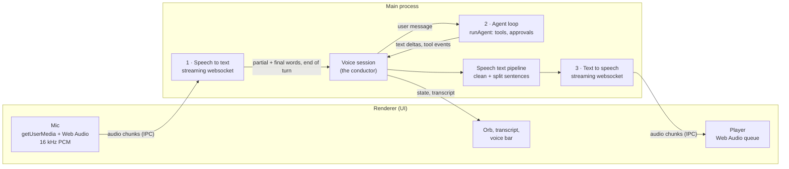
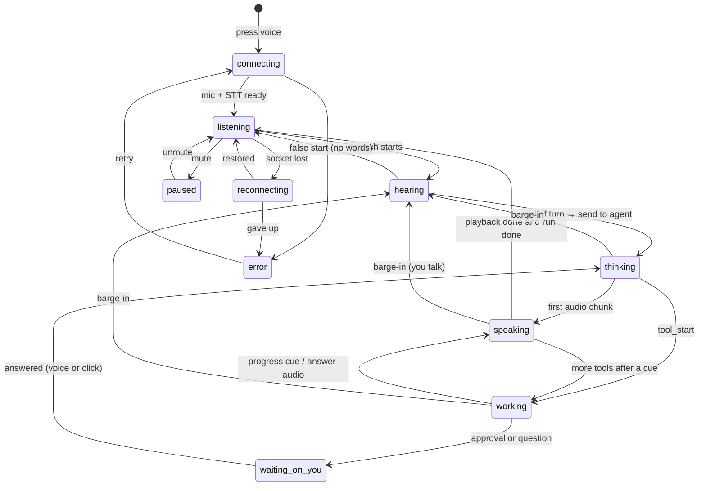

# Voice mode

A spoken conversation with Agent V: you talk, the agent works, and it answers
out loud while the full result lands in the task record. This page is the
design. It is a living document: every decision, change of plan and finished
step is recorded here as the work goes, and the **Status** and **Decision log**
sections are updated on every commit to the `feat/voice-mode` branch.

> **Status:** built through Phase 6 plus approvals and questions by voice and most of Phase 7, on
> `feat/voice-mode`, as local commits in the voice worktree (not pushed; D-19). Not yet run on
> real hardware: the first run with real keys, a mic and speakers is the next real test.
> PR: [#65](https://github.com/vyotiqai/vyotiq-agent-v/pull/65) (draft, holds the design only until pushed).

---

## Contents

1. [What voice mode is, and isn't](#1-what-voice-mode-is-and-isnt)
2. [How a voice turn works](#2-how-a-voice-turn-works)
3. [What already exists](#3-what-already-exists)
4. [Architecture](#4-architecture)
5. [The session state machine](#5-the-session-state-machine)
6. [Turn-taking and barge-in](#6-turn-taking-and-barge-in)
7. [Connecting to the agent loop](#7-connecting-to-the-agent-loop)
8. [What gets spoken: the speech text pipeline](#8-what-gets-spoken-the-speech-text-pipeline) (incl. [§8.6 voice agent behaviour spec](#86-voice-agent-behaviour-spec))
9. [Providers and models](#9-providers-and-models)
10. [Audio formats and transport](#10-audio-formats-and-transport)
11. [IPC contract](#11-ipc-contract)
12. [Settings and keys](#12-settings-and-keys)
13. [UI and UX](#13-ui-and-ux)
14. [Latency budget](#14-latency-budget)
15. [Network failures](#15-network-failures)
16. [Risks](#16-risks)
17. [Open questions](#17-open-questions)
18. [Privacy, security and cost](#18-privacy-security-and-cost)
19. [Testing](#19-testing)
20. [Build plan](#20-build-plan)
21. [Decision log](#21-decision-log)
22. [References](#22-references)
23. [Next version (v2 backlog)](#23-next-version-v2-backlog)

---

## 1. What voice mode is, and isn't

**Is:** a hands-free conversation with the agent on a task. One press opens a
session. After that you just talk. The agent listens, notices when you've
finished, works, and speaks a short answer. You can talk over it at any time,
and it stops. Everything said and done also appears in the record, so code,
diffs and long results are read on screen, not listened to.

**Is not:**

- A replacement for dictation. Dictation (the composer's mic and `Ctrl+M`)
  still turns speech into text in a field you then edit. Voice mode is a
  conversation; dictation is typing by voice. They share the mic stack.
- A speech-to-speech model in place of the agent. Models like OpenAI's realtime
  speech models can hear and talk directly, but they can't run Agent V's tools,
  approvals, record or provider choice. Voice mode keeps Agent V's own loop as
  the brain and wraps speech around it. See [§21](#21-decision-log), D-03.
- Local or offline, in this first version. Cloud first (Ajay, 2026-10-11).
  The provider layer leaves room for local engines later.

**Product stance to confirm.** The dictation redesign
(`src/redesign/voice/README.md`, decision 6) said: *"Not a conversational voice
mode. No spoken replies. That fits 'never chatbot-like', and it can be revisited
separately."* This feature is that revisit. The design keeps to the spirit of
that rule: the agent speaks briefly and points at the record. It doesn't chat.
That is question **Q1**.

### Goals

| Goal | Measured by |
| --- | --- |
| Feels live | Under 1 s from the end of your speech to the first audio of the reply, when the model is fast (see §14) |
| Interruptible | Agent audio stops within 150 ms of you starting to speak |
| Always clear whose turn it is | One orb with distinct listening, thinking, working and speaking states |
| Trustworthy | A live transcript of what it heard; the full answer always on screen |
| Survives bad networks | A dropped socket reconnects without losing the session or the run |
| Providers are swappable | Changing STT or TTS vendor touches one adapter file |

---

## 2. How a voice turn works

There are three stages and one conductor.



1. **Speech to text.** The renderer opens the mic and sends ~80–128 ms chunks of
   16 kHz mono PCM to main. Main streams them to the STT provider over a
   websocket. The provider streams back partial words (for the live
   transcript), final words, and an **end of turn** signal: its judgment that
   you've finished.
2. **The agent.** On end of turn, the conductor sends your words to the agent
   as an ordinary user message: a new run, or a follow-up on the running one.
   The agent loop runs as usual (tools, approvals, record) and streams text.
3. **Text to speech.** The conductor takes the agent's streamed text, cleans it
   into something worth hearing (no code, no paths, no markdown), splits it into
   sentences and streams them to the TTS provider. Audio comes back in chunks,
   goes to the renderer and plays as it arrives. The first sentence is playing
   while later ones are still being written.

**The conductor** (the voice session in main) owns turn-taking: when to
listen, when to answer, when to stop talking because you started, and what
state the orb shows.

---

## 3. What already exists

Most of the input half is already built for dictation. Voice mode reuses it
rather than writing a second mic stack.

| Piece | Where | Reuse |
| --- | --- | --- |
| Mic capture, 16 kHz mono Int16, device choice, typed failures (`blocked`, `no_device`, `busy`…) | `src/renderer/src/lib/audio/micCapture.ts` | As is |
| Pause detector (RMS, adaptive noise floor, 600 ms silence cut) and level meter math | `src/renderer/src/lib/audio/segmenter.ts` | Local barge-in detection and orb levels |
| OpenAI realtime transcription over websocket, in main, 16→24 kHz upsampler | `src/main/dictation/liveOpenAI.ts` | Becomes the OpenAI STT adapter |
| Typed error codes over IPC (`no_key`, `rejected_key`, `rate_limited`, `offline`…) | `DICTATION_ERROR_CODES`, `schemas/agent.ts` | Same pattern, `voice:<code>` |
| Encrypted key storage, keys never in the renderer | `src/main/settings/secrets.ts` | OpenAI/OpenRouter keys as is; new namespace for Deepgram and ElevenLabs |
| Mic permission (audio only, main window only), OS mic status, open OS settings | `src/main/app/security.ts`, `src/main/dictation/micAccess.ts` | As is |
| Level meter component, mic device picker, mic test | `take/TakeStrip.tsx` (`LevelMeter`), `VoiceSection.tsx` | As is |
| Follow-up queue, soft interrupt of the current model stream (`promoteFollowUp`), cancel | `src/main/agent/runRegistry.ts` | Barge-in while the agent works (§6) |

**What doesn't exist:** any text-to-speech, any audio playback (the only
`AudioContext` is the silent capture tap), any turn detection beyond the pause
cutter, and any Deepgram or ElevenLabs code or keys.

---

## 4. Architecture

### Where things run, and why

| Concern | Process | Why |
| --- | --- | --- |
| Mic capture | Renderer | `getUserMedia` only exists there |
| Audio playback | Renderer | Same; Web Audio for gapless queued playback and the orb's output level |
| STT and TTS sockets | Main | Keys stay in main. The renderer's CSP has no `wss:` in `connect-src`, so sockets there are blocked in production builds anyway |
| Turn-taking, agent bridge, speech text pipeline | Main | Lives next to the agent loop, so it reads events before they are batched or UI-gated (§7.3), and it survives the task pane being hidden |
| UI state | Renderer | Driven by `voice:event` pushes from main |

Playback can't use `<audio src="blob:…">`: the CSP has no `blob:` in
`media-src`, and `tests/main/unit/rendererNoObjectUrls.test.ts` bans
`URL.createObjectURL`. The player decodes raw PCM into `AudioBuffer`s and
schedules them, so neither rule needs to change.

### Files (planned)

```
src/shared/voice.ts                         types, constants, provider catalog
src/shared/ipc/schemas/voice.ts             zod schemas for every voice IPC payload
src/shared/ipc/channels.ts                  + voice:* channels

src/main/voice/
  index.ts                                  barrel
  session.ts                                VoiceSession: the conductor and its state machine
  agentBridge.ts                            starts runs and follow-ups, taps run events
  speechText.ts                             markdown → speakable text, sentence splitter
  spokenSummary.ts                          the <spoken> tag parser (§8.2)
  keys.ts                                   voice secret namespace (deepgram, elevenlabs)
  errors.ts                                 VoiceError + typed codes
  providers/
    types.ts                                SttProvider, TtsProvider interfaces (§9.1)
    registry.ts                             id → adapter, plus capability flags
    stt/deepgramFlux.ts
    stt/assemblyai.ts
    stt/elevenlabsScribe.ts
    stt/openaiRealtime.ts                   wraps dictation/liveOpenAI.ts
    stt/local.ts                            wraps dictation's local engine (beta)
    stt/fixture.ts                          scripted, for tests and VYOTIQ_E2E_FIXTURE
    tts/elevenlabs.ts
    tts/cartesia.ts
    tts/openai.ts
    tts/openrouter.ts                       OpenAI-compatible speech endpoint
    tts/fixture.ts
  socket.ts                                 shared websocket wrapper: open timeout,
                                            keepalive, reconnect with backoff, proxy

src/main/ipc/register.ts                    + voice handlers

src/renderer/src/features/voice/
  VoiceBar.tsx                              the docked bar on a task (§13)
  VoiceOrb.tsx                              the reactive orb
  VoiceTranscript.tsx                       live captions
  useVoiceSession.ts                        subscribes to voice:event, owns mic + player
  voicePlayer.ts                            Web Audio scheduler, ducking, output level
  voiceStore.ts                             useSyncExternalStore, like dictationStore.ts

src/renderer/src/features/settings/sections/VoiceSection.tsx
                                            + a "Voice mode" group
```

### Provider abstraction

All vendor code is behind two interfaces (§9.1). The session never imports a
vendor file; it asks the registry for the adapter that matches the settings.
Adding Cartesia, Deepgram TTS or a local engine later means one new adapter and
one catalog entry.

---

## 5. The session state machine

One session per window, one owner, the same rule as dictation's
`activeOwner`. States:

| State | Meaning | Orb | Mic |
| --- | --- | --- | --- |
| `off` | No session | Hidden | Closed |
| `connecting` | Opening mic and STT socket (and warming TTS) | Hollow, slow pulse | Opening |
| `listening` | Waiting for you; nothing heard yet | Idle breathing | Open |
| `hearing` | You're talking; partial words streaming | Follows your voice level | Open |
| `thinking` | Turn ended, waiting for the agent's first words | Inward shimmer | Open (barge-in) |
| `working` | Agent is running tools; it may speak short progress cues | Slow orbit + tool name | Open (barge-in) |
| `speaking` | Agent audio playing | Follows the agent's output level | Open (barge-in, ducked) |
| `waiting_on_you` | Agent asked a question or needs an approval | Accent ring | Open |
| `paused` | You muted the mic; the session stays open | Dimmed, mic-slash | Closed |
| `reconnecting` | A socket dropped; retrying | Hollow, warning tint | Buffering |
| `error` | Can't continue (bad key, mic blocked…); says why and how to fix it | Static, danger | Closed |



Every transition is an event (`voice:event { kind: 'state' }`), so the UI never
works out the state by itself. Transitions are pure functions in `session.ts`
and unit-tested without audio or sockets.

---

## 6. Turn-taking and barge-in

### 6.1 Ending your turn

Picking the moment you've finished is the hardest part of voice UX. If it's
too eager, the agent cuts you off mid-thought. If it's too slow, every reply
feels late.

- **Primary: the STT provider's own turn model.** Deepgram Flux was built for
  this: it emits `EndOfTurn` from a model of the conversation, not a silence
  timer. Defaults: `eot_threshold 0.7`, `eot_timeout_ms 5000`. We'll start
  with those and tune.
- **Fallback: the local pause detector** (`segmenter.ts`, 600 ms) for
  providers without turn detection, e.g. OpenAI realtime with server VAD off,
  as dictation runs it today. The OpenAI adapter can turn on server VAD
  instead. To decide in the spike.
- **Push-to-talk always wins.** Holding the voice key (§13.6) records until
  release, and release is the end of turn. No guessing. It's the fallback for
  noisy rooms.
- **Do not start the agent early.** Flux can send `EagerEndOfTurn` so a reply
  can be prepared speculatively and discarded on `TurnResumed`. For a chatbot
  that's free speed. For Agent V it's dangerous: a speculative run can edit
  files or run commands before you've finished talking. So we **don't** use
  eager end-of-turn to start runs. The only use, if any, is to warm the TTS
  socket. (D-05)

### 6.2 Barge-in: you talk while the agent talks

The effect is the same in every state where the agent has the floor:

1. **Duck** (≤ 50 ms): as soon as local voice activity is detected on the
   mic, the player's gain ramps to ~20%. This is local, so it doesn't wait for
   the network.
2. **Confirm** (≤ 150–300 ms): if the STT provider confirms speech (Flux
   start-of-turn, or ≥ 250 ms of voiced frames locally with real words in the
   partial), it's a barge-in. Otherwise it was a cough or a door, and the gain
   ramps back.
3. **Stop**: on a confirmed barge-in, the player flushes its queue (30 ms fade),
   the TTS context is closed (ElevenLabs `close_context`; OpenAI aborts the
   request), and the not-yet-spoken text is dropped from the speech queue.
4. **Mark**: the record shows where the agent was cut off. The agent's text
   stays in full in the record; only the speech stops.

### 6.3 What happens to the agent's *work* on barge-in

Stopping the voice is easy. What to do with a run that's mid-work is a product
decision (**Q4**). The recommendation:

| When you interrupt during… | Default | Mechanism |
| --- | --- | --- |
| `speaking` the final answer (run done) | Stop speech; your words are a new message | New user message on the same task |
| `thinking` / `working` (run live) | **Steer**: stop speech; your words become a follow-up that interrupts the current model stream and is applied at the next step | `chatFollowUp`, then `chatFollowUpPromote` (soft abort via `streamInterrupt`; tools in flight finish) |
| You say a stop phrase ("stop", "cancel", "never mind") | **Cancel** the run | `chatCancel` |
| `waiting_on_you` | Your words answer the question or approval (§7.5) | `respondToolApproval` / question response |

Steering, not cancelling, is the default because cancelling throws away work
in progress. Steering is what you'd do if you leaned over a colleague's
shoulder. The stop-phrase list is short, exact-match on the whole utterance,
and shown in Settings.

### 6.4 Echo: the agent hearing itself

With speakers rather than headphones, the mic picks up the agent's own voice,
and that can trigger a false barge-in. Defences, in order:

1. Chromium's echo cancellation (`echoCancellation: true`, already on in
   `micCapture.ts`). **Whether Chromium's canceller treats Web Audio playback
   as its echo reference on Windows and macOS isn't confirmed. Verify it in
   the first spike** (R-02).
2. While `speaking`, a higher voiced threshold and a longer confirm window
   for barge-in.
3. Ignore STT partials that match the text currently being spoken (a fuzzy
   match on the last ~2 s of TTS text). **Built** (D-31, `voice/echoGuard.ts`):
   the session remembers what the agent said (up to 300 words of the current
   stretch of speech). While its audio plays, and for 2.5 s after it stops or
   is cut off, a transcript made at least 75% of those words, in order, is an
   echo: it isn't shown as your caption, and a finished echo turn is dropped
   as a false start, never sent to the agent. One or two words count only
   while audio is actually playing and only as an exact run of what was said,
   so "yes" right after "Say yes or no." is your answer. A false start now
   returns the orb to Working when the run is still going (a cough mid-run
   used to show Listening).
   Limit: if the echo was loud enough to trigger barge-in, the reply has
   already stopped by the time its words are recognised; that reply stays
   quiet (B5). The duck-then-confirm stage (§6.2, D-25) is the fix if this
   happens in real use.
4. Push-to-talk, and a "headphones recommended" hint the first time voice
   mode is used on speakers.

---

## 7. Connecting to the agent loop

### 7.1 Input: your words become a message

A finished turn becomes a `ChatMessage { role: 'user', content: text }` and goes
down the same path a typed message takes. No new loop entry point.

- **No run on the task:** the message starts one. The voice bridge calls the
  same launch path as `chat:start` (`launchRun`), with `source: 'voice'`.
- **A run is live:** follow-up and promote, as §6.3.
- The message carries `meta.voice = { sttProvider, durationMs, confidence? }`.
  The record shows a small mic glyph on the turn. Low-confidence words can be
  underlined so a mishearing is easy to spot.

The renderer's composer flow (`createChatStreamController.send`) has
offline-queue and onboarding gates. The bridge either goes through it (sending a
`voice:submit` from the renderer once main reports end of turn) or reproduces
the gates in main. **Recommended: go through the renderer controller** so voice
messages get identical behaviour (drafts, offline queue, onboarding,
`buildUserContent`). Main tells the renderer "turn ended, here's the text", and
the renderer sends it like a typed message. This costs one IPC hop (< 5 ms). (D-07)

### 7.2 Telling the model it's a voice conversation

The model has to know its reply will be heard. While a voice session is open,
the run gets a `voice_reply` prompt section in the **stable zone**, next to
`response_style` (`agent/context/userRules.ts`). The stable zone matters for
the prompt cache: the prefix must stay byte-identical across steps (see
`docs/architecture.md`, "The prompt"). The section is fixed for the life of the
session, so it costs one cache miss when voice starts or stops, not one per step.

Draft text (superseded by the fuller draft in §8.6):

> The person is talking to you by voice and will hear your reply read aloud.
> Begin your final reply with a `<spoken>` block: one to three short spoken
> sentences, no code, no file paths, no markdown, no lists, that say what you
> did or found and what (if anything) you need from them. Then write your
> normal reply, which they will read on screen. Keep progress narration
> between tool calls to a short phrase.

### 7.3 Output: tapping the run's events

`startAgentRun.ts` iterates `runAgent`'s events and pushes them into the IPC
batcher (`for await (ev) … batcher.push(ev)`). The bridge adds a tap there: a
per-run listener the voice session registers for runs it owns. That gives it:

- `text_delta` with no 16 ms/80 ms batching delay, and
- events the IPC layer would drop: `UI_GATED_STREAM_TYPES` filters text deltas
  for runs the UI isn't subscribed to, so if you switch tasks mid-answer,
  speech would cut out. The tap doesn't have that problem.

The tap is read-only and must never slow the loop: it pushes into the session's
own queue and returns. A throwing listener is caught and logged; it must never
break a run.

Events used:

| Event | Voice use |
| --- | --- |
| `text_delta` | Feed the `<spoken>` parser / speech pipeline |
| `stream_reset` | The provider retried. Text already *spoken* can't be unsaid. Drop what's queued, and suppress the repeated prefix of the retried stream |
| `tool_start` | State `working`; optional progress cue (§8.4) |
| `assistant_message` (with `toolCalls`) | End of a narration step |
| `assistant_message` (no `toolCalls`) then `status: done` | Final answer complete → flush speech |
| `status: cancelled / error`, `error` | Speak a one-line failure ("That run failed, the error's on screen.") |
| `network_wait` | State reflects the agent waiting on the network (§15) |
| tool approval / `ask_question` requests | State `waiting_on_you` (§7.5) |

### 7.4 Final answer vs narration

There's no explicit "final" flag on the wire. An `assistant_message` without
tool calls, followed by `status: done`, is the final prose
(`recordModel.ts` → `RecordRun.result`). Narration between tool steps arrives as
`assistant_message` with `toolCalls`. The bridge buffers text per step and
decides when the step ends:

- step ended with tools → it was narration → maybe speak a progress cue (§8.4)
- step ended without tools → it's the answer → speak the `<spoken>` block, or
  the fallback summary

To start speaking before the step ends (sub-second goal), the parser speaks the
`<spoken>` block **as it streams**. If the model opens the reply with `<spoken>`,
we know it's the answer, even before the step ends.

### 7.5 Tools, approvals and questions by voice

- **Tools run as usual.** Voice doesn't change what the agent may do. Approval
  rules, the sandbox and mode (Ask / Agent) apply unchanged.
- **Approvals.** On an approval request the agent says a short version of
  `approvalTitle()` ("It wants to run `pnpm test`. Allow?") and the card shows
  on screen. Spoken "yes / allow / go ahead" means `once`; "no / deny" means
  `deny`. **Recommended:** voice can never answer an approval marked `danger`,
  or give `session`/`always`. Those need a click. (Q5)
- **Questions** (`ask_question`) — built (D-29). The question is spoken with
  its choices when there are four or fewer ("Which database should I use?
  Postgres, SQLite or MySQL."); a yes/no question ends "Yes or no?"; a form
  with several questions says "They're on screen, or just tell me what you
  want." A reply that clearly answers a one-question form settles it as the
  card would, and the agent says "Got it.":
  - single choice: the option's name, said alone or inside a sentence ("let's
    go with Postgres"), or its position ("the second one", "option 3", "the
    last one"); naming two options is unclear;
  - multiple choice: every option named;
  - yes/no: the approval words (§7.5 above), whole utterance only;
  - free text: the whole reply;
  - a question that allows its own answer: a short reply (eight words or
    fewer) that names no option.

  Anything else — an unclear pick, a long reply, a stop phrase, a form with
  several questions — goes to the agent as an ordinary message. That already
  closes the card and tells the model "the user sent a message instead; treat
  it as the answer if it addresses the question"
  (`ASK_QUESTION_SUPERSEDED_GUIDANCE`), so a miss costs precision, never the
  answer. Hook: `watchAgentQuestions` in `agent/agentQuestion.ts`; matching in
  `voice/questionByVoice.ts`.

### 7.6 Mode

Voice works in both Ask and Agent mode and doesn't switch modes. Spoken "switch
to ask mode" is out of scope for v1.

---

## 8. What gets spoken: the speech text pipeline

### 8.1 Why not read the answer verbatim

Agent V's answers are written to be read: code blocks, paths, diffs, tables,
lists. Read aloud, `src/main/agent/loop.ts:4008` is noise and a fenced block is
unbearable. Voice speaks a **short spoken version** and points at the screen
for the rest.

### 8.2 The `<spoken>` tag

The only new text tag. The model starts its final answer with:

```
<spoken>I fixed the race in the follow-up queue and the tests pass now. There's
one thing to check: the retry limit is a guess.</spoken>

…the full written answer, as normal…
```

- The bridge streams what's inside the tag to TTS **as it arrives**, sentence
  by sentence.
- The renderer **removes** the block from the displayed answer
  (`lib/markdown` sanitising plus a one-line strip in `recordModel.ts`). It
  isn't shown twice, and an old record without voice is unaffected.
- **Fallback** if the model skips the tag: clean the first paragraph of the
  answer (§8.3) and speak at most ~3 sentences / 400 characters, followed by
  "The details are on screen." A provider that ignores the instruction still
  gets a sensible result.
- Tag text never reaches the record redaction path differently. It is part of
  the message content like any other text.

**Provider expressiveness tags** (ElevenLabs v3 audio tags like `[laughs]`, SSML
`<break>`, Deepgram pause markers) are **not used in v1**. They're
vendor-specific, would leak into the written answer, and Flash models ignore
most of them. The speech pipeline strips anything bracketed that looks like one.
The `TtsProvider` interface has a `supportsMarkup` flag so they can be added
per vendor later. (D-08)

### 8.3 Cleaning text for speech (`speechText.ts`)

Pure functions, unit tested against fixtures:

| Input | Spoken as |
| --- | --- |
| Fenced code block | Dropped. If it was the whole answer: "I've put the code on screen." |
| Inline code `` `runAgent` `` | The identifier, de-camel-cased only if short: "run agent" |
| Paths `src/main/agent/loop.ts` | Basename without extension: "loop" ("in loop dot ts" if ambiguous) |
| Markdown (`**`, `#`, `>`, `-`, tables) | Stripped; list items joined as a sentence |
| Links `[text](url)` | `text` |
| URLs | "a link on screen" |
| Numbers, versions, `v1.2.0` | Left to the TTS normaliser; `1.2.0` becomes "1.2.0" with dots kept |
| Emoji, symbols | Dropped |

### 8.4 Progress cues while the agent works

A long silence while the agent works feels broken. Options, ordered by
cost, with the recommendation in bold:

1. **An earcon only** (a soft tick when a tool starts). No speech.
2. **Short template cues from tool events**: "Reading files…", "Running tests…",
   "Editing loop dot ts…". Drawn from `tool_start.summary`, rate-limited to one
   per ~6 s, never over a tool that finishes in < 1.5 s.
3. Speaking the model's own narration text between tools. Natural, but chatty
   and uncontrolled.

**Recommended: 2, with 1 when cues are turned off** (setting `speakProgress`).
It's what "short spoken summary while details render on screen" means in
practice.

### 8.5 Splitting into sentences

The TTS gets text in sentence-sized pieces so the first audio comes quickly
without choppy prosody:

- Split on `. ! ?` followed by space or newline, not after common
  abbreviations (`e.g.`, `i.e.`, `vs.`, version numbers, decimals).
- The **first** chunk may be cut early at a comma once it's ≥ 40 characters,
  to get audio started.
- ElevenLabs: send text continuously with `flush` at sentence ends (their
  recommended pattern). OpenAI TTS (HTTP): one request per sentence, the next
  request started while the previous one plays.

### 8.6 Voice agent behaviour spec

The rules for how it sounds, and why (Ajay asked for this to be spelled out,
2026-10-11). They're carried out in three places: the `voice_reply` prompt
section (§7.2), the speech text pipeline (§8.3–8.5) and the session state
machine (§5). Each rule names where it lives.

| # | Rule | Why | Where it's enforced |
| --- | --- | --- | --- |
| B1 | **Brief by default.** One to three spoken sentences. Go longer only when you ask for detail ("walk me through it") | Long speech is the most common way voice assistants fail; listening is slower than reading | Prompt (`<spoken>` length) + fallback cap (§8.2) |
| B2 | **Know the medium.** Code, lists, paths, diffs and numbers-heavy output go on screen; the voice says what it is and where ("The diff's on screen, three files") | A fenced block read aloud is useless | Prompt + `speechText.ts` |
| B3 | **No dead air.** Acknowledge within ~100 ms of your turn ending (earcon + orb). If the first words take more than ~1.5 s, a short spoken acknowledgement ("Sure, let me look.") is allowed once per turn | Silence feels like it didn't hear you | Session timers (§13.8); acknowledgement from a small fixed phrase set in main, not the model, so it costs nothing and never says anything wrong |
| B4 | **Say what it's doing during long work.** One short cue when a slow tool starts ("Running the tests."), never more than one every ~6 s, nothing for tools under 1.5 s | Long silence while working feels broken; a running commentary is grating | Progress cues (§8.4) |
| B5 | **Stop the moment you talk.** No "sorry, go ahead", no finishing the sentence, no repeating what it already said when it resumes | Interrupting is the most natural thing people do | Barge-in (§6.2); prompt: "if interrupted, don't repeat what you already said" |
| B6 | **Don't repeat itself.** It doesn't restate your question or recap what it said in an earlier turn unless asked | Repetition is far more annoying spoken than written | Prompt |
| B7 | **Warm, steady personality; not fake-cheery.** Friendly and direct; matches your register (serious when you are, lighter when you are); a little humour when it fits; never over-apologises or gushes | Over-enthusiasm reads as insincere when spoken | Prompt (`voice_reply` tone lines); respects the user's own Tone / Persona settings (`response_style`) when set |
| B8 | **Honest about uncertainty and failure.** "I'm not sure this fixes it; the test is flaky." "That failed, the error's on screen." It never covers a failure with confident speech | The voice must not be more confident than the record | Prompt + failure lines from run status (§7.3) |
| B9 | **Confirm before risky actions, by voice too.** Reads approvals as a short question, accepts yes/no for ordinary ones, requires a click for risky ones | Mishearing must never delete things | §7.5 |
| B10 | **Repeat back when unsure what it heard.** When transcript confidence is low on a word that matters (a file name, "delete"), it asks: "Did you say *delete* the branch?" | Speech recognition makes mistakes; agents act on words | STT confidence (where the provider gives it) + prompt; low-confidence words highlighted in the record |
| B11 | **Plain words for numbers and names.** "about two hundred milliseconds", "the loop file" rather than reading a full path or a 12-digit number | Natural to hear | `speechText.ts` + prompt |
| B12 | **Ends turns clearly.** Finishes with what happens next or a direct question, so you know it's your turn ("Want me to run the full suite?"). No trailing "Let me know if you need anything else" | Clear hand-back is how spoken turn-taking works | Prompt |

**Draft `voice_reply` prompt section** (replaces the shorter draft in §7.2;
tuned in Phase 5):

> The person is talking with you by voice and hears your reply read aloud.
> Begin your final reply with a `<spoken>` block: one to three short spoken
> sentences in plain, natural speech: no code, file paths, markdown, lists or
> long numbers. Say what you did or found, and end with what happens next or
> one direct question. Put everything detailed in the written reply after the
> block; in the spoken part, point to it ("the diff's on screen").
> Be warm and direct and match their tone; don't gush, apologise repeatedly,
> restate their question or repeat what you said earlier. If you're unsure,
> say so plainly. If a word that matters may have been misheard, ask before
> acting on it. Between tool calls, narrate in a few words at most.

---

## 9. Providers and models

### 9.1 Interfaces

```ts
// src/main/voice/providers/types.ts (planned)

export type SttEvent =
  | { kind: 'open' }
  | { kind: 'speech_start' }                       // provider detected speech
  | { kind: 'partial'; text: string }              // unstable words, for captions
  | { kind: 'final'; text: string; confidence?: number }
  | { kind: 'end_of_turn'; text: string }          // the turn is complete
  | { kind: 'error'; code: VoiceErrorCode; message: string; retryable: boolean }
  | { kind: 'closed'; reason: string }

export interface SttSession {
  /** 16 kHz mono Int16 LE; the adapter resamples if its provider wants otherwise. */
  pushAudio(pcm16k: Int16Array): void
  /** Push-to-talk release: force end of turn now. */
  endTurn(): void
  /** Vocabulary hints (workspace identifiers), replaces the previous list. */
  setKeyterms?(terms: readonly string[]): void
  close(): Promise<void>
}

export interface SttProvider {
  id: SttProviderId
  label: string
  caps: { turnDetection: boolean; keyterms: boolean; languages: 'en' | 'multi' }
  open(opts: {
    apiKey: string
    language?: string
    keyterms?: readonly string[]
    signal: AbortSignal
    emit: (e: SttEvent) => void
  }): Promise<SttSession>
}

export type TtsChunk = { pcm: Int16Array; sampleRate: number; contextId: string }

export interface TtsStream {
  /** Append text; the adapter decides when to synthesise. */
  pushText(text: string): void
  /** Sentence boundary or end of reply: synthesise what's buffered. */
  flush(): void
  /** Barge-in: stop generating and drop anything not yet delivered. */
  cancel(): void
  /** Resolves when all audio for pushed text has been delivered. */
  done(): Promise<void>
}

export interface TtsProvider {
  id: TtsProviderId
  label: string
  caps: { streamingInput: boolean; speed: [min: number, max: number]; supportsMarkup: boolean }
  listVoices(apiKey: string): Promise<VoiceOption[]>
  /** One per reply. Keep-alive and connection reuse are the adapter's job. */
  stream(opts: {
    apiKey: string
    voiceId: string
    speed: number
    signal: AbortSignal
    onAudio: (c: TtsChunk) => void
  }): TtsStream
}
```

Rules every adapter follows:

- Errors are mapped to `VoiceErrorCode` in the adapter (401/403 → `rejected_key`,
  429 → `rate_limited`, socket failure → `offline`…), never as raw provider text
  in the UI. This fixes dictation finding #6 for voice from the start.
- Audio out of the adapter is always Int16 PCM with its sample rate stated. The
  player handles 16/22.05/24/44.1 kHz.
- There's a `fixture` adapter for each side, used by tests and by
  `VYOTIQ_E2E_FIXTURE=1`.

### 9.2 You choose the providers and bring the keys

Voice mode has no single fixed vendor (Ajay, 2026-10-11, D-15). Each
direction, **Listens with** (STT) and **Speaks with** (TTS), is a choice from a
catalog. You add your own API key for each vendor you use. One key per vendor
covers both directions: an ElevenLabs key powers ElevenLabs listening *and*
speaking.

- Keys you already gave Agent V for the model (OpenAI, OpenRouter) are reused.
  The row says "Using your OpenAI key from Providers" instead of asking again.
- Vendors that aren't LLM providers (Deepgram, ElevenLabs, AssemblyAI, Cartesia)
  get keys in Settings → Voice (§13.7).
- The catalog lives in `src/shared/voice.ts`: one entry per provider, with its
  label, which directions it supports, its key source, its models, its
  capabilities and its privacy line ("Audio goes to Deepgram"). Settings, the
  voice bar and the fallback logic all read from this catalog. Nothing is
  hard-coded per vendor in the UI.

### 9.3 Speech to text options

| Provider | Model(s) | Endpoint | Turn detection | Vocabulary | Key | Notes |
| --- | --- | --- | --- | --- | --- | --- |
| **Deepgram Flux** (recommended) | `flux-general-en`, `flux-general-multi` | `wss://api.deepgram.com/v2/listen` | Model-based `EndOfTurn` (`eot_threshold` 0.5–1.0, default 0.7; `eot_timeout_ms` default 5000) | `keyterms` ≤ 100, updatable mid-stream | Deepgram | Built for voice agents; 16 kHz linear16, 80 ms chunks |
| **AssemblyAI Universal Streaming** | `universal-3-6-pro` (default), `universal-streaming-english`, `universal-streaming-multilingual` | `wss://streaming.assemblyai.com/v3/ws` (US/EU residency hosts exist) | `Turn` messages with `end_of_turn`; `end_of_turn_confidence_threshold`, `min_turn_silence`, `max_turn_silence`; `ForceEndpoint` for push-to-talk | `keyterms_prompt` ≤ 100, updatable | AssemblyAI | `Authorization` header without `Bearer`; 50–1000 ms chunks |
| **ElevenLabs Scribe Realtime** | `scribe_v2_realtime` | `wss://api.elevenlabs.io/v1/speech-to-text/realtime` | Commit-based: we commit on our local pause detector or push-to-talk release (VAD commit mode to evaluate in Phase 1) | to check | ElevenLabs | JSON chunks with base64 PCM 16 kHz; partial and committed transcripts |
| **OpenAI realtime transcription** | `gpt-live-transcribe` | `wss://api.openai.com/v1/realtime?intent=transcription` | Server VAD, or our local pause detector (as dictation runs it today) | `prompt` / `keywords` | OpenAI (reused) | Code already exists in `dictation/liveOpenAI.ts` |
| **This PC** (Whisper / Moonshine, beta) | `whisper-small.en`, `whisper-tiny.en`, `moonshine-base` | Local utility process | Local pause detector | — | none | Already built for dictation. Not streaming: each turn is transcribed when it ends, so replies start later. Offline and private. A bonus, not cloud-first |

**Whisper, to be precise.** OpenAI's hosted Whisper (`whisper-1`) is batch-only
(upload a file, get text back), so it can't produce live captions or detect turns.
The cloud "Whisper" option is the OpenAI realtime row above. Local Whisper is the
*This PC* row.

### 9.4 Text to speech options

| Provider | Model(s) | Transport | Streams text in? | Barge-in | Speed | Key | Notes |
| --- | --- | --- | --- | --- | --- | --- | --- |
| **ElevenLabs** (recommended) | `eleven_flash_v2_5` (fast); higher-quality models selectable | WS `…/v1/text-to-speech/{voice}/multi-stream-input` | Yes, `flush` per sentence | `close_context` | `voice_settings.speed` (range to confirm) | ElevenLabs | ~100–150 ms to first byte (NA/EU); ≤ 5 contexts per socket; cloned voices appear in the list |
| **Cartesia Sonic** | `sonic-3.6`, `sonic-latest` | WS `wss://api.cartesia.ai/tts/websocket` | Yes, `continue: true` per chunk, `context_id` | `{ context_id, cancel: true }` | 0.6–1.5 | Cartesia | Raw `pcm_s16le` at 24 kHz; also has volume and emotion controls; versioned API (`cartesia_version`) |
| **OpenAI** | `gpt-4o-mini-tts` | HTTP `POST /v1/audio/speech`, streamed | Per sentence | Abort the request | 0.25–4.0 | OpenAI (reused) | `instructions` steer the delivery ("calm, brief"); fixed voice set |
| **OpenRouter** | `openai/gpt-4o-mini-tts-…`, Gemini, Mistral Voxtral, Azure MAI-Voice and others | HTTP `POST /api/v1/audio/speech` (OpenAI-compatible) | Per sentence | Abort the request | `speed` where the model supports it | OpenRouter (reused) | Model list comes from `GET /api/v1/models?output_modalities=speech`; one key covers many voices |
| **Deepgram** | Aura / Flux TTS | `/v2/speak` | to verify | to verify | 0.5–1.5 | Deepgram | One vendor for both directions with a single key. Details checked in Phase 1 before it's listed |

### 9.5 Picking a default, and what happens without keys

- **No key at all:** pressing the voice button opens **Set up voice** (§13.5).
  It lists every provider, recommended first, each with *Add key*. It never fails
  with an error.
- **Out of the box:** Listens with = the first provider in the order Deepgram,
  AssemblyAI, ElevenLabs, OpenAI that has a key. Speaks with = the first in the
  order ElevenLabs, Cartesia, OpenAI, OpenRouter that has a key. If you only
  have an OpenAI key, both are OpenAI and it just works (D-13).
- **Your choice wins.** Once you pick a provider, it's used. If its key is later
  removed or rejected, the session falls back to the next provider in the order
  that has a working key, and the engine token in the bar says so ("Speaking
  with OpenAI, ElevenLabs key rejected"). It never falls back silently.
- **Fallback during a session** (a provider fails mid-session): see §15.

### 9.6 Adding a provider later

1. Write the adapter in `src/main/voice/providers/{stt|tts}/<id>.ts` against the
   §9.1 interface, with error mapping to `VoiceErrorCode`.
2. Add a catalog entry in `src/shared/voice.ts` (label, directions, key source,
   models, capabilities, privacy line).
3. If the vendor's key is new, add it to the `VoiceKeyVendor` union. The key
   store, the settings rows and the IPC are generic over it.
4. Add an adapter test against a fake socket, and add the endpoint to
   `PRIVACY.md`.

No UI change is needed: the settings rows, voice lists and engine token are
built from the catalog.

---

## 10. Audio formats and transport

| Leg | Format | Chunking | Transport |
| --- | --- | --- | --- |
| Mic → main | Int16 LE mono 16 kHz | 2,048 frames (128 ms), current `TAP_FRAMES`; consider 1,280 (80 ms) for Deepgram | IPC `voice:audio`, base64 like `dictation:liveAudio` today |
| Main → STT | Provider format (16 kHz linear16 for Deepgram; 24 kHz PCM for OpenAI) | Pass-through / upsampled | Websocket |
| TTS → main | Int16 PCM 24 kHz | Provider chunks | Websocket / HTTP stream |
| Main → renderer | Int16 LE + sample rate + context id + seq | Pass-through | IPC `voice:audio-out` push |
| Renderer playback | `AudioBuffer` (Float32) | Scheduled back-to-back on one `AudioContext` clock; 60 ms jitter buffer before the first chunk | Web Audio |

Notes:

- **Base64 over IPC** matches today's dictation and its 700k-char cap. Electron
  can pass `ArrayBuffer`/typed arrays through structured clone, which avoids the
  ~33% size overhead and an encode/decode on both sides. Worth switching for
  voice because it streams in both directions; the cost is a new schema shape.
  To decide when the IPC is built (D-09, open).
- **Capture uses a ScriptProcessorNode**, not an AudioWorklet, because worklet
  module loading fails under `file://` (comment in `micCapture.ts`). The player
  can avoid worklets too: chained `AudioBufferSourceNode`s are enough for
  gapless playback.
- The player has its own `AudioContext` at the TTS rate (24 kHz) so it never
  resamples. An `AnalyserNode` on its output drives the orb while speaking.
- **Ducking** is a `GainNode` ramp (`setTargetAtTime`, ~30 ms), never a jump,
  to avoid clicks.

---

## 11. IPC contract

All channels follow the five-place rule in `docs/architecture.md` (channel,
`vyotiqApi`, preload, handler with `senderOk` + zod, `ipcContract.test.ts`).

| Channel | Direction | Payload | Purpose |
| --- | --- | --- | --- |
| `voice:start` | invoke | `{ workspacePath, runId?, taskId? }` | Open a session on a task |
| `voice:stop` | invoke | `{ sessionId }` | Close it |
| `voice:audio` | send | `{ sessionId, seq, pcm16k }` | Mic chunks (fire-and-forget, like `liveAudio`) |
| `voice:ptt` | invoke | `{ sessionId, down: boolean }` | Push-to-talk press/release |
| `voice:mute` | invoke | `{ sessionId, muted }` | Pause / resume listening |
| `voice:barge` | send | `{ sessionId, level }` | Local VAD fired (renderer ducks right away; main confirms) |
| `voice:interrupt` | invoke | `{ sessionId }` | Stop speaking now (button / Esc) |
| `voice:submitted` | invoke | `{ sessionId, turnId, runId }` | The renderer sent the turn as a message (§7.1) |
| `voice:event` | push | union, below | State, captions, errors, turn ended |
| `voice:audio-out` | push | `{ sessionId, contextId, seq, sampleRate, pcm, final? }` | TTS audio to play |
| `voice:voices` | invoke | `{ provider }` | List voices for the picker |
| `voice:preview` | invoke | `{ provider, voiceId, speed }` | Speak a sample line in Settings |
| `voice:status` | invoke | — | Which providers have keys; which will be used |
| `voice:setKey` / `voice:clearKey` | invoke | `{ vendor: VoiceKeyVendor, key }` | Voice-only vendor keys, verified before save (§12). OpenAI/OpenRouter keep using `setSecret` |
| `voice:keyStatus` | invoke | — | Per vendor `{ set, last4?, lastVerified?, lastError? }` |
| `voice:catalog` | invoke | — | The provider catalog with each entry's resolved key state |

`voice:event` kinds: `state`, `partial` (caption), `final`, `turn_ended { text }`,
`speaking { contextId, text }` (what's being said, for captions),
`spoken_done`, `cue { text }`, `error { code, message, retryable }`,
`reconnecting { attempt }`, `engine { stt, tts }`.

Ownership: a session belongs to the `webContents` that opened it and closes when
that sender is destroyed (the `liveOwners` pattern from dictation). On quit,
`before-quit` closes all sessions next to `closeAllLiveTakes`.

---

## 12. Settings and keys

New `Settings.voice` (zod schema with defaults, migrated by ignoring unknown
keys, like `dictation`):

| Key | Type | Default | Notes |
| --- | --- | --- | --- |
| `sttProvider` | `SttProviderId \| 'auto'` | `'auto'` | `'auto'` = the first in the §9.5 order with a key. Ids: `deepgram`, `assemblyai`, `elevenlabs`, `openai`, `local` |
| `ttsProvider` | `TtsProviderId \| 'auto'` | `'auto'` | Ids: `elevenlabs`, `cartesia`, `openai`, `openrouter` (+ `deepgram` once verified) |
| `stt` | `Partial<Record<SttProviderId, { model?: string }>>` | `{}` | Per-provider model choice; empty = catalog default |
| `tts` | `Partial<Record<TtsProviderId, { model?: string; voiceId?: string }>>` | `{}` | Per provider, so switching back keeps your voice |
| `speed` | number | `1.0` | Clamped to the provider's range in the catalog |
| `language` | ISO-639-1 or `''` | `''` (English) | Each adapter maps it (e.g. Flux `-en` vs `-multi` + hint) |
| `deviceId` | string | shared with dictation | One mic choice for the app |
| `interruptMode` | `'steer' \| 'cancel' \| 'off'` | `'steer'` | §6.3 (D-12) |
| `speakProgress` | boolean | `true` | Spoken cues (§8.4); off = earcon only |
| `pushToTalkOnly` | boolean | `false` | No automatic turns; hold to talk |
| `endOfTurnPatience` | `'quick' \| 'normal' \| 'patient'` | `'normal'` | Each STT adapter maps this to its own knobs (Flux `eot_threshold`/timeout, AssemblyAI confidence/silence, local pause length) |
| `approveByVoice` | boolean | `true` | Only `once`/`deny` on non-danger approvals (§7.5) |
| `captions` | boolean | `true` | Live transcript in the voice bar |
| `earcons` | boolean | `true` | Start, end and turn-accepted sounds (§13.8) |

**Keys.** Voice vendors that aren't LLM providers can't use `SecretProvider`,
which only accepts `ProviderId | custom:*`. They get their own namespace in
`secrets.ts`: `setVoiceKey(vendor, key)`, `getVoiceKey(vendor)`,
`clearVoiceKey(vendor)` and `voiceKeyStatus()`, the same pattern as
`setVideoEngineKey`/`getVideoEngineKey`. Keys are encrypted with `safeStorage`,
written 0600, and never sent to the renderer; the renderer only sees
`{ set, lastVerified?, lastError? }`. `VoiceKeyVendor` is
`'deepgram' | 'assemblyai' | 'elevenlabs' | 'cartesia'`. OpenAI and OpenRouter
keep using `getSecret('openai' | 'openrouter')`, so one key serves the model and
voice.

**Checking a key.** *Add key* runs a cheap authenticated call in main (`keyService.ts`; the per-vendor endpoints are rechecked in the spike, and only a 401/403/402 refuses a key, so a moved endpoint can't lock a good key out) (list
voices or models) before saving, and shows the outcome on the row: ✓ verified,
✕ rejected (with the vendor's reason mapped to plain words), or ⚠ couldn't reach
the vendor (saved anyway, verified on first use).

Settings UI: §13.7.

---

## 13. UI and UX

All UI follows the root `CLAUDE.md`: tokens only (no literal colours, five
skins × light/dark), `lib/ui` primitives, icons from `lib/icons` only, 40px pane
rows, `focus-visible:vy-focus-ring` on everything interactive, type sizes on the
scale, and no `cn()` overrides. Every surface is checked against the
`wcag-desktop` skill before it ships.

### 13.1 Where voice mode lives

**Recommended (Q2):** a **voice bar docked at the bottom of the task pane, in
place of the composer** while a session is open. The record stays visible above
it, so "details render on screen" is literally true: you hear the summary and
see the diff in the same view.

Alternatives considered:

- *Full-screen overlay with a big orb* (like phone assistants): beautiful, but
  hides the record. That's wrong for a coding agent where the output is the point.
- *A floating mini window*: lets you talk while looking at another app. It's a
  good v2 ("talk to Agent V while you're in your editor"), but it adds
  window-management work.

### 13.2 The voice bar

```
┌───────────────────────────────────────────────────────────────────────────┐
│ record …                                                                  │
├───────────────────────────────────────────────────────────────────────────┤
│  ◉  "…and make the retry limit configurable"            0:42   🔒/☁  ⋯  ✕  │  ← 40px row
│ orb  live caption (you: fg; agent: muted)                time  engine menu end│
├───────────────────────────────────────────────────────────────────────────┤
│  [🎤 Mute]   [■ Stop speaking]                         Hold Space to talk │  ← 32px controls
└───────────────────────────────────────────────────────────────────────────┘
```

- **Orb** (left edge, 28px): the one living element. Everything else is
  muted (emphasis comes from neighbours).
- **Caption** (fills the row): your words in `text-fg` while you talk, unsettled
  tail in `text-tertiary` (the same convention as the take strip); the agent's
  current sentence in `text-muted` while it speaks. One line, ellipsised from the
  left so the newest words are visible.
- **Time**: session length, `text-tertiary`, tabular numerals.
- **Engine token**: where audio goes, ☁ `Deepgram · ElevenLabs` (or `OpenAI`),
  the same idea as the take strip's `EngineToken`. Click → engine and voice menu.
- **⋯**: voice, speed, captions, interrupt mode, headphones tip.
- **✕ End**: ends the session (also `Esc` twice, or the voice shortcut).
- **Controls row**: Mute (`micSlash` when muted), Stop speaking (only while
  speaking), push-to-talk hint.

### 13.3 The orb

One canvas (or SVG) element, 28px in the bar and 96px in the empty-task hero.
It's drawn only with token colours, read from CSS variables at mount and on skin
change (the `TerminalPanel.tsx` exception for JS colour reads).

| State | Motion | Colour token |
| --- | --- | --- |
| listening | Slow breathing scale (4 s) | `--vy-muted` |
| hearing | Radius and edge follow **your** mic level (RMS from `segmenter.levelFromRms`), 60 fps, smoothed | `--vy-accent` |
| thinking | Inward shimmer, no level | `--vy-accent-soft` |
| working | Slow orbit dot + tool glyph beside the orb | `--vy-muted` |
| speaking | Edge follows **the agent's** output level (`AnalyserNode`) | `--vy-fg-strong` |
| waiting_on_you | Steady ring + "needs you" dot | `--vy-accent` |
| paused | Static, `micSlash` overlay | `--vy-tertiary` |
| reconnecting | Hollow, slow blink | `--vy-warning` |
| error | Static | `--vy-danger` |

Meaning is never carried by colour alone (CLAUDE.md "Never"): every state also
changes **shape or motion** and has a **text label** for screen readers
(`aria-live="polite"` region: "Listening", "Thinking", "Speaking"). Under
`prefers-reduced-motion: reduce` the orb doesn't animate; it switches between
static shapes and the label carries the state.

### 13.4 In the record

- Your spoken turns render like typed ones, with a small `mic` glyph and the
  duration. A low-confidence word is dotted-underlined; click to correct, which
  re-sends as an edit.
- The agent's answer renders exactly as today, minus the `<spoken>` block. A
  small `speaker` button on the answer replays the spoken summary.
- If you interrupted, a thin marker shows where speech stopped.

### 13.5 Starting voice mode

- A **voice button** (`waveform` icon) next to the mic on the instruction line
  and on the New task brief. The mic (dictation) and the voice button sit side
  by side: one types, one talks.
- **Shortcut:** `Ctrl+Shift+M` / `Cmd+Shift+M`, next to dictation's `Ctrl+M`.
  It's free in `lib/shortcuts/bindings.ts`, and mod chords forbid Shift by
  default, so it doesn't also fire dictation.
- **Command palette:** "Start voice mode".
- **On New task** — built (D-30). The voice bar takes the brief's place and
  says "Listening. Say what you want done." The first thing you say starts
  the task, exactly as Start task would: after anything already typed in the
  brief, with its checks, added folders, attachments, worktree choice and
  draft. The session then moves to the new task's instruction line, and the
  conversation carries on there; its clock keeps counting and no earcons
  play for the move. How: the brief marks a handoff just before sending, and
  the first instruction line to appear in the next 10 s takes the session
  (`beginVoiceHandoff` / `registerVoiceLine` in `voiceMode.ts`); if the brief
  turns into that line in place, it simply keeps it. The run id to follow is
  read from whichever line owns the session by then. A task started in a new
  worktree runs in another folder: following its run points the voice-reply
  prompt there (`followVoiceRun`), so every reply after the first is written
  to be heard; the first falls back to the spoken summary (§8.2).
- **First use:** the *Set up voice* popover (§9.5), then a one-time tip:
  "Talk naturally. Interrupt any time. Headphones work best."

### 13.6 Keys while a session is open

| Key | Action |
| --- | --- |
| `Space` (hold, when no field is focused) | Push to talk |
| `Esc` | Stop speaking. A second `Esc` within 2 s ends the session |
| `Ctrl/Cmd+Shift+M` | End the session |
| `M` | Mute / unmute |

Esc routing must respect existing handlers (`lib/shortcuts/escape.ts` already
routes Esc to an open take before stopping a run). Voice adds `[data-voice-open]`
with the same precedence.

### 13.7 Settings → Voice

Voice mode gets its own group at the top of Settings → Voice; Dictation and
Microphone follow. It uses the page's existing `FormGroup` / `FormRow` grammar.
Values at their default are `text-muted`, so anything you changed stands out on
its own (CLAUDE.md "Emphasis comes from the neighbours").

```
Voice mode
─────────────────────────────────────────────────────────────────────────────
Listens with      [ Deepgram Flux        ▾ ]   ☁ Audio goes to Deepgram
                    Model  flux-general-en ▾
Speaks with       [ ElevenLabs           ▾ ]   ☁ Reply text goes to ElevenLabs
                    Model  eleven_flash_v2_5 ▾
Voice             [ Rachel · warm, calm  ▾ ]   ▶ Preview
Speed             ──────●──────  1.0×           ▶ Preview
Language          [ English              ▾ ]

Keys
  Deepgram        ✓ Verified            ••••3f9a     Replace · Remove
  ElevenLabs      ✓ Verified            ••••a120     Replace · Remove
  AssemblyAI      Not set                            Add key
  Cartesia        Not set                            Add key
  OpenAI          ✓ From Providers                   Manage in Providers
  OpenRouter      Not set                            Manage in Providers

Behaviour
  When you interrupt     ( Steer the agent | Stop the agent | Just stop talking )
  Progress updates       ( Spoken | Sound only )
  Turn ending            ( Quick | Normal | Patient )
  Push-to-talk only      [ ]
  Approve by voice       [✓]  once/deny only; risky actions always need a click
  Captions               [✓]
  Sounds                 [✓]
  Shortcut               Ctrl Shift M

Microphone (shared with dictation)
  Input           [ MacBook Pro Microphone ▾ ]  ▮▮▮▮▯▯▯▯ live level
```

**Provider pickers** (`Listens with`, `Speaks with`):

- A menu (`vy-menu`, `MENU_ROW`) listing every catalog provider for that
  direction. Each row has the provider name, a one-line trait ("Fastest turn
  detection", "Runs on this PC") and a trailing key state: ✓, *Add key*, or
  *From Providers*.
- A provider without a key can still be selected. The row then shows *Add key*
  inline, and the voice bar won't use it until the key works. Choosing it is
  never disabled (the same rule as dictation finding #11).
- An *Automatic* option at the top shows what it resolves to: "Automatic ·
  Deepgram Flux".
- The **privacy line** to the right always says where audio or text goes for
  the current choice, with `cloud` or `lock` icons from `lib/icons`.

**Model** sub-row: shown only when the provider has more than one model, with
the catalog default first and labelled *Recommended*.

**Voice picker:**

- Lists voices from `voice:voices` for the selected TTS provider, fetched in
  main with your key and cached for 24 h.
- Each row: name, the vendor's descriptors (accent, gender, style), a ▶ preview,
  and a badge for your own cloned voices.
- Has a search field when there are more than 12 voices.
- Without a key, the picker shows the catalog's built-in default names and a
  note that previews need a key.

**Speed** (as built: four presets, D-20; the slider below was the first sketch):

- A slider limited to the provider's range from the catalog, snapping to 0.05.
- ▶ Preview speaks one fixed sentence ("Done. I fixed the failing test and the
  diff is on screen.") at that speed and voice.
- A preview cancels any preview already playing.

**Keys block:**

- One row per vendor in the catalog, whether or not it's selected, so all keys
  are managed in one place.
- *Add key* opens an inline field with `type="password"` and *Save* / *Cancel*.
  Saving verifies the key first (§12).
- *Replace* works the same way. *Remove* asks for a short confirm when the key
  is in use: "Voice mode uses this key. Remove it?".
- OpenAI and OpenRouter rows link to Settings → Providers and don't duplicate
  key entry.
- The masked tail (`••••3f9a`) comes from main, which returns the last four
  characters only.

**States and copy:**

| Situation | Row shows |
| --- | --- |
| Key verified | `✓ Verified` (`text-muted`) |
| Key rejected | `✕ Key rejected: check it in your Deepgram dashboard` + *Replace* (danger icon + words, not colour alone) |
| Out of credit / rate limited | `⚠ Deepgram says this account is out of credit` + link to the vendor's billing page |
| Can't reach vendor | `⚠ Couldn't reach Deepgram: saved, will check on first use` |
| Provider selected, no key | Picker row tinted `bg-warning-soft` + *Add key* |

Accessibility (checked with the `wcag-desktop` skill):

- Every control is keyboard-reachable with `focus-visible:vy-focus-ring`.
- Previews announce "Playing preview" in a polite live region.
- Key fields have visible labels.
- Status text pairs icon and words.
- Slider values are announced ("1.1 times").

### 13.8 UX details that make it feel right

- **Earcons:** a soft rising tone on session start, falling on end, a tick when
  your turn is accepted. Short (≤ 120 ms), quiet, synthesised in Web Audio (no
  asset files), and one setting turns them off.
- **No dead air:** if the agent hasn't produced audio 1.5 s after your turn, the
  orb is already in `thinking`. At ~4 s with tools running, a progress cue
  plays (if enabled).
- **Speech is never longer than ~20 s** without a pause for you. The
  `<spoken>` block is short by instruction, and the fallback caps it.
- **Window focus:** a session keeps running when the window loses focus (that's
  the point of hands-free), with an OS-level "Agent V is listening" indicator in
  the title bar. A session never starts without a press.
- **Volume:** the player follows system volume; Settings has no separate
  volume slider in v1.

---

## 14. Latency budget

Target: **under 1 s from the end of your speech to the first audio**. It's
honest only for fast models; the agent's model is the dominant term and the one
voice can't control.

| Step | Budget | Notes |
| --- | --- | --- |
| End-of-turn decision | 200–400 ms after you stop | Flux `EndOfTurn`; patience setting moves this |
| IPC + launch / follow-up | < 30 ms | `launchRun` is in-process |
| Model time to first token | **300 ms – 3 s+** | Depends on provider/model/prompt size. Prompt cache helps on follow-ups |
| `<spoken>` first sentence ready | +200–600 ms of tokens | First chunk may be cut at a comma (§8.5) |
| TTS time to first audio | ~100–150 ms | ElevenLabs Flash over a warm websocket |
| IPC + jitter buffer + play | ~70 ms | |
| **Total** | **~0.9 s – 4 s+** | |

What voice does about the model term:

- **Instant acknowledgement**: the earcon and `thinking` orb within 100 ms of
  end of turn, so the wait never feels like being ignored.
- **Warm sockets**: open the TTS socket when the session starts and keep it
  alive, so the first reply skips the TLS handshake (~100–300 ms).
- **Recommend a fast model for voice** (Q7): a setting *Model for voice
  replies*, defaulting to the task's model. Advice in the UI when the task model's
  measured first-token time is > 1.5 s.
- **Measure it.** Each turn logs `eot→submit`, `submit→first_token`,
  `first_token→first_audio`, `first_audio→played` through the existing
  diagnostics path, so tuning is based on data.

---

## 15. Network failures

All cloud, so the network will fail mid-sentence. Rules:

| Failure | Behaviour |
| --- | --- |
| STT socket drops | State `reconnecting`. Mic keeps capturing into a ring buffer (≤ 10 s). Reconnect with backoff (250 ms, 500 ms, 1 s, 2 s, 4 s; 5 tries). On success, replay the buffer. The caption shows "Reconnecting…" |
| TTS socket drops mid-reply | Reopen and resend the not-yet-delivered sentences; the record already has the full text. Two failures → stop speaking with "Lost the voice connection. The answer's on screen." |
| Fully offline | Use `networkMonitor` (the `1.1.1.1` probe) to tell "offline" from "provider down". Offline → session goes `paused` with a clear reason and resumes by itself when the network's back |
| Agent waiting on network (`network_wait`) | Orb `working`, caption "Waiting for the network…"; no extra speech |
| Key rejected / rate limited | `error` with the fix button (*Update key* / *Switch to OpenAI*), never raw provider text |
| Proxy | `main/net/proxy.ts` sets Node's global proxy for `fetch`/`http(s)`. **Whether Node's global `WebSocket` follows it isn't established** (R-04). The shared `socket.ts` checks and, if needed, connects through the proxy explicitly |

Socket keepalive: ElevenLabs closes idle contexts after 20 s by default. The
adapter raises `inactivity_timeout` and sends empty-text keepalives while the
session is open but quiet. Deepgram gets `KeepAlive` while muted.

---

## 16. Risks

| ID | Risk | Mitigation |
| --- | --- | --- |
| R-01 | **This branch is built on GitHub `main` (2026-10-04); Ajay's local code is newer.** Conflicts in `register.ts`, `channels.ts`, `vyotiqApi.ts`, `settings.ts`, `Composer.tsx` are likely | Push local work to GitHub before implementation starts, or rebase this branch onto it when it lands. Keep new code in new files; keep edits to shared files small and additive |
| R-02 | Echo: speaker playback triggers false barge-in | §6.4; verify Chromium AEC with Web Audio playback in the first spike on Windows + macOS |
| R-03 | Model first-token latency makes "sub-second" untrue for big models | §14: acknowledge instantly, measure, recommend a fast voice model |
| R-04 | Node's global `WebSocket` may ignore the proxy | Test behind a proxy; explicit proxy agent in `socket.ts` if needed |
| R-05 | Model ignores the `<spoken>` instruction | §8.2 fallback summary |
| R-06 | A voice turn edits files from a misheard instruction | Captions show what was heard; approvals apply unchanged; never start runs on eager end-of-turn (D-05); low-confidence words highlighted |
| R-07 | Many providers means many adapters to build and keep working as vendor APIs change | One interface, catalog-driven UI, adapter tests against fake sockets; ship the recommended + OpenAI adapters first (Phases 3–4), the rest in Phase 4b; recheck vendor docs each phase |
| R-08 | macOS builds are unsigned, so entitlements (incl. `audio-input`) aren't applied (comment in `build/entitlements.mac.plist`) | Same situation as dictation today; mic works via `NSMicrophoneUsageDescription`. Note for release |
| R-09 | Cost runs while the session sits open | STT bills per second of streamed audio: pause STT streaming after ~60 s of silence (local VAD still listens), resume on speech |

---

## 17. Open questions

Answers go in the decision log (§21) and this list is kept current.

| # | Question | Recommendation / answer |
| --- | --- | --- |
| Q1 | Spoken replies change the product's "never chatbot-like" stance (dictation decision 6). OK to revisit? | Yes, with brief speech + "details on screen" |
| Q2 | Where does voice mode live? | **Answered:** no preference → going with the docked bar (D-11) |
| Q3 | What is spoken? | `<spoken>` summary of the final answer + short tool cues (§8) |
| Q4 | Talking while the agent works: steer, cancel, or just stop the voice? | **Answered:** steer by default; "stop" cancels (D-12) |
| Q5 | Approvals by voice? | Yes for `once`/`deny` on non-danger only (§7.5) |
| Q6 | Ship with Deepgram + ElevenLabs required, or fall back to OpenAI automatically? | **Answered:** auto-fallback to OpenAI (D-13) |
| Q7 | A separate (faster) model for voice turns? | Setting, default = task model |
| Q8 | Can you push your local code to GitHub before implementation starts? | **Answered:** yes, Ajay pushes first; implementation waits for it (D-14) |
| Q9 | One big PR, or this design PR followed by stacked PRs per phase? | One branch, one draft PR, with commits per phase and this doc updated on each |

---

## 18. Privacy, security and cost

- **Audio leaves the machine** in voice mode, to the STT provider, and the
  agent's text goes to the TTS provider. The engine token says so on every
  session. `PRIVACY.md` gets a new section next to §7 (Voice dictation) naming
  every catalog provider and its endpoints (Deepgram, AssemblyAI, ElevenLabs,
  Cartesia, OpenAI, OpenRouter), generated from the catalog so it can't drift. The README's "No audio
  leaves the app" line is already untrue for cloud dictation and should be
  corrected in the same change.
- **Nothing is recorded to disk.** Audio isn't kept after it's sent. Only the
  text turns enter the task record (redacted as usual).
- **Keys** stay in main, encrypted (§12). Renderer sees status only.
- **Mic permission** is unchanged: audio only, main window only
  (`security.ts`). No new permission.
- **The agent's text is sent to the TTS vendor.** It could contain secrets the
  agent read from files. The `<spoken>` block is short and filtered (§8.3), but
  the fallback path sends answer text. **Run TTS input through the record
  redaction (`recordRedaction.ts`) before sending.** (D-10)
- **Cost** (rough, check current pricing): STT is billed per minute of audio
  streamed; TTS per character spoken. Short spoken summaries keep TTS cheap.
  Silence-pausing (R-09) keeps STT cheap. Usage goes through `aux_usage` so it
  shows in the usage view.

---

## 19. Testing

| Layer | What | Where |
| --- | --- | --- |
| Pure | State machine transitions, speech text cleaning, sentence splitter, `<spoken>` parser (streamed char by char), stop-phrase matcher, echo-match filter | `tests/main/unit/voice*.test.ts` |
| Adapters | Each adapter against a fake websocket/HTTP server: handshake, events, error mapping, keepalive, reconnect, cancel | `tests/main/unit/voiceProviders*.test.ts` (pattern: `dictationLiveOpenAI.test.ts`'s `setOpenLiveSocketForTests`) |
| Bridge | Fixture STT + fixture TTS + a scripted run: turn → message → speech; barge-in → follow-up promote; stop phrase → cancel; approval by voice | `tests/main/integration/voiceSession.test.ts` |
| IPC | Every channel in `VYOTIQ_INVOKE_MAP`; schema round-trips | `ipcContract.test.ts`, `tests/shared/ipcSchemas.test.ts` |
| Renderer | Orb states and labels, voice bar, player scheduling (fake `AudioContext`), Esc precedence, reduced motion | `tests/renderer/voice/*.test.tsx` |
| End to end | Electron with Chromium's fake mic (`--use-fake-device-for-media-stream` + a WAV), fixture providers under `VYOTIQ_E2E_FIXTURE=1` | `tests/gui-e2e/voice.spec.ts` |
| Manual | Real keys: latency per leg, echo on speakers (Win/macOS), proxy, airplane-mode mid-turn | Checklist in this doc, filled in per phase |

Gates for every commit: `pnpm typecheck`, `eslint .`, the vitest suite.

---

## 20. Build plan

One branch, one draft PR, commits per phase. Each phase leaves the app working
with the feature off.

| Phase | Scope | Done when |
| --- | --- | --- |
| 0 | This design doc | Questions answered, decisions logged |
| 1 · Spike | Throwaway script: mic → Flux → `EndOfTurn`; text → ElevenLabs → Web Audio; measure latency and echo on Windows/macOS | Numbers recorded in §14; R-02, R-04 resolved |
| 2 · Foundations | `shared/voice.ts`, schemas, channels, settings, key namespace, provider interfaces, fixture adapters, `speechText.ts`, `<spoken>` parser, player | Unit tests green; nothing visible yet |
| 3 · Speaking | Voice key store + catalog; TTS adapters (ElevenLabs, OpenAI, OpenRouter); the `speaker` replay button on answers (a small, shippable slice that exercises TTS + player end to end) | You can hear a past answer read out |
| 4 · Listening | STT adapters (Deepgram Flux, OpenAI realtime), the session state machine, turn → message via the renderer controller | A spoken question starts a run |
| 4b · More providers | AssemblyAI, ElevenLabs Scribe, Cartesia, local Whisper/Moonshine (beta); Deepgram TTS once verified | Every catalog provider passes its adapter tests and a manual call with a real key |
| 5 · Conversation | Event tap, `voice_reply` prompt section, spoken summary, progress cues, barge-in (duck/confirm/stop), steer/cancel, approvals and questions by voice | Full loop with interruption |
| 6 · UI polish | Voice bar, orb, captions, settings group, set-up popover, earcons, shortcuts, reduced motion, a11y review | Passes `wcag-desktop` review in all 5 skins × 2 themes |
| 7 · Hardening | Reconnect/backoff, offline, proxy, silence pause, latency logging, PRIVACY.md and README, e2e spec | All tests green; manual checklist done |

### Progress

- [x] Phase 0: design doc drafted (2026-10-11)
- [x] Phase 0: blocking questions answered (Q2, Q4, Q6, Q8) — 2026-10-11
- [ ] Phase 0: remaining questions (Q1, Q3, Q5, Q7, Q9): taking the recommendations unless Ajay says otherwise
- [ ] Ajay's local code pushed to GitHub; branch updated onto it (no longer blocking, D-19)
- [ ] Phase 1 · Spike: needs real keys, a mic and speakers on Windows/macOS; can't run in the cloud workspace, so it moves to the first hands-on session. Phase 2 doesn't depend on it
- [x] Phase 2 · Foundations (2026-10-11)
  - [x] Provider catalog, auto/fallback resolution, error codes (`src/shared/voice.ts`)
  - [x] `Settings.voice` schema + defaults, in settings export (`src/shared/ipc/schemas/voice.ts`)
  - [x] Voice key namespace in `secrets.ts`; key status without exposing keys (`src/main/voice/keys.ts`)
  - [x] Provider interfaces (`src/main/voice/providers/types.ts`), `VoiceError`
  - [x] Speech text cleaning, sentence splitter, fallback summary, stop phrases (`src/main/voice/speechText.ts`)
  - [x] Streaming `<spoken>` parser + display strip (`src/shared/spokenSummary.ts`)
  - [x] Session state machine as a pure function (`src/shared/voiceSession.ts`)
  - [x] Tests: 49 new, passing; typecheck and lint clean
  - [x] Fixture STT/TTS adapters (`src/main/voice/providers/fixture.ts`)
  - [x] Key check before save + IPC `voice:keyStatus`, `voice:setKey`, `voice:clearKey` (`src/main/voice/keyService.ts`)
  - [x] Renderer player: gapless Web Audio queue, 60 ms jitter buffer, duck to 20%, 30 ms fade on barge-in, output level (`features/voice/voicePlayer.ts`)
  - [x] 12 more tests (67 total for voice); IPC contract test updated; test-typecheck ratchet: no new errors
- [x] Voice mode settings, first cut (2026-10-11, ahead of Phase 6 because Ajay asked for it): provider pickers with Automatic and privacy lines, model per provider, speaking speed, language, all vendor keys with check-on-save, behaviour switches; search entries; 6 tests (`features/settings/sections/VoiceModeSettings.tsx`). Voice picker with preview comes with the speaking engines in Phase 3
- [x] Phase 3 · Speaking (2026-10-11), not yet heard on real hardware
  - [x] ElevenLabs (multi-context websocket), Cartesia (websocket), OpenAI + OpenRouter (`/audio/speech`, two sentences in flight, in order) (`src/main/voice/providers/tts/`)
  - [x] Provider registry with fixtures under `VYOTIQ_E2E_FIXTURE` (`providers/registry.ts`); websocket seam (`socket.ts`)
  - [x] Speaker service: one utterance at a time, `<spoken>` block or fallback summary, voice lists cached a day (`speaker.ts`)
  - [x] IPC `voice:speak`, `voice:stopSpeaking`, `voice:voices`; pushes `voice:audio-out`, `voice:speak-end`
  - [x] Renderer playback store + **Read aloud** button beside Copy on every finished answer (`features/voice/speechPlayback.ts`, `ReadAloudButton.tsx`)
  - [x] Voice picker with ▶ Preview in Settings → Voice (your own voices grouped first)
  - [x] `<spoken>` block hidden from the displayed and copied answer
  - [x] 34 more tests (voice total: 101). Full unit suites: 8,701 pass; the 36 that fail here fail identically on untouched `main` in this workspace (no network, setup scripts skipped), so none are from this branch
  - [ ] Hear it: first run with a real key on Windows/macOS (needs Ajay at his computer)
- [x] Phase 4 · Listening (2026-10-11), not yet heard on real hardware
  - [x] Listeners: Deepgram Flux (turn events; eager end-of-turn ignored, D-05), AssemblyAI v3, ElevenLabs Scribe (commit-based), OpenAI realtime (same protocol as dictation), This PC (beta, per-turn local Whisper) (`src/main/voice/providers/stt/`), on a shared socket base (`socketStt.ts`)
  - [x] Pause detector: ends turns for listeners without turn detection; fast local speech-start for barge-in; stricter while the agent speaks (`pauseDetector.ts`)
  - [x] Live session: state machine, captions, finished turns with stop-phrase flag, push-to-talk, mute with keepalive, reconnect 250 ms→4 s ×5 with the turn so far replayed, typed errors (`session.ts`); one session per window, closed with the window and on quit (`sessions.ts`)
  - [x] IPC `voice:start`, `voice:stop`, `voice:audio`, `voice:ptt`, `voice:mute`; push `voice:event`. Mic audio crosses as `Int16Array` too (D-09 complete)
  - [x] Renderer controller: opens the mic first (a blocked mic fails before anything is billed), streams audio, follows events, hands each turn on (`features/voice/voiceSessionController.ts`)
  - [x] 50 more tests (voice total: 151)
- [ ] Phase 4b · More providers
- [ ] Phase 5 · Conversation (2026-10-11): 5a done, 5b open
  - [x] Run event tap: the loop's events, before IPC batching and UI gating (`src/main/agent/runEventTap.ts`, one line in `startAgentRun.ts`)
  - [x] `voice_reply` prompt section in the stable zone while voice is open on the workspace; byte-identical prompt when it isn't (`context/userRules.ts`, `voice/voiceReply.ts`)
  - [x] Reply speaker: `<spoken>` spoken as it streams, cleaned per whole sentence (a word split across deltas stays whole), fallback summary, narration silent, one progress cue for slow tools, failure line, quiet after barge-in until the next turn, secrets redacted before any text leaves for a vendor (D-10) (`voice/replySpeaker.ts`)
  - [x] Session follows the run each turn went to; speaking state driven by the player's start/drain reports; barge-in flushes the speakers (`session.ts`); IPC `voice:follow`, `voice:playback`; events `say`, `flush`
  - [x] Renderer: reply playback + captions in the controller; turn routing for Redirect / Stop the agent / Just stop talking and stop phrases (`turnRouting.ts`)
  - [x] 28 more tests (voice total: 179); prompt-assembly and run-launch suites unchanged
  - [x] 5b: approvals by voice (2026-10-11). The followed run's approval is read out ("It wants to run pnpm test. Say yes or no.") and the orb shows Needs you; a whole-utterance yes/no answers it (`once` / `deny`) and is not sent as a message; anything else is a message; risky (`danger`) approvals and Approve by voice off always say "on screen"; a click on the card clears the wait. Hook: `watchToolApprovals` in `agent/toolApproval.ts`. 8 tests
  - [x] 5c: questions by voice (2026-10-11). The followed run's `ask_question` is read out with its choices; a clear pick, yes/no or free-text reply answers a one-question form as the card would; everything else goes as a message, which the agent already reads as the answer (D-29). Hook: `watchAgentQuestions` in `agent/agentQuestion.ts`; matching in `voice/questionByVoice.ts`. 14 tests
  - [x] Echo filter (2026-10-11, D-31): the agent's own words picked up by the mic are neither captions nor messages; a false start mid-run returns to Working (`voice/echoGuard.ts`). 10 tests
- [x] Phase 6 · Voice bar and orb (2026-10-11), first cut — not yet seen on real hardware
  - [x] Voice button (waveform) beside dictation's mic on the instruction line; `Ctrl/Cmd+Shift+M` and the palette's "Voice mode" go to the line last used (no double start in a split view) (`VoiceModeButton.tsx`)
  - [x] Voice bar in place of the line's box: orb · caption (yours in `text-fg`, the agent's in `text-muted`) · time · listener with cloud/lock; Mute · Stop speaking · Stop the agent · hint or problem with its fix · End (`VoiceBar.tsx`)
  - [x] Orb: a distinct shape or motion per state, token colours via `currentColor`, level-driven size in an animation frame (no re-renders), still under reduced motion (`VoiceOrb.tsx`)
  - [x] Keys: Esc stops speaking, Esc twice ends (never stops the run: `escape.ts` defers to `[data-voice-bar]`); M mutes; hold Space to talk; none of them in a text field
  - [x] Plain-language problems with one fix each: Voice settings / Open mic settings / Try again (`voiceCopy.ts`); a speaking problem is a quiet note, replies stay on screen
  - [x] Earcons: start, end, turn accepted; synthesised, quiet, off in Settings (`earcons.ts`)
  - [x] One session per window, owned by one line; the line keeps the store pointed at its task's send/stop (`voiceMode.ts`); `voice:interrupt` for Stop speaking
  - [x] WCAG review against the repo's `wcag-desktop` skill: 24px targets with ≥4px gaps, state announced in a polite live region, no meaning in hue alone, informative text in `text-muted` or stronger
  - [x] 15 more tests (voice total: 222); composer, task, settings, shortcut and palette suites pass
  - [ ] Seen and tuned in all five skins × light/dark, at the narrowest pane, and at large text (needs the running app)
  - [x] Voice mode on New task (2026-10-11, D-30): the bar in the brief's place, the first turn starts the task with the brief's checks, folders, attachments and worktree choice, and the session is handed to the task's line (clock and quiet earcons carried over); a worktree task's replies are written to be heard from its second reply. 5 tests
- [ ] Phase 6b · Polish after first real use
- [ ] Phase 7 · Hardening (2026-10-11, mostly done)
  - [x] Reconnect with backoff and replay (Phase 4); offline/provider errors worded with a fix (Phase 6)
  - [x] PRIVACY.md §7 "Voice mode": every listening and speaking endpoint, what is sent and what isn't, vocabulary hints, redaction, keys, previews; summary bullet. README: dictation bullet corrected (it said no audio ever leaves the app, untrue for cloud dictation) and a Voice mode bullet. **Ajay: the policy's effective date is unchanged; bump it when this ships**
  - [x] Site docs: new "Voice mode" page (Tasks), "What leaves your computer" and keyboard shortcuts updated
  - [x] Per-turn latency log: end of turn → sent → first sentence → first audio, timings only (`logLatency`, scope `voice`)
  - [ ] GUI end-to-end spec with Chromium's fake mic under `VYOTIQ_E2E_FIXTURE=1` (`tests/gui-e2e/voice.spec.ts`): needs a built Electron app and a display; the cloud workspace installs without Electron's binary. Write it when the branch is next built on a full machine
  - [ ] Silence pause for billing (R-09) and the proxy check for websockets (R-04): need real providers to verify

---

## 21. Decision log

Newest last. "Proposed" means waiting on Ajay.

| ID | Date | Decision | Status |
| --- | --- | --- | --- |
| D-01 | 2026-10-11 | Cloud speech providers first; local engines later through the same interfaces | Decided (Ajay) |
| D-02 | 2026-10-11 | Defaults: Deepgram (STT) and ElevenLabs (TTS); OpenAI as the alternative for both | Superseded by D-15 (now the *recommended* picks, not fixed) |
| D-03 | 2026-10-11 | Agent V's own loop stays the brain; no speech-to-speech model in its place (it can't run Agent V's tools, approvals or record) | Proposed |
| D-04 | 2026-10-11 | Provider sockets, keys, turn-taking and the agent bridge live in main; mic and playback in the renderer. Required anyway by the renderer CSP (no `wss:`, no `blob:` media) | Proposed |
| D-05 | 2026-10-11 | Never start an agent run on an *eager* end-of-turn; it could act on half a sentence | Proposed |
| D-06 | 2026-10-11 | Reuse dictation's mic capture, segmenter, level meter, OpenAI realtime client and key storage | Proposed |
| D-07 | 2026-10-11 | A finished turn is sent through the renderer's chat controller like a typed message, not a new main-side entry | Proposed |
| D-08 | 2026-10-11 | One new text tag, `<spoken>`; no vendor expressiveness tags (SSML, `[laughs]`) in v1 | Proposed |
| D-09 | 2026-10-11 | IPC audio crosses as `Int16Array` by structured clone both ways (no base64; ~33% smaller, no encode/decode) | Decided |
| D-10 | 2026-10-11 | Text is redacted before it goes to the TTS vendor (`redactSecretsInText`, in the speaker and the reply speaker) | Decided |
| D-11 | 2026-10-11 | Voice mode lives in a bar docked on the task pane, in place of the composer (§13.1). Ajay had no preference; this was the recommendation | Decided |
| D-12 | 2026-10-11 | Talking while the agent works steers the run (follow-up + promote); a stop phrase cancels it (§6.3) | Decided (Ajay) |
| D-13 | 2026-10-11 | Without Deepgram/ElevenLabs keys, voice falls back to OpenAI automatically and says so (§9.5) | Decided (Ajay) |
| D-14 | 2026-10-11 | Implementation code waits until Ajay's newer local code is on GitHub; this branch is then updated onto it (R-01) | Decided (Ajay) |
| D-15 | 2026-10-11 | No fixed vendor: every catalog provider is selectable per direction; users bring their own keys; one key per vendor covers both directions; OpenAI/OpenRouter keys are reused from Providers (§9.2) | Decided (Ajay) |
| D-16 | 2026-10-11 | A dedicated **Voice mode** settings group: provider pickers, per-vendor key management with verification, voice + speed with preview, behaviour toggles (§13.7) | Decided (Ajay) |
| D-17 | 2026-10-11 | Voice agent behaviour spec B1–B12 (§8.6): brief, quick acknowledgements, stops when interrupted, doesn't repeat itself, warm but not fake-cheery, summary spoken + details on screen | Decided (Ajay) |
| D-18 | 2026-10-11 | Wake word, stronger privacy indicators and deeper failure recovery are **v2** (§23) | Decided (Ajay) |
| D-19 | 2026-10-11 | Build on the GitHub copy now instead of waiting for Ajay's local code (supersedes D-14). New code goes in new files; edits to shared files stay small and additive, to keep the later merge easy. Commits stay local until Ajay says to push | Decided (Ajay) |
| D-20 | 2026-10-11 | Speaking speed is four presets (Slower 0.85×, Normal, Faster 1.15×, Fastest 1.3×) on the existing `Segmented` control rather than a slider: the design system has no slider primitive, presets read faster, and each is clamped to the provider's range at use. A fine slider can follow if presets prove too coarse | Proposed |
| D-21 | 2026-10-11 | Read aloud sits beside Copy on the receipt line of every finished answer, not in the answer body: it's an action on the whole answer, and the receipt already holds those | Proposed |
| D-22 | 2026-10-11 | ElevenLabs opens one websocket per spoken reply for now. Keeping one socket warm for the whole session (§14 "warm sockets") lands with the live session in Phase 5, where it saves the handshake on every turn | Proposed |
| D-23 | 2026-10-11 | Mic chunks travel over `invoke` like dictation's `liveAudio` (about 8 a second), not a fire-and-forget `send`: it keeps the IPC contract test's invoke/push split and needs no new channel kind. Revisit only if the latency logging in §14 shows it matters | Proposed |
| D-24 | 2026-10-11 | The voice bar opens the mic **before** asking main for a session, so a blocked or missing mic fails at once and nothing is billed | Decided |
| D-25 | 2026-10-11 | Barge-in is one step for now: main's local speech detector (200 ms voiced, stricter while the agent speaks) stops speech at once, rather than §6.2's duck-then-confirm. Simpler and fast; if coughs cut the agent off in real use, add the duck stage | Proposed |
| D-26 | 2026-10-11 | The voice_reply prompt section is keyed by workspace, not run: it must be in the very first step's prompt, before the renderer knows the run id. While voice is open on a workspace, every reply there is written to be heard | Decided |
| D-27 | 2026-10-11 | Voice mode is started from the task's instruction line only (not the New task brief) in this cut: a session needs a task to steer. Starting a task by voice from the brief can follow | Superseded by D-30 |
| D-28 | 2026-10-11 | The bar's single-letter keys (M, Space) yield to any text field, empty or not; the app's `isTypingIn` treats an empty field as not typing, which is right for chords but wrong for bare letters | Decided |
| D-30 | 2026-10-11 | Voice mode on New task (Ajay: yes). The first spoken turn starts the task with everything the brief holds, typed text first, and the session is handed to the new task's line; there is no "confirm before starting" step, because the brief's Start task has none either and the task can be stopped by voice ("stop") | Decided |
| D-31 | 2026-10-11 | The echo filter errs towards letting words through: only during playback plus a 2.5 s tail, 75% in-order word match, and one- or two-word transcripts only by exact run while audio plays. Dropping something you really said is worse than an occasional echo; push-to-talk and headphones remain the strong defences | Decided |
| D-29 | 2026-10-11 | Questions by voice answer only what's unambiguous, and only one-question forms; everything else is sent as a message, which the existing superseded path hands to the model as the likely answer. No separate setting: unlike approvals, a wrong answer to a question grants nothing | Decided |

---

## 22. References

Code (this repo): `src/main/dictation/liveOpenAI.ts`, `src/main/dictation/transcribe.ts`,
`src/renderer/src/lib/audio/micCapture.ts`, `src/renderer/src/lib/audio/segmenter.ts`,
`src/renderer/src/features/chat/components/composer/take/`, `src/main/agent/runRegistry.ts`,
`src/main/agent/startAgentRun.ts`, `src/main/ipc/streamBatch.ts`, `src/main/app/security.ts`,
`src/main/settings/secrets.ts`, `src/redesign/voice/README.md`, `docs/architecture.md`, `PRIVACY.md`.

Vendors (checked 2026-10-11; recheck model ids and limits in Phase 1):

- Deepgram Flux quickstart: <https://developers.deepgram.com/docs/flux/quickstart>
- Deepgram Flux configure: <https://developers.deepgram.com/docs/flux/configure>
- Deepgram changelog: <https://developers.deepgram.com/changelog/speech-to-text-changelog>
- ElevenLabs multi-context websocket: <https://elevenlabs.io/docs/eleven-api/guides/how-to/websockets/multi-context-web-socket.md>
- ElevenLabs latency guide: <https://elevenlabs.io/docs/api-reference/reducing-latency>
- OpenRouter TTS (OpenAI-compatible speech endpoint, model list): <https://openrouter.ai/docs/features/multimodal/tts>
- AssemblyAI streaming websocket (v3): <https://assemblyai.com/docs/streaming/api-spec/streaming-websocket>
- ElevenLabs Scribe realtime (server side): <https://elevenlabs.io/docs/eleven-api/guides/how-to/speech-to-text/realtime/server-side-streaming.md>
- Cartesia TTS websocket: <https://docs.cartesia.ai/api-reference/tts/websocket>

---

## 23. Next version (v2 backlog)

Out of scope for v1 and written down so they aren't lost (Ajay, 2026-10-11).
Each needs its own short design before it's built.

| Item | What | Notes |
| --- | --- | --- |
| **Wake word** | "Hey Agent V" starts a turn without a press, fully hands-free | Needs an always-on **local** keyword spotter (audio must not stream to the cloud while idle). Clear always-on indicator; off by default; per-workspace opt-in |
| **Privacy indicators, stronger** | A persistent, OS-level "mic is live" indicator (tray/dock badge + title-bar dot) whenever the mic is open, even when the window is hidden; a per-session log of what was sent where ("12 s of audio to Deepgram, 340 characters to ElevenLabs") | v1 has the engine token and title-bar indicator (§13.8); v2 makes it system-wide and auditable |
| **Friendlier failure handling, deeper** | Vendor-specific credit/quota detection with a "top up" link; automatic switch to the next provider mid-turn without losing the turn; "Did you mean…?" repair when a turn's transcript is low-confidence across the board | v1 maps errors to plain words with a fix button (§12, §15); v2 recovers by itself |
| **Floating mini window** | Talk to Agent V while in your editor | Considered for v1 surface (§13.1), deferred |
| **Local / offline engines first-class** | Streaming local STT (and local TTS, e.g. Piper/Kokoro-class models) behind the same interfaces | v1 has local Whisper/Moonshine as a non-streaming beta |
| **Expressive TTS markup** | Vendor tags (pauses, emphasis, emotion) where the provider supports them | `supportsMarkup` capability flag already in the interface (D-08) |
| **Voice-only mode switching** | "Switch to ask mode", "use the faster model" by voice | §7.6 |
| **Multiple languages per session** | Auto-detect and reply in the language spoken | Needs multilingual STT models + a matching voice |
