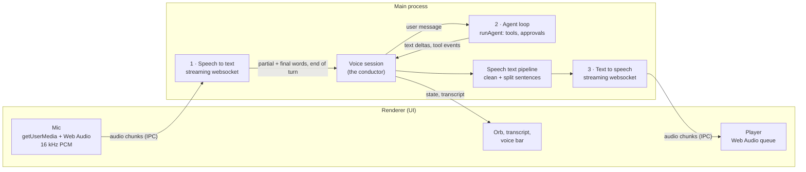
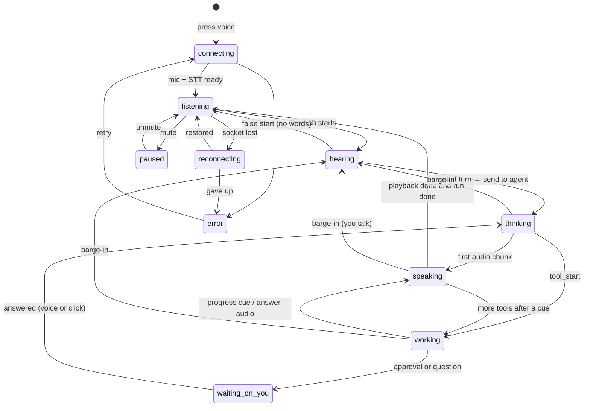

# Voice mode

A spoken conversation with Agent V: you talk, the agent works, and it answers
out loud while the full result lands in the task record. This page is the
design. It is a living document: every decision, change of plan and finished
step is recorded here as the work goes, and the **Status** and **Decision log**
sections are updated on every commit to the `feat/voice-mode` branch.

> **Status:** design reviewed in part (2026-10-11: Q2, Q4, Q6 and Q8 answered).
> No implementation code yet: it is **waiting on Ajay's newer local code
> reaching GitHub** (Q8), so the build doesn't start on stale files.
> PR: [#65](https://github.com/vyotiqai/vyotiq-agent-v/pull/65) (draft).
>
> **Branch:** `feat/voice-mode` (draft PR). Built against `main` at `0febc99`
> (2026-10-04). Ajay's local checkout is newer than GitHub; see [§16](#16-risks).

---

## Contents

1. [What voice mode is, and isn't](#1-what-voice-mode-is-and-isnt)
2. [How a voice turn works](#2-how-a-voice-turn-works)
3. [What already exists](#3-what-already-exists)
4. [Architecture](#4-architecture)
5. [The session state machine](#5-the-session-state-machine)
6. [Turn-taking and barge-in](#6-turn-taking-and-barge-in)
7. [Connecting to the agent loop](#7-connecting-to-the-agent-loop)
8. [What gets spoken: the speech text pipeline](#8-what-gets-spoken-the-speech-text-pipeline)
9. [Providers and models](#9-providers-and-models)
10. [Audio formats and transport](#10-audio-formats-and-transport)
11. [IPC contract](#11-ipc-contract)
12. [Settings and keys](#12-settings-and-keys)
13. [UI and UX](#13-ui-and-ux)
14. [Latency budget](#14-latency-budget)
15. [Network failures](#15-network-failures)
16. [Risks](#16-risks)
17. [Open questions](#17-open-questions)
18. [Privacy, security and cost](#18-privacy-security-and-cost)
19. [Testing](#19-testing)
20. [Build plan](#20-build-plan)
21. [Decision log](#21-decision-log)
22. [References](#22-references)

---

## 1. What voice mode is, and isn't

**Is:** a hands-free conversation with the agent on a task. One press opens a
session. After that you just talk. The agent listens, notices when you've
finished, works, and speaks a short answer. You can talk over it at any time,
and it stops. Everything said and done also appears in the record, so code,
diffs and long results are read on screen, not listened to.

**Is not:**

- A replacement for dictation. Dictation (the composer's mic and `Ctrl+M`)
  still turns speech into text in a field you then edit. Voice mode is a
  conversation; dictation is typing by voice. They share the mic stack.
- A speech-to-speech model in place of the agent. Models like OpenAI's realtime
  speech models can hear and talk directly, but they can't run Agent V's tools,
  approvals, record or provider choice. Voice mode keeps Agent V's own loop as
  the brain and wraps speech around it. See [§21](#21-decision-log), D-03.
- Local or offline, in this first version. Cloud first (Ajay, 2026-10-11).
  The provider layer leaves room for local engines later.

**Product stance to confirm.** The dictation redesign
(`src/redesign/voice/README.md`, decision 6) said: *"Not a conversational voice
mode. No spoken replies. That fits 'never chatbot-like', and it can be revisited
separately."* This feature is that revisit. The design keeps to the spirit of
that rule: the agent speaks briefly and points at the record. It doesn't chat.
That is question **Q1**.

### Goals

| Goal | Measured by |
| --- | --- |
| Feels live | Under 1 s from the end of your speech to the first audio of the reply, when the model is fast (see §14) |
| Interruptible | Agent audio stops within 150 ms of you starting to speak |
| Always clear whose turn it is | One orb with distinct listening, thinking, working and speaking states |
| Trustworthy | A live transcript of what it heard; the full answer always on screen |
| Survives bad networks | A dropped socket reconnects without losing the session or the run |
| Providers are swappable | Changing STT or TTS vendor touches one adapter file |

---

## 2. How a voice turn works

There are three stages and one conductor.



1. **Speech to text.** The renderer opens the mic and sends ~80–128 ms chunks of
   16 kHz mono PCM to main. Main streams them to the STT provider over a
   websocket. The provider streams back partial words (for the live
   transcript), final words, and an **end of turn** signal: its judgment that
   you've finished.
2. **The agent.** On end of turn, the conductor sends your words to the agent
   as an ordinary user message: a new run, or a follow-up on the running one.
   The agent loop runs as usual (tools, approvals, record) and streams text.
3. **Text to speech.** The conductor takes the agent's streamed text, cleans it
   into something worth hearing (no code, no paths, no markdown), splits it into
   sentences and streams them to the TTS provider. Audio comes back in chunks,
   goes to the renderer and plays as it arrives. The first sentence is playing
   while later ones are still being written.

**The conductor** (the voice session in main) owns turn-taking: when to
listen, when to answer, when to stop talking because you started, and what
state the orb shows.

---

## 3. What already exists

Most of the input half is already built for dictation. Voice mode reuses it
rather than writing a second mic stack.

| Piece | Where | Reuse |
| --- | --- | --- |
| Mic capture, 16 kHz mono Int16, device choice, typed failures (`blocked`, `no_device`, `busy`…) | `src/renderer/src/lib/audio/micCapture.ts` | As is |
| Pause detector (RMS, adaptive noise floor, 600 ms silence cut) and level meter math | `src/renderer/src/lib/audio/segmenter.ts` | Local barge-in detection and orb levels |
| OpenAI realtime transcription over websocket, in main, 16→24 kHz upsampler | `src/main/dictation/liveOpenAI.ts` | Becomes the OpenAI STT adapter |
| Typed error codes over IPC (`no_key`, `rejected_key`, `rate_limited`, `offline`…) | `DICTATION_ERROR_CODES`, `schemas/agent.ts` | Same pattern, `voice:<code>` |
| Encrypted key storage, keys never in the renderer | `src/main/settings/secrets.ts` | OpenAI/OpenRouter keys as is; new namespace for Deepgram and ElevenLabs |
| Mic permission (audio only, main window only), OS mic status, open OS settings | `src/main/app/security.ts`, `src/main/dictation/micAccess.ts` | As is |
| Level meter component, mic device picker, mic test | `take/TakeStrip.tsx` (`LevelMeter`), `VoiceSection.tsx` | As is |
| Follow-up queue, soft interrupt of the current model stream (`promoteFollowUp`), cancel | `src/main/agent/runRegistry.ts` | Barge-in while the agent works (§6) |

**What doesn't exist:** any text-to-speech, any audio playback (the only
`AudioContext` is the silent capture tap), any turn detection beyond the pause
cutter, and any Deepgram or ElevenLabs code or keys.

---

## 4. Architecture

### Where things run, and why

| Concern | Process | Why |
| --- | --- | --- |
| Mic capture | Renderer | `getUserMedia` only exists there |
| Audio playback | Renderer | Same; Web Audio for gapless queued playback and the orb's output level |
| STT and TTS sockets | Main | Keys stay in main. The renderer's CSP has no `wss:` in `connect-src`, so sockets there are blocked in production builds anyway |
| Turn-taking, agent bridge, speech text pipeline | Main | Lives next to the agent loop, so it reads events before they are batched or UI-gated (§7.3), and it survives the task pane being hidden |
| UI state | Renderer | Driven by `voice:event` pushes from main |

Playback can't use `<audio src="blob:…">`: the CSP has no `blob:` in
`media-src`, and `tests/main/unit/rendererNoObjectUrls.test.ts` bans
`URL.createObjectURL`. The player decodes raw PCM into `AudioBuffer`s and
schedules them, so neither rule needs to change.

### Files (planned)

```
src/shared/voice.ts                         types, constants, provider catalog
src/shared/ipc/schemas/voice.ts             zod schemas for every voice IPC payload
src/shared/ipc/channels.ts                  + voice:* channels

src/main/voice/
  index.ts                                  barrel
  session.ts                                VoiceSession: the conductor and its state machine
  agentBridge.ts                            starts runs and follow-ups, taps run events
  speechText.ts                             markdown → speakable text, sentence splitter
  spokenSummary.ts                          the <spoken> tag parser (§8.2)
  keys.ts                                   voice secret namespace (deepgram, elevenlabs)
  errors.ts                                 VoiceError + typed codes
  providers/
    types.ts                                SttProvider, TtsProvider interfaces (§9.1)
    registry.ts                             id → adapter, plus capability flags
    stt/deepgramFlux.ts
    stt/openaiRealtime.ts                   wraps dictation/liveOpenAI.ts
    stt/fixture.ts                          scripted, for tests and VYOTIQ_E2E_FIXTURE
    tts/elevenlabs.ts
    tts/openai.ts
    tts/fixture.ts
  socket.ts                                 shared websocket wrapper: open timeout,
                                            keepalive, reconnect with backoff, proxy

src/main/ipc/register.ts                    + voice handlers

src/renderer/src/features/voice/
  VoiceBar.tsx                              the docked bar on a task (§13)
  VoiceOrb.tsx                              the reactive orb
  VoiceTranscript.tsx                       live captions
  useVoiceSession.ts                        subscribes to voice:event, owns mic + player
  voicePlayer.ts                            Web Audio scheduler, ducking, output level
  voiceStore.ts                             useSyncExternalStore, like dictationStore.ts

src/renderer/src/features/settings/sections/VoiceSection.tsx
                                            + a "Voice mode" group
```

### Provider abstraction

All vendor code is behind two interfaces (§9.1). The session never imports a
vendor file; it asks the registry for the adapter that matches the settings.
Adding Cartesia, Deepgram TTS or a local engine later means one new adapter and
one catalog entry.

---

## 5. The session state machine

One session per window, one owner, the same rule as dictation's
`activeOwner`. States:

| State | Meaning | Orb | Mic |
| --- | --- | --- | --- |
| `off` | No session | Hidden | Closed |
| `connecting` | Opening mic and STT socket (and warming TTS) | Hollow, slow pulse | Opening |
| `listening` | Waiting for you; nothing heard yet | Idle breathing | Open |
| `hearing` | You're talking; partial words streaming | Follows your voice level | Open |
| `thinking` | Turn ended, waiting for the agent's first words | Inward shimmer | Open (barge-in) |
| `working` | Agent is running tools; it may speak short progress cues | Slow orbit + tool name | Open (barge-in) |
| `speaking` | Agent audio playing | Follows the agent's output level | Open (barge-in, ducked) |
| `waiting_on_you` | Agent asked a question or needs an approval | Accent ring | Open |
| `paused` | You muted the mic; the session stays open | Dimmed, mic-slash | Closed |
| `reconnecting` | A socket dropped; retrying | Hollow, warning tint | Buffering |
| `error` | Can't continue (bad key, mic blocked…); says why and how to fix it | Static, danger | Closed |



Every transition is an event (`voice:event { kind: 'state' }`), so the UI never
works out the state by itself. Transitions are pure functions in `session.ts`
and unit-tested without audio or sockets.

---

## 6. Turn-taking and barge-in

### 6.1 Ending your turn

Picking the moment you've finished is the hardest part of voice UX. If it's
too eager, the agent cuts you off mid-thought. If it's too slow, every reply
feels late.

- **Primary: the STT provider's own turn model.** Deepgram Flux was built for
  this: it emits `EndOfTurn` from a model of the conversation, not a silence
  timer. Defaults: `eot_threshold 0.7`, `eot_timeout_ms 5000`. We'll start
  with those and tune.
- **Fallback: the local pause detector** (`segmenter.ts`, 600 ms) for
  providers without turn detection, e.g. OpenAI realtime with server VAD off,
  as dictation runs it today. The OpenAI adapter can turn on server VAD
  instead. To decide in the spike.
- **Push-to-talk always wins.** Holding the voice key (§13.6) records until
  release, and release is the end of turn. No guessing. It's the fallback for
  noisy rooms.
- **Do not start the agent early.** Flux can send `EagerEndOfTurn` so a reply
  can be prepared speculatively and discarded on `TurnResumed`. For a chatbot
  that's free speed. For Agent V it's dangerous: a speculative run can edit
  files or run commands before you've finished talking. So we **don't** use
  eager end-of-turn to start runs. The only use, if any, is to warm the TTS
  socket. (D-05)

### 6.2 Barge-in: you talk while the agent talks

The effect is the same in every state where the agent has the floor:

1. **Duck** (≤ 50 ms): as soon as local voice activity is detected on the
   mic, the player's gain ramps to ~20%. This is local, so it doesn't wait for
   the network.
2. **Confirm** (≤ 150–300 ms): if the STT provider confirms speech (Flux
   start-of-turn, or ≥ 250 ms of voiced frames locally with real words in the
   partial), it's a barge-in. Otherwise it was a cough or a door, and the gain
   ramps back.
3. **Stop**: on a confirmed barge-in, the player flushes its queue (30 ms fade),
   the TTS context is closed (ElevenLabs `close_context`; OpenAI aborts the
   request), and the not-yet-spoken text is dropped from the speech queue.
4. **Mark**: the record shows where the agent was cut off. The agent's text
   stays in full in the record; only the speech stops.

### 6.3 What happens to the agent's *work* on barge-in

Stopping the voice is easy. What to do with a run that's mid-work is a product
decision (**Q4**). The recommendation:

| When you interrupt during… | Default | Mechanism |
| --- | --- | --- |
| `speaking` the final answer (run done) | Stop speech; your words are a new message | New user message on the same task |
| `thinking` / `working` (run live) | **Steer**: stop speech; your words become a follow-up that interrupts the current model stream and is applied at the next step | `chatFollowUp`, then `chatFollowUpPromote` (soft abort via `streamInterrupt`; tools in flight finish) |
| You say a stop phrase ("stop", "cancel", "never mind") | **Cancel** the run | `chatCancel` |
| `waiting_on_you` | Your words answer the question or approval (§7.5) | `respondToolApproval` / question response |

Steering, not cancelling, is the default because cancelling throws away work
in progress. Steering is what you'd do if you leaned over a colleague's
shoulder. The stop-phrase list is short, exact-match on the whole utterance,
and shown in Settings.

### 6.4 Echo: the agent hearing itself

With speakers rather than headphones, the mic picks up the agent's own voice,
and that can trigger a false barge-in. Defences, in order:

1. Chromium's echo cancellation (`echoCancellation: true`, already on in
   `micCapture.ts`). **Whether Chromium's canceller treats Web Audio playback
   as its echo reference on Windows and macOS isn't confirmed. Verify it in
   the first spike** (R-02).
2. While `speaking`, a higher voiced threshold and a longer confirm window
   for barge-in.
3. Ignore STT partials that match the text currently being spoken (a fuzzy
   match on the last ~2 s of TTS text).
4. Push-to-talk, and a "headphones recommended" hint the first time voice
   mode is used on speakers.

---

## 7. Connecting to the agent loop

### 7.1 Input: your words become a message

A finished turn becomes a `ChatMessage { role: 'user', content: text }` and goes
down the same path a typed message takes. No new loop entry point.

- **No run on the task:** the message starts one. The voice bridge calls the
  same launch path as `chat:start` (`launchRun`), with `source: 'voice'`.
- **A run is live:** follow-up and promote, as §6.3.
- The message carries `meta.voice = { sttProvider, durationMs, confidence? }`.
  The record shows a small mic glyph on the turn. Low-confidence words can be
  underlined so a mishearing is easy to spot.

The renderer's composer flow (`createChatStreamController.send`) has
offline-queue and onboarding gates. The bridge either goes through it (sending a
`voice:submit` from the renderer once main reports end of turn) or reproduces
the gates in main. **Recommended: go through the renderer controller** so voice
messages get identical behaviour (drafts, offline queue, onboarding,
`buildUserContent`). Main tells the renderer "turn ended, here's the text", and
the renderer sends it like a typed message. This costs one IPC hop (< 5 ms). (D-07)

### 7.2 Telling the model it's a voice conversation

The model has to know its reply will be heard. While a voice session is open,
the run gets a `voice_reply` prompt section in the **stable zone**, next to
`response_style` (`agent/context/userRules.ts`). The stable zone matters for
the prompt cache: the prefix must stay byte-identical across steps (see
`docs/architecture.md`, "The prompt"). The section is fixed for the life of the
session, so it costs one cache miss when voice starts or stops, not one per step.

Draft text:

> The person is talking to you by voice and will hear your reply read aloud.
> Begin your final reply with a `<spoken>` block: one to three short spoken
> sentences, no code, no file paths, no markdown, no lists, that say what you
> did or found and what (if anything) you need from them. Then write your
> normal reply, which they will read on screen. Keep progress narration
> between tool calls to a short phrase.

### 7.3 Output: tapping the run's events

`startAgentRun.ts` iterates `runAgent`'s events and pushes them into the IPC
batcher (`for await (ev) … batcher.push(ev)`). The bridge adds a tap there: a
per-run listener the voice session registers for runs it owns. That gives it:

- `text_delta` with no 16 ms/80 ms batching delay, and
- events the IPC layer would drop: `UI_GATED_STREAM_TYPES` filters text deltas
  for runs the UI isn't subscribed to, so if you switch tasks mid-answer,
  speech would cut out. The tap doesn't have that problem.

The tap is read-only and must never slow the loop: it pushes into the session's
own queue and returns. A throwing listener is caught and logged; it must never
break a run.

Events used:

| Event | Voice use |
| --- | --- |
| `text_delta` | Feed the `<spoken>` parser / speech pipeline |
| `stream_reset` | The provider retried. Text already *spoken* can't be unsaid. Drop what's queued, and suppress the repeated prefix of the retried stream |
| `tool_start` | State `working`; optional progress cue (§8.4) |
| `assistant_message` (with `toolCalls`) | End of a narration step |
| `assistant_message` (no `toolCalls`) then `status: done` | Final answer complete → flush speech |
| `status: cancelled / error`, `error` | Speak a one-line failure ("That run failed, the error's on screen.") |
| `network_wait` | State reflects the agent waiting on the network (§15) |
| tool approval / `ask_question` requests | State `waiting_on_you` (§7.5) |

### 7.4 Final answer vs narration

There's no explicit "final" flag on the wire. An `assistant_message` without
tool calls, followed by `status: done`, is the final prose
(`recordModel.ts` → `RecordRun.result`). Narration between tool steps arrives as
`assistant_message` with `toolCalls`. The bridge buffers text per step and
decides when the step ends:

- step ended with tools → it was narration → maybe speak a progress cue (§8.4)
- step ended without tools → it's the answer → speak the `<spoken>` block, or
  the fallback summary

To start speaking before the step ends (sub-second goal), the parser speaks the
`<spoken>` block **as it streams**. If the model opens the reply with `<spoken>`,
we know it's the answer, even before the step ends.

### 7.5 Tools, approvals and questions by voice

- **Tools run as usual.** Voice doesn't change what the agent may do. Approval
  rules, the sandbox and mode (Ask / Agent) apply unchanged.
- **Approvals.** On an approval request the agent says a short version of
  `approvalTitle()` ("It wants to run `pnpm test`. Allow?") and the card shows
  on screen. Spoken "yes / allow / go ahead" means `once`; "no / deny" means
  `deny`. **Recommended:** voice can never answer an approval marked `danger`,
  or give `session`/`always`. Those need a click. (Q5)
- **Questions** (`ask_question`): the question is spoken; your next turn is
  the answer. Multiple choice accepts an option's label or its number.

### 7.6 Mode

Voice works in both Ask and Agent mode and doesn't switch modes. Spoken "switch
to ask mode" is out of scope for v1.

---

## 8. What gets spoken: the speech text pipeline

### 8.1 Why not read the answer verbatim

Agent V's answers are written to be read: code blocks, paths, diffs, tables,
lists. Read aloud, `src/main/agent/loop.ts:4008` is noise and a fenced block is
unbearable. Voice speaks a **short spoken version** and points at the screen
for the rest.

### 8.2 The `<spoken>` tag

The only new text tag. The model starts its final answer with:

```
<spoken>I fixed the race in the follow-up queue and the tests pass now. There's
one thing to check: the retry limit is a guess.</spoken>

…the full written answer, as normal…
```

- The bridge streams what's inside the tag to TTS **as it arrives**, sentence
  by sentence.
- The renderer **removes** the block from the displayed answer
  (`lib/markdown` sanitising plus a one-line strip in `recordModel.ts`). It
  isn't shown twice, and an old record without voice is unaffected.
- **Fallback** if the model skips the tag: clean the first paragraph of the
  answer (§8.3) and speak at most ~3 sentences / 400 characters, followed by
  "The details are on screen." A provider that ignores the instruction still
  gets a sensible result.
- Tag text never reaches the record redaction path differently. It is part of
  the message content like any other text.

**Provider expressiveness tags** (ElevenLabs v3 audio tags like `[laughs]`, SSML
`<break>`, Deepgram pause markers) are **not used in v1**. They're
vendor-specific, would leak into the written answer, and Flash models ignore
most of them. The speech pipeline strips anything bracketed that looks like one.
The `TtsProvider` interface has a `supportsMarkup` flag so they can be added
per vendor later. (D-08)

### 8.3 Cleaning text for speech (`speechText.ts`)

Pure functions, unit tested against fixtures:

| Input | Spoken as |
| --- | --- |
| Fenced code block | Dropped. If it was the whole answer: "I've put the code on screen." |
| Inline code `` `runAgent` `` | The identifier, de-camel-cased only if short: "run agent" |
| Paths `src/main/agent/loop.ts` | Basename without extension: "loop" ("in loop dot ts" if ambiguous) |
| Markdown (`**`, `#`, `>`, `-`, tables) | Stripped; list items joined as a sentence |
| Links `[text](url)` | `text` |
| URLs | "a link on screen" |
| Numbers, versions, `v1.2.0` | Left to the TTS normaliser; `1.2.0` becomes "1.2.0" with dots kept |
| Emoji, symbols | Dropped |

### 8.4 Progress cues while the agent works

A long silence while the agent works feels broken. Options, ordered by
cost, with the recommendation in bold:

1. **An earcon only** (a soft tick when a tool starts). No speech.
2. **Short template cues from tool events**: "Reading files…", "Running tests…",
   "Editing loop dot ts…". Drawn from `tool_start.summary`, rate-limited to one
   per ~6 s, never over a tool that finishes in < 1.5 s.
3. Speaking the model's own narration text between tools. Natural, but chatty
   and uncontrolled.

**Recommended: 2, with 1 when cues are turned off** (setting `speakProgress`).
It's what "short spoken summary while details render on screen" means in
practice.

### 8.5 Splitting into sentences

The TTS gets text in sentence-sized pieces so the first audio comes quickly
without choppy prosody:

- Split on `. ! ?` followed by space or newline, not after common
  abbreviations (`e.g.`, `i.e.`, `vs.`, version numbers, decimals).
- The **first** chunk may be cut early at a comma once it's ≥ 40 characters,
  to get audio started.
- ElevenLabs: send text continuously with `flush` at sentence ends (their
  recommended pattern). OpenAI TTS (HTTP): one request per sentence, the next
  request started while the previous one plays.

---

## 9. Providers and models

### 9.1 Interfaces

```ts
// src/main/voice/providers/types.ts (planned)

export type SttEvent =
  | { kind: 'open' }
  | { kind: 'speech_start' }                       // provider detected speech
  | { kind: 'partial'; text: string }              // unstable words, for captions
  | { kind: 'final'; text: string; confidence?: number }
  | { kind: 'end_of_turn'; text: string }          // the turn is complete
  | { kind: 'error'; code: VoiceErrorCode; message: string; retryable: boolean }
  | { kind: 'closed'; reason: string }

export interface SttSession {
  /** 16 kHz mono Int16 LE; the adapter resamples if its provider wants otherwise. */
  pushAudio(pcm16k: Int16Array): void
  /** Push-to-talk release: force end of turn now. */
  endTurn(): void
  /** Vocabulary hints (workspace identifiers), replaces the previous list. */
  setKeyterms?(terms: readonly string[]): void
  close(): Promise<void>
}

export interface SttProvider {
  id: SttProviderId
  label: string
  caps: { turnDetection: boolean; keyterms: boolean; languages: 'en' | 'multi' }
  open(opts: {
    apiKey: string
    language?: string
    keyterms?: readonly string[]
    signal: AbortSignal
    emit: (e: SttEvent) => void
  }): Promise<SttSession>
}

export type TtsChunk = { pcm: Int16Array; sampleRate: number; contextId: string }

export interface TtsStream {
  /** Append text; the adapter decides when to synthesise. */
  pushText(text: string): void
  /** Sentence boundary or end of reply: synthesise what's buffered. */
  flush(): void
  /** Barge-in: stop generating and drop anything not yet delivered. */
  cancel(): void
  /** Resolves when all audio for pushed text has been delivered. */
  done(): Promise<void>
}

export interface TtsProvider {
  id: TtsProviderId
  label: string
  caps: { streamingInput: boolean; speed: [min: number, max: number]; supportsMarkup: boolean }
  listVoices(apiKey: string): Promise<VoiceOption[]>
  /** One per reply. Keep-alive and connection reuse are the adapter's job. */
  stream(opts: {
    apiKey: string
    voiceId: string
    speed: number
    signal: AbortSignal
    onAudio: (c: TtsChunk) => void
  }): TtsStream
}
```

Rules every adapter follows:

- Errors are mapped to `VoiceErrorCode` in the adapter (401/403 → `rejected_key`,
  429 → `rate_limited`, socket failure → `offline`…), never as raw provider text
  in the UI. This fixes dictation finding #6 for voice from the start.
- Audio out of the adapter is always Int16 PCM with its sample rate stated. The
  player handles 16/22.05/24/44.1 kHz.
- There's a `fixture` adapter for each side, used by tests and by
  `VYOTIQ_E2E_FIXTURE=1`.

### 9.2 Speech to text

| | **Deepgram Flux** (default) | OpenAI realtime transcription (alternative) |
| --- | --- | --- |
| Model | `flux-general-en`; `flux-general-multi` for other languages | `gpt-live-transcribe` (as dictation uses today) |
| Endpoint | `wss://api.deepgram.com/v2/listen` (Flux needs `/v2`) | `wss://api.openai.com/v1/realtime?intent=transcription` |
| Audio in | `linear16`, 16 kHz, ~80 ms chunks (2,560 bytes) | PCM 24 kHz (upsampled from 16 kHz in main, existing code) |
| Turn detection | Built in: `EndOfTurn`, optional `EagerEndOfTurn` / `TurnResumed`; `eot_threshold` 0.5–1.0 (default 0.7), `eot_timeout_ms` 500–60000 (default 5000) | Server VAD (silence-based) or our local pause detector |
| Vocabulary | `keyterms` (≤ 100, replaceable mid-stream with `Configure`) | `prompt` / `keywords` (existing) |
| Key | New: Deepgram key | Reuses the OpenAI key you already have |
| Why | Made for voice agents. Turn detection is a model, not a timer; that's the biggest UX difference | No new account; code already exists and is tested |

Workspace identifiers go in as key terms (≤ 100 for Deepgram), the same idea
as dictation's `dictationKeywordsFromFiles`, so "run agent" can come out as
`runAgent`.

### 9.3 Text to speech

| | **ElevenLabs** (default) | OpenAI TTS (alternative) |
| --- | --- | --- |
| Model | `eleven_flash_v2_5` (low latency; ~75 ms inference; ~100–150 ms to first byte over websocket in NA/EU) | `gpt-4o-mini-tts` |
| Transport | Websocket `wss://api.elevenlabs.io/v1/text-to-speech/{voice}/multi-stream-input?model_id=…` | HTTP `POST /v1/audio/speech`, streamed response |
| Text in | Streamed; `flush` per sentence; one context per reply; barge-in = `close_context` | One request per sentence |
| Audio out | `pcm_24000` (or `pcm_16000`) | `pcm` (24 kHz, 16-bit) |
| Speed | `voice_settings.speed` (range to confirm in the spike) | `speed` 0.25–4.0 |
| Voices | Large library + your own cloned voices (`listVoices`) | Fixed set (`alloy`, `nova`…); `instructions` steer delivery |
| Key | New: ElevenLabs key | Reuses the OpenAI key |
| Limits | ≤ 5 concurrent contexts per socket; 20 s inactivity timeout (raise to 180 s) | Per-request; ordinary rate limits |

### 9.4 Defaults and fallbacks

The defaults asked for are **Deepgram + ElevenLabs**: the best quality and
latency, but two new accounts and keys. The recommended behaviour (Q6):

- Settings default to Deepgram + ElevenLabs.
- **If those keys aren't set but an OpenAI key is**, voice mode still works on
  OpenAI for both sides, and the voice bar says which engine is in use. The
  first press doesn't fail. That fixes dictation finding #12 ("the default
  fails") for voice.
- If no usable key exists, pressing the voice button opens a **Set up voice**
  popover with three rows (Deepgram, ElevenLabs, OpenAI), each with *Add key*.
  It doesn't fail.

Also worth knowing (not in v1): OpenRouter now proxies TTS (OpenAI-compatible
`/api/v1/audio/speech`), so an OpenRouter key could power the OpenAI-style TTS
adapter. Deepgram also sells TTS (`/v2/speak`), which would mean one vendor and
one key for both directions. The provider layer makes either a small addition.

---

## 10. Audio formats and transport

| Leg | Format | Chunking | Transport |
| --- | --- | --- | --- |
| Mic → main | Int16 LE mono 16 kHz | 2,048 frames (128 ms), current `TAP_FRAMES`; consider 1,280 (80 ms) for Deepgram | IPC `voice:audio`, base64 like `dictation:liveAudio` today |
| Main → STT | Provider format (16 kHz linear16 for Deepgram; 24 kHz PCM for OpenAI) | Pass-through / upsampled | Websocket |
| TTS → main | Int16 PCM 24 kHz | Provider chunks | Websocket / HTTP stream |
| Main → renderer | Int16 LE + sample rate + context id + seq | Pass-through | IPC `voice:audio-out` push |
| Renderer playback | `AudioBuffer` (Float32) | Scheduled back-to-back on one `AudioContext` clock; 60 ms jitter buffer before the first chunk | Web Audio |

Notes:

- **Base64 over IPC** matches today's dictation and its 700k-char cap. Electron
  can pass `ArrayBuffer`/typed arrays through structured clone, which avoids the
  ~33% size overhead and an encode/decode on both sides. Worth switching for
  voice because it streams in both directions; the cost is a new schema shape.
  To decide when the IPC is built (D-09, open).
- **Capture uses a ScriptProcessorNode**, not an AudioWorklet, because worklet
  module loading fails under `file://` (comment in `micCapture.ts`). The player
  can avoid worklets too: chained `AudioBufferSourceNode`s are enough for
  gapless playback.
- The player has its own `AudioContext` at the TTS rate (24 kHz) so it never
  resamples. An `AnalyserNode` on its output drives the orb while speaking.
- **Ducking** is a `GainNode` ramp (`setTargetAtTime`, ~30 ms), never a jump,
  to avoid clicks.

---

## 11. IPC contract

All channels follow the five-place rule in `docs/architecture.md` (channel,
`vyotiqApi`, preload, handler with `senderOk` + zod, `ipcContract.test.ts`).

| Channel | Direction | Payload | Purpose |
| --- | --- | --- | --- |
| `voice:start` | invoke | `{ workspacePath, runId?, taskId? }` | Open a session on a task |
| `voice:stop` | invoke | `{ sessionId }` | Close it |
| `voice:audio` | send | `{ sessionId, seq, pcm16k }` | Mic chunks (fire-and-forget, like `liveAudio`) |
| `voice:ptt` | invoke | `{ sessionId, down: boolean }` | Push-to-talk press/release |
| `voice:mute` | invoke | `{ sessionId, muted }` | Pause / resume listening |
| `voice:barge` | send | `{ sessionId, level }` | Local VAD fired (renderer ducks right away; main confirms) |
| `voice:interrupt` | invoke | `{ sessionId }` | Stop speaking now (button / Esc) |
| `voice:submitted` | invoke | `{ sessionId, turnId, runId }` | The renderer sent the turn as a message (§7.1) |
| `voice:event` | push | union, below | State, captions, errors, turn ended |
| `voice:audio-out` | push | `{ sessionId, contextId, seq, sampleRate, pcm, final? }` | TTS audio to play |
| `voice:voices` | invoke | `{ provider }` | List voices for the picker |
| `voice:preview` | invoke | `{ provider, voiceId, speed }` | Speak a sample line in Settings |
| `voice:status` | invoke | — | Which providers have keys; which will be used |
| `voice:setKey` / `voice:clearKey` | invoke | `{ provider, key }` | Deepgram / ElevenLabs keys (OpenAI/OpenRouter keep using `setSecret`) |

`voice:event` kinds: `state`, `partial` (caption), `final`, `turn_ended { text }`,
`speaking { contextId, text }` (what's being said, for captions),
`spoken_done`, `cue { text }`, `error { code, message, retryable }`,
`reconnecting { attempt }`, `engine { stt, tts }`.

Ownership: a session belongs to the `webContents` that opened it and closes when
that sender is destroyed (the `liveOwners` pattern from dictation). On quit,
`before-quit` closes all sessions next to `closeAllLiveTakes`.

---

## 12. Settings and keys

New `Settings.voice` (zod schema with defaults, migrated by ignoring unknown
keys, like `dictation`):

| Key | Type | Default | Notes |
| --- | --- | --- | --- |
| `sttProvider` | `'deepgram' \| 'openai'` | `'deepgram'` | Auto-fallback per §9.4 |
| `ttsProvider` | `'elevenlabs' \| 'openai'` | `'elevenlabs'` | |
| `voiceId` | `Record<TtsProviderId, string>` | provider's default | Per provider, so switching back keeps your pick |
| `speed` | number | `1.0` | Clamped to the provider's range |
| `language` | ISO-639-1 or `''` | `''` (English) | `''`/`en` → `flux-general-en`; others → `flux-general-multi` + hint |
| `deviceId` | string | shared with dictation | One mic choice for the app |
| `interruptMode` | `'steer' \| 'cancel' \| 'off'` | `'steer'` | §6.3 |
| `speakProgress` | boolean | `true` | Spoken cues (§8.4); off = earcon only |
| `pushToTalkOnly` | boolean | `false` | No automatic turns; hold to talk |
| `endOfTurnPatience` | `'quick' \| 'normal' \| 'patient'` | `'normal'` | Maps to `eot_threshold`/timeout (0.6/3 s, 0.7/5 s, 0.85/8 s), tuned in testing |
| `approveByVoice` | boolean | `true` | Only `once`/`deny` on non-danger approvals (§7.5) |
| `captions` | boolean | `true` | Live transcript under the orb |

**Keys.** Deepgram and ElevenLabs aren't LLM providers, and `SecretProvider`
only accepts `ProviderId | custom:*`. They get their own namespace in
`secrets.ts`, the same pattern as `setVideoEngineKey`/`getVideoEngineKey`
(encrypted with `safeStorage`, never sent to the renderer; the renderer only
sees "set / not set"). OpenAI keeps using `getSecret('openai')`.

Settings UI: a **Voice mode** group in Settings → Voice, below Dictation (§13.7).

---

## 13. UI and UX

All UI follows the root `CLAUDE.md`: tokens only (no literal colours, five
skins × light/dark), `lib/ui` primitives, icons from `lib/icons` only, 40px pane
rows, `focus-visible:vy-focus-ring` on everything interactive, type sizes on the
scale, and no `cn()` overrides. Every surface is checked against the
`wcag-desktop` skill before it ships.

### 13.1 Where voice mode lives

**Recommended (Q2):** a **voice bar docked at the bottom of the task pane, in
place of the composer** while a session is open. The record stays visible above
it, so "details render on screen" is literally true: you hear the summary and
see the diff in the same view.

Alternatives considered:

- *Full-screen overlay with a big orb* (like phone assistants): beautiful, but
  hides the record. That's wrong for a coding agent where the output is the point.
- *A floating mini window*: lets you talk while looking at another app. It's a
  good v2 ("talk to Agent V while you're in your editor"), but it adds
  window-management work.

### 13.2 The voice bar

```
┌───────────────────────────────────────────────────────────────────────────┐
│ record …                                                                  │
├───────────────────────────────────────────────────────────────────────────┤
│  ◉  "…and make the retry limit configurable"            0:42   🔒/☁  ⋯  ✕  │  ← 40px row
│ orb  live caption (you: fg; agent: muted)                time  engine menu end│
├───────────────────────────────────────────────────────────────────────────┤
│  [🎤 Mute]   [■ Stop speaking]                         Hold Space to talk │  ← 32px controls
└───────────────────────────────────────────────────────────────────────────┘
```

- **Orb** (left edge, 28px): the one living element. Everything else is
  muted (emphasis comes from neighbours).
- **Caption** (fills the row): your words in `text-fg` while you talk, unsettled
  tail in `text-tertiary` (the same convention as the take strip); the agent's
  current sentence in `text-muted` while it speaks. One line, ellipsised from the
  left so the newest words are visible.
- **Time**: session length, `text-tertiary`, tabular numerals.
- **Engine token**: where audio goes, ☁ `Deepgram · ElevenLabs` (or `OpenAI`),
  the same idea as the take strip's `EngineToken`. Click → engine and voice menu.
- **⋯**: voice, speed, captions, interrupt mode, headphones tip.
- **✕ End**: ends the session (also `Esc` twice, or the voice shortcut).
- **Controls row**: Mute (`micSlash` when muted), Stop speaking (only while
  speaking), push-to-talk hint.

### 13.3 The orb

One canvas (or SVG) element, 28px in the bar and 96px in the empty-task hero.
It's drawn only with token colours, read from CSS variables at mount and on skin
change (the `TerminalPanel.tsx` exception for JS colour reads).

| State | Motion | Colour token |
| --- | --- | --- |
| listening | Slow breathing scale (4 s) | `--vy-muted` |
| hearing | Radius and edge follow **your** mic level (RMS from `segmenter.levelFromRms`), 60 fps, smoothed | `--vy-accent` |
| thinking | Inward shimmer, no level | `--vy-accent-soft` |
| working | Slow orbit dot + tool glyph beside the orb | `--vy-muted` |
| speaking | Edge follows **the agent's** output level (`AnalyserNode`) | `--vy-fg-strong` |
| waiting_on_you | Steady ring + "needs you" dot | `--vy-accent` |
| paused | Static, `micSlash` overlay | `--vy-tertiary` |
| reconnecting | Hollow, slow blink | `--vy-warning` |
| error | Static | `--vy-danger` |

Meaning is never carried by colour alone (CLAUDE.md "Never"): every state also
changes **shape or motion** and has a **text label** for screen readers
(`aria-live="polite"` region: "Listening", "Thinking", "Speaking"). Under
`prefers-reduced-motion: reduce` the orb doesn't animate; it switches between
static shapes and the label carries the state.

### 13.4 In the record

- Your spoken turns render like typed ones, with a small `mic` glyph and the
  duration. A low-confidence word is dotted-underlined; click to correct, which
  re-sends as an edit.
- The agent's answer renders exactly as today, minus the `<spoken>` block. A
  small `speaker` button on the answer replays the spoken summary.
- If you interrupted, a thin marker shows where speech stopped.

### 13.5 Starting voice mode

- A **voice button** (`waveform` icon) next to the mic on the instruction line
  and on the New task brief. The mic (dictation) and the voice button sit side
  by side: one types, one talks.
- **Shortcut:** `Ctrl+Shift+M` / `Cmd+Shift+M`, next to dictation's `Ctrl+M`.
  It's free in `lib/shortcuts/bindings.ts`, and mod chords forbid Shift by
  default, so it doesn't also fire dictation.
- **Command palette:** "Start voice mode".
- **First use:** the *Set up voice* popover (§9.4), then a one-time tip:
  "Talk naturally. Interrupt any time. Headphones work best."

### 13.6 Keys while a session is open

| Key | Action |
| --- | --- |
| `Space` (hold, when no field is focused) | Push to talk |
| `Esc` | Stop speaking. A second `Esc` within 2 s ends the session |
| `Ctrl/Cmd+Shift+M` | End the session |
| `M` | Mute / unmute |

Esc routing must respect existing handlers (`lib/shortcuts/escape.ts` already
routes Esc to an open take before stopping a run). Voice adds `[data-voice-open]`
with the same precedence.

### 13.7 Settings → Voice

Same `FormGroup`/`FormRow` grammar as the page today, with changed rows
marked:

- **Voice mode**
  - *Listens with*: Deepgram / OpenAI, with key status and *Add key* on the row
  - *Speaks with*: ElevenLabs / OpenAI, key status
  - *Voice*: a picker with ▶ preview per voice (`voice:preview`)
  - *Speed*: slider with the provider's range, ▶ preview
  - *Language*
  - *When you interrupt*: Steer the agent / Stop the agent / Just stop talking
  - *Progress updates*: Spoken / Sound only
  - *Turn ending*: Quick / Normal / Patient
  - *Push-to-talk only*
  - *Approve by voice*
- **Microphone** (shared with dictation): device + live level meter (existing)

### 13.8 UX details that make it feel right

- **Earcons:** a soft rising tone on session start, falling on end, a tick when
  your turn is accepted. Short (≤ 120 ms), quiet, synthesised in Web Audio (no
  asset files), and one setting turns them off.
- **No dead air:** if the agent hasn't produced audio 1.5 s after your turn, the
  orb is already in `thinking`. At ~4 s with tools running, a progress cue
  plays (if enabled).
- **Speech is never longer than ~20 s** without a pause for you. The
  `<spoken>` block is short by instruction, and the fallback caps it.
- **Window focus:** a session keeps running when the window loses focus (that's
  the point of hands-free), with an OS-level "Agent V is listening" indicator in
  the title bar. A session never starts without a press.
- **Volume:** the player follows system volume; Settings has no separate
  volume slider in v1.

---

## 14. Latency budget

Target: **under 1 s from the end of your speech to the first audio**. It's
honest only for fast models; the agent's model is the dominant term and the one
voice can't control.

| Step | Budget | Notes |
| --- | --- | --- |
| End-of-turn decision | 200–400 ms after you stop | Flux `EndOfTurn`; patience setting moves this |
| IPC + launch / follow-up | < 30 ms | `launchRun` is in-process |
| Model time to first token | **300 ms – 3 s+** | Depends on provider/model/prompt size. Prompt cache helps on follow-ups |
| `<spoken>` first sentence ready | +200–600 ms of tokens | First chunk may be cut at a comma (§8.5) |
| TTS time to first audio | ~100–150 ms | ElevenLabs Flash over a warm websocket |
| IPC + jitter buffer + play | ~70 ms | |
| **Total** | **~0.9 s – 4 s+** | |

What voice does about the model term:

- **Instant acknowledgement**: the earcon and `thinking` orb within 100 ms of
  end of turn, so the wait never feels like being ignored.
- **Warm sockets**: open the TTS socket when the session starts and keep it
  alive, so the first reply skips the TLS handshake (~100–300 ms).
- **Recommend a fast model for voice** (Q7): a setting *Model for voice
  replies*, defaulting to the task's model. Advice in the UI when the task model's
  measured first-token time is > 1.5 s.
- **Measure it.** Each turn logs `eot→submit`, `submit→first_token`,
  `first_token→first_audio`, `first_audio→played` through the existing
  diagnostics path, so tuning is based on data.

---

## 15. Network failures

All cloud, so the network will fail mid-sentence. Rules:

| Failure | Behaviour |
| --- | --- |
| STT socket drops | State `reconnecting`. Mic keeps capturing into a ring buffer (≤ 10 s). Reconnect with backoff (250 ms, 500 ms, 1 s, 2 s, 4 s; 5 tries). On success, replay the buffer. The caption shows "Reconnecting…" |
| TTS socket drops mid-reply | Reopen and resend the not-yet-delivered sentences; the record already has the full text. Two failures → stop speaking with "Lost the voice connection. The answer's on screen." |
| Fully offline | Use `networkMonitor` (the `1.1.1.1` probe) to tell "offline" from "provider down". Offline → session goes `paused` with a clear reason and resumes by itself when the network's back |
| Agent waiting on network (`network_wait`) | Orb `working`, caption "Waiting for the network…"; no extra speech |
| Key rejected / rate limited | `error` with the fix button (*Update key* / *Switch to OpenAI*), never raw provider text |
| Proxy | `main/net/proxy.ts` sets Node's global proxy for `fetch`/`http(s)`. **Whether Node's global `WebSocket` follows it isn't established** (R-04). The shared `socket.ts` checks and, if needed, connects through the proxy explicitly |

Socket keepalive: ElevenLabs closes idle contexts after 20 s by default. The
adapter raises `inactivity_timeout` and sends empty-text keepalives while the
session is open but quiet. Deepgram gets `KeepAlive` while muted.

---

## 16. Risks

| ID | Risk | Mitigation |
| --- | --- | --- |
| R-01 | **This branch is built on GitHub `main` (2026-10-04); Ajay's local code is newer.** Conflicts in `register.ts`, `channels.ts`, `vyotiqApi.ts`, `settings.ts`, `Composer.tsx` are likely | Push local work to GitHub before implementation starts, or rebase this branch onto it when it lands. Keep new code in new files; keep edits to shared files small and additive |
| R-02 | Echo: speaker playback triggers false barge-in | §6.4; verify Chromium AEC with Web Audio playback in the first spike on Windows + macOS |
| R-03 | Model first-token latency makes "sub-second" untrue for big models | §14: acknowledge instantly, measure, recommend a fast voice model |
| R-04 | Node's global `WebSocket` may ignore the proxy | Test behind a proxy; explicit proxy agent in `socket.ts` if needed |
| R-05 | Model ignores the `<spoken>` instruction | §8.2 fallback summary |
| R-06 | A voice turn edits files from a misheard instruction | Captions show what was heard; approvals apply unchanged; never start runs on eager end-of-turn (D-05); low-confidence words highlighted |
| R-07 | Two new vendors, two new keys | OpenAI fallback (§9.4); setup popover |
| R-08 | macOS builds are unsigned, so entitlements (incl. `audio-input`) aren't applied (comment in `build/entitlements.mac.plist`) | Same situation as dictation today; mic works via `NSMicrophoneUsageDescription`. Note for release |
| R-09 | Cost runs while the session sits open | STT bills per second of streamed audio: pause STT streaming after ~60 s of silence (local VAD still listens), resume on speech |

---

## 17. Open questions

Answers go in the decision log (§21) and this list is kept current.

| # | Question | Recommendation / answer |
| --- | --- | --- |
| Q1 | Spoken replies change the product's "never chatbot-like" stance (dictation decision 6). OK to revisit? | Yes, with brief speech + "details on screen" |
| Q2 | Where does voice mode live? | **Answered:** no preference → going with the docked bar (D-11) |
| Q3 | What is spoken? | `<spoken>` summary of the final answer + short tool cues (§8) |
| Q4 | Talking while the agent works: steer, cancel, or just stop the voice? | **Answered:** steer by default; "stop" cancels (D-12) |
| Q5 | Approvals by voice? | Yes for `once`/`deny` on non-danger only (§7.5) |
| Q6 | Ship with Deepgram + ElevenLabs required, or fall back to OpenAI automatically? | **Answered:** auto-fallback to OpenAI (D-13) |
| Q7 | A separate (faster) model for voice turns? | Setting, default = task model |
| Q8 | Can you push your local code to GitHub before implementation starts? | **Answered:** yes, Ajay pushes first; implementation waits for it (D-14) |
| Q9 | One big PR, or this design PR followed by stacked PRs per phase? | One branch, one draft PR, with commits per phase and this doc updated on each |

---

## 18. Privacy, security and cost

- **Audio leaves the machine** in voice mode, to the STT provider, and the
  agent's text goes to the TTS provider. The engine token says so on every
  session. `PRIVACY.md` gets a new section next to §7 (Voice dictation) naming
  Deepgram, ElevenLabs and OpenAI and their endpoints. The README's "No audio
  leaves the app" line is already untrue for cloud dictation and should be
  corrected in the same change.
- **Nothing is recorded to disk.** Audio isn't kept after it's sent. Only the
  text turns enter the task record (redacted as usual).
- **Keys** stay in main, encrypted (§12). Renderer sees status only.
- **Mic permission** is unchanged: audio only, main window only
  (`security.ts`). No new permission.
- **The agent's text is sent to the TTS vendor.** It could contain secrets the
  agent read from files. The `<spoken>` block is short and filtered (§8.3), but
  the fallback path sends answer text. **Run TTS input through the record
  redaction (`recordRedaction.ts`) before sending.** (D-10)
- **Cost** (rough, check current pricing): STT is billed per minute of audio
  streamed; TTS per character spoken. Short spoken summaries keep TTS cheap.
  Silence-pausing (R-09) keeps STT cheap. Usage goes through `aux_usage` so it
  shows in the usage view.

---

## 19. Testing

| Layer | What | Where |
| --- | --- | --- |
| Pure | State machine transitions, speech text cleaning, sentence splitter, `<spoken>` parser (streamed char by char), stop-phrase matcher, echo-match filter | `tests/main/unit/voice*.test.ts` |
| Adapters | Each adapter against a fake websocket/HTTP server: handshake, events, error mapping, keepalive, reconnect, cancel | `tests/main/unit/voiceProviders*.test.ts` (pattern: `dictationLiveOpenAI.test.ts`'s `setOpenLiveSocketForTests`) |
| Bridge | Fixture STT + fixture TTS + a scripted run: turn → message → speech; barge-in → follow-up promote; stop phrase → cancel; approval by voice | `tests/main/integration/voiceSession.test.ts` |
| IPC | Every channel in `VYOTIQ_INVOKE_MAP`; schema round-trips | `ipcContract.test.ts`, `tests/shared/ipcSchemas.test.ts` |
| Renderer | Orb states and labels, voice bar, player scheduling (fake `AudioContext`), Esc precedence, reduced motion | `tests/renderer/voice/*.test.tsx` |
| End to end | Electron with Chromium's fake mic (`--use-fake-device-for-media-stream` + a WAV), fixture providers under `VYOTIQ_E2E_FIXTURE=1` | `tests/gui-e2e/voice.spec.ts` |
| Manual | Real keys: latency per leg, echo on speakers (Win/macOS), proxy, airplane-mode mid-turn | Checklist in this doc, filled in per phase |

Gates for every commit: `pnpm typecheck`, `eslint .`, the vitest suite.

---

## 20. Build plan

One branch, one draft PR, commits per phase. Each phase leaves the app working
with the feature off.

| Phase | Scope | Done when |
| --- | --- | --- |
| 0 | This design doc | Questions answered, decisions logged |
| 1 · Spike | Throwaway script: mic → Flux → `EndOfTurn`; text → ElevenLabs → Web Audio; measure latency and echo on Windows/macOS | Numbers recorded in §14; R-02, R-04 resolved |
| 2 · Foundations | `shared/voice.ts`, schemas, channels, settings, key namespace, provider interfaces, fixture adapters, `speechText.ts`, `<spoken>` parser, player | Unit tests green; nothing visible yet |
| 3 · Speaking | TTS adapters (ElevenLabs, OpenAI); the `speaker` replay button on answers (a small, shippable slice that exercises TTS + player end to end) | You can hear a past answer read out |
| 4 · Listening | STT adapters (Deepgram Flux, OpenAI realtime), the session state machine, turn → message via the renderer controller | A spoken question starts a run |
| 5 · Conversation | Event tap, `voice_reply` prompt section, spoken summary, progress cues, barge-in (duck/confirm/stop), steer/cancel, approvals and questions by voice | Full loop with interruption |
| 6 · UI polish | Voice bar, orb, captions, settings group, set-up popover, earcons, shortcuts, reduced motion, a11y review | Passes `wcag-desktop` review in all 5 skins × 2 themes |
| 7 · Hardening | Reconnect/backoff, offline, proxy, silence pause, latency logging, PRIVACY.md and README, e2e spec | All tests green; manual checklist done |

### Progress

- [x] Phase 0: design doc drafted (2026-10-11)
- [x] Phase 0: blocking questions answered (Q2, Q4, Q6, Q8) — 2026-10-11
- [ ] Phase 0: remaining questions (Q1, Q3, Q5, Q7, Q9): taking the recommendations unless Ajay says otherwise
- [ ] Ajay's local code pushed to GitHub; branch updated onto it
- [ ] Phase 1 · Spike
- [ ] Phase 2 · Foundations
- [ ] Phase 3 · Speaking
- [ ] Phase 4 · Listening
- [ ] Phase 5 · Conversation
- [ ] Phase 6 · UI polish
- [ ] Phase 7 · Hardening

---

## 21. Decision log

Newest last. "Proposed" means waiting on Ajay.

| ID | Date | Decision | Status |
| --- | --- | --- | --- |
| D-01 | 2026-10-11 | Cloud speech providers first; local engines later through the same interfaces | Decided (Ajay) |
| D-02 | 2026-10-11 | Defaults: Deepgram (STT) and ElevenLabs (TTS); OpenAI as the alternative for both | Decided (Ajay) |
| D-03 | 2026-10-11 | Agent V's own loop stays the brain; no speech-to-speech model in its place (it can't run Agent V's tools, approvals or record) | Proposed |
| D-04 | 2026-10-11 | Provider sockets, keys, turn-taking and the agent bridge live in main; mic and playback in the renderer. Required anyway by the renderer CSP (no `wss:`, no `blob:` media) | Proposed |
| D-05 | 2026-10-11 | Never start an agent run on an *eager* end-of-turn; it could act on half a sentence | Proposed |
| D-06 | 2026-10-11 | Reuse dictation's mic capture, segmenter, level meter, OpenAI realtime client and key storage | Proposed |
| D-07 | 2026-10-11 | A finished turn is sent through the renderer's chat controller like a typed message, not a new main-side entry | Proposed |
| D-08 | 2026-10-11 | One new text tag, `<spoken>`; no vendor expressiveness tags (SSML, `[laughs]`) in v1 | Proposed |
| D-09 | 2026-10-11 | IPC audio encoding: base64 (as dictation) vs transferable `ArrayBuffer` | Open |
| D-10 | 2026-10-11 | Text is redacted before it goes to the TTS vendor | Proposed |
| D-11 | 2026-10-11 | Voice mode lives in a bar docked on the task pane, in place of the composer (§13.1). Ajay had no preference; this was the recommendation | Decided |
| D-12 | 2026-10-11 | Talking while the agent works steers the run (follow-up + promote); a stop phrase cancels it (§6.3) | Decided (Ajay) |
| D-13 | 2026-10-11 | Without Deepgram/ElevenLabs keys, voice falls back to OpenAI automatically and says so (§9.4) | Decided (Ajay) |
| D-14 | 2026-10-11 | Implementation code waits until Ajay's newer local code is on GitHub; this branch is then updated onto it (R-01) | Decided (Ajay) |

---

## 22. References

Code (this repo): `src/main/dictation/liveOpenAI.ts`, `src/main/dictation/transcribe.ts`,
`src/renderer/src/lib/audio/micCapture.ts`, `src/renderer/src/lib/audio/segmenter.ts`,
`src/renderer/src/features/chat/components/composer/take/`, `src/main/agent/runRegistry.ts`,
`src/main/agent/startAgentRun.ts`, `src/main/ipc/streamBatch.ts`, `src/main/app/security.ts`,
`src/main/settings/secrets.ts`, `src/redesign/voice/README.md`, `docs/architecture.md`, `PRIVACY.md`.

Vendors (checked 2026-10-11; recheck model ids and limits in Phase 1):

- Deepgram Flux quickstart: <https://developers.deepgram.com/docs/flux/quickstart>
- Deepgram Flux configure: <https://developers.deepgram.com/docs/flux/configure>
- Deepgram changelog: <https://developers.deepgram.com/changelog/speech-to-text-changelog>
- ElevenLabs multi-context websocket: <https://elevenlabs.io/docs/eleven-api/guides/how-to/websockets/multi-context-web-socket.md>
- ElevenLabs latency guide: <https://elevenlabs.io/docs/api-reference/reducing-latency>
- OpenRouter TTS (OpenAI-compatible speech endpoint, model list): <https://openrouter.ai/docs/features/multimodal/tts>
